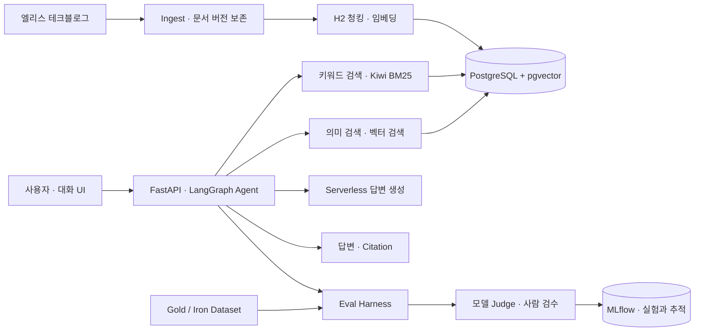

# elice-techblog-RAG

엘리스 테크블로그를 근거로 답변과 출처를 제공하는 **RAG 질의응답 서비스**와, 답변 품질을 측정하는 **Eval Harness**입니다. 엘리스 AI Engineer (Platform) 미니 프로젝트로 개발했습니다.

## 1. 실행 방법과 환경 변수

### 설치 및 초기 설정

Docker와 Docker Compose, Python 3.12, [uv](https://docs.astral.sh/uv/)가 필요합니다. 아래 명령은 저장소 루트에서 실행합니다. 색인과 평가를 실행하면 엘리스 Serverless API 사용량이 발생합니다.

```bash
# .env.dev가 없을 때만 실행합니다. DB 비밀번호와 관리자 코드 등을 생성합니다.
./tools/operations/rag init-env
```

`.env.dev`에 엘리스 Serverless의 `ELICE_API_KEY`와 MLflow 접속 정보를 설정합니다. 모델 이름과 엔드포인트는 [models.json](models.json)에 두며, 실제 API 키와 비밀번호는 Git에 올리지 않습니다. 엔드포인트와 사용할 모델은 실행 환경에 맞게 확인해 주세요.

```bash
# 기존 MLflow가 없다면 .env.dev의 MLFLOW_CRYPTO_KEK_PASSPHRASE를 설정하고 실행합니다.
./tools/operations/rag mlflow-start --configure

# 대화식으로 MLflow 실험 이름과 답변·임베딩·Judge 모델을 선택합니다.
./tools/operations/rag setup
./tools/operations/rag serve init-db
```

기존 MLflow를 사용한다면 `mlflow-start`는 생략합니다. `setup`은 선택한 Judge, 프롬프트, Gold·Iron Dataset을 MLflow에 등록합니다. `init-db`는 개발용 PostgreSQL을 시작하고 Knowledge DB를 초기화합니다.

| 설정 | 용도 |
| --- | --- |
| `ELICE_API_KEY` | 엘리스 Serverless 모델 호출·Judge 등록에 사용하는 키 |
| `MLFLOW_TRACKING_URI` | 서비스 컨테이너에서 접근할 MLflow 주소 |
| `RAG_HOST_MLFLOW_TRACKING_URI` | 호스트에서 MLflow 주소가 다를 때 사용하는 주소 |
| `MLFLOW_CRYPTO_KEK_PASSPHRASE` | 새 로컬 MLflow의 Gateway 암호화 키 |
| `MLFLOW_EXPERIMENT_NAME`, `QA_MLFLOW_EXPERIMENT_NAME` | 실험 이름; `setup`에서 설정 |
| `ANSWER_MODEL_PROFILE`, `EMBEDDING_MODEL_PROFILE` | `models.json`에서 선택한 답변·임베딩 프로필 |
| `DATABASE_URL`, `RAG_HOST_DATABASE_URL` | 컨테이너와 호스트 각각에서 사용할 PostgreSQL 주소 |
| `ADMIN_ACCESS_CODE`, `AUTH_SESSION_SECRET`, `EVALUATION_API_TOKEN` | 관리자 로그인, 세션, 평가 API 인증; `init-env`에서 생성 |
| `QA_CORPUS_SNAPSHOT_ID`, `QA_CHUNK_POLICY_KEY` | 선택한 임베딩에 여러 인덱스가 일치할 때 사용할 Corpus·청킹 정책 |

전체 예시는 [.env.dev.example](.env.dev.example)을 참고하세요. dev는 `compose.dev.yaml`을 사용하고, prod 설정은 `.env`와 `compose.yaml`을 사용합니다. 엘리스클라우드 배포 및 외부 접속은 아직 검증하지 않았습니다.

배포 환경에서는 아래 명령으로 `.env`를 생성합니다. 배포용 `KNOWLEDGE_IMAGE`, 외부 PostgreSQL의 `DATABASE_URL`, MLflow 주소와 모델 연결을 실제 환경에 맞게 설정한 후 초기화합니다. PostgreSQL은 pgvector를 사용할 수 있어야 합니다.

```bash
./tools/operations/rag init-env --kind prod
./tools/operations/rag --env-file .env setup
./tools/operations/rag --env-file .env serve init-db
./tools/operations/rag --env-file .env serve start
```

운영 초기화는 `.env`의 `ADMIN_ACCESS_CODE`와 `AUTH_SESSION_SECRET`을 사용합니다. `init-db`는 관리자 코드의 해시를 DB에 등록하며 재실행해도 같은 관리자를 중복 생성하지 않습니다. 두 값이 없으면 초기화를 중단합니다. 코드를 변경해도 기존 관리자는 자동 폐기되지 않습니다. 운영 이미지와 외부 의존성은 별도로 준비해야 합니다.

### Ingest와 색인

```bash
./tools/operations/rag corpus ingest
./tools/operations/rag corpus chunk
# chunk 출력의 policy_key를 사용합니다.
./tools/operations/rag corpus index --policy-key '<policy-key>'
```

Ingest는 한국어 테크블로그를 수집해 원문과 문서 버전, 고정 Corpus 스냅샷을 저장합니다. 청킹과 임베딩·색인은 별도 명령입니다. 새 임베딩 모델이나 청킹 정책을 사용하면 해당 조건으로 인덱스를 다시 만듭니다.

### 서버 실행과 QA

```bash
./tools/operations/rag serve start
./tools/operations/rag doctor
```

[대화 화면](http://127.0.0.1:8080/)에서 `.env.dev`의 관리자 코드로 로그인하고, 관리자 화면에서 방문자 코드를 관리합니다. [API 문서](http://127.0.0.1:8080/docs)에서 요청·응답 스키마를 확인할 수 있습니다. 접근 방식과 API 상세는 [대화 서비스 운영 문서](docs/chat-service-operations.md)에 있습니다.

관리자용 `POST /qa`의 주요 요청 필드는 `question`, `index_key`, `top_k`이며, 응답에는 `status`, `answer`, `citations`, 검색·생성 문맥과 모델 사용량이 포함됩니다. 근거가 충분하지 않거나 인용 검증에 실패하면 정보 부족으로 응답합니다. 검색 오류와 생성 오류는 정상 답변과 구분합니다.

### Gold Set 평가와 보고서

```bash
# setup에서 등록한 Dataset의 ID를 확인합니다.
./tools/operations/rag datasets

# 전체 Gold Set을 평가하고 사례 및 지표가 담긴 JSON을 저장합니다.
./tools/operations/rag evaluate --dataset-id '<gold-dataset-id>' --submit --wait \
  --report artifacts/evaluation/gold-report.json
```

`--submit`은 실제 생성·Judge 호출을 실행합니다. 결과와 고정 답변은 MLflow에 기록됩니다. [사람 검수 화면](http://127.0.0.1:8080/review)에서는 로그인한 코드로 질문별 답변과 근거를 보고 독립적으로 채점할 수 있습니다.

```bash
# 완료된 채점을 모아 Agreement를 만들고 HTML로 내보냅니다.
./tools/operations/rag runs --kind answers
./tools/operations/rag agreement --answers-run-id '<answers-run-id>' \
  --output-dir artifacts/evaluation/agreement --log
./tools/operations/rag runs --kind agreement
./tools/operations/rag report agreement --run-id '<agreement-run-id>' \
  --output artifacts/reports/agreement.html
```

같은 조건의 반복과 조건 비교도 각각 `repeatability`, `comparison` 명령으로 생성할 수 있습니다. 보고서 도구와 실행 옵션은 [tools/reporting](tools/reporting/README.md)에서 설명합니다. 자세한 실험 결과는 엘리스 과제 제출 시 별도로 전달하는 `elice-ai-engineer-report.html`을 참고해 주세요.

## 2. 데이터셋과 기술 스택 선정 이유

### Corpus: [엘리스 테크블로그 컨텐츠(한국어)](https://elice.io/ko/resources/blog?filter=tech_blog)

제시된 Corpus 유형 중 무엇으로 할 지 고민하다가, 엘리스 미니 프로젝트인만큼 엘리스 블로그에 공개된 컨텐츠들을 사용하면 참가자 입장에서는 기술 면접 대비 공부도 자연스럽게 되면서 면접관의 관심을 끌기 좋고, 실제 면접관 입장에서는 익숙한 도메인인 만큼 RAG 시스템 퀄리티를 평가하기도 좋을 것 같아 서로에게 재미있는 주제라고 생각이 되어 골랐습니다.

블로그 컨텐츠는 엘리스 소식/블로그/테크블로그 세 가지 카테고리로 나뉘어져 있음을 확인했고, 그 중 엘리스 소식 부분은 엘리스 구성원들의 이야기가 주로 담겨있는 만큼 개인정보 부분에서 문제가 될 것 같아 제외했고 (비록 public으로 공개되어 있지만), 블로그는 일반적인 IT 기술 트렌드나 용어 설명들을 담고 있지만 그만큼 AI가 미리 학습한 지식을 이용하여 대답할 가능성이 있어 제외했습니다.
테크블로그 컨텐츠의 경우 실제로 엘리스에서 독자적으로 수행한 실험/구축/개발에 관한 내용이기 때문에, 검색 시스템이 제대로 동작하지 않으면 AI Hallucination이 일어나기 쉬운 구조라 시스템의 퀄리티를 측정하기에 좋다고 생각하여 테크블로그 카테고리만 사용하기로 결정했습니다.

블로그 컨텐츠는 또한 세 가지 언어(한국어, 영어, 일본어)를 지원하는 것을 확인했는데, 한국어가 최신 글들을 많이 포함하고 있고 아직 외국어로는 번역되지 않은 컨텐츠가 있음을 확인했기 때문에 한국어로 작성된 글들만 대상으로 하기로 결정했습니다. (무엇보다 우리 모두 한국인이기 때문에...)
:warning: 블로그 페이지에서 글들을 오갈 때 언어설정이 영어로 불규칙하게 바뀌는 현상이 있습니다.

현실적으로는 블로그 내용들이 모두 인터넷에 공개되어 있어 일반적인 웹 검색으로 블로그 컨텐츠를 쉽게 검색할 수 있지만, 이번 미니 프로젝트에서는 이 블로그의 내용들이 공개되어 있지 않다고 가정하고 문서 Ingest, Chunking, Embedding 등 RAG에 필요한 구성 요소들을 구현하도록 하겠습니다.

### 모델과 프레임워크

| 역할 | 사용한 기술 |
| --- | --- |
| 답변 생성 | 엘리스 Serverless `gpt-6.1-terra`; 비교 실험에 `Qwen3.6-35B-A3B` 사용 |
| 임베딩 | 엘리스 Serverless `text-embedding-3-small`, 1,536차원 |
| 지식·벡터 저장 | PostgreSQL + pgvector |
| 문서 처리·청킹·벡터 검색 | LlamaIndex의 Docstore, 노드 파서, SentenceSplitter, PGVectorStore |
| 키워드 검색 | Kiwi 형태소 분석 + BM25 |
| Agentic RAG와 API | LangGraph, FastAPI, Pydantic, Python 3.12 |
| 평가 및 추적 | Ragas, MLflow Dataset·Prompt·Gateway·Run·Trace |
| 대화·사람 검수 UI | Open WebUI에서 추출·수정한 프런트엔드 |

모델과 엔드포인트는 [models.json](models.json)에서 선택합니다. 실험에서 사용한 모델과 버전은 평가 Run에 기록합니다.

## 3. 시스템 아키텍처



Ingest는 HTML 본문을 LlamaIndex로 처리하고 원문·문서 버전·스냅샷을 보존합니다. 검색용 청킹은 H2 구간을 우선 유지하고, 긴 일반 텍스트는 문장 단위로 나눕니다. 기준 정책은 512토큰과 64토큰 겹침이며 표와 코드는 분할에서 보호합니다. 이는 섹션의 문맥을 유지하면서 긴 본문이 검색·생성 예산을 초과하는 문제를 줄이기 위한 선택입니다.

Agent는 질문에 따라 키워드 검색과 의미 검색을 호출하고, 확보한 자료로 답변합니다. 검색 도구 호출 횟수에는 상한이 있습니다. 최종 출처 번호와 인용문은 검색 결과와 대조하며, 관련 근거가 없으면 모른다고 답합니다. 인용문 검증만으로 답변 전체가 정확하다는 뜻은 아니므로 별도 평가가 필요합니다.

## 4. 평가 체계

### Gold Set

[🥇 Gold Set](tools/evaluation/gold_set/README.md)은 22문항으로, 문서 기반 요약·추론·여러 글의 종합과 근거 부족 상황을 포함합니다. PostgreSQL의 고정 Corpus를 바탕으로 GPT와 Claude가 만든 후보를 비교·수정하고, 사람이 질문과 답안·기대 근거·수용 기준을 검수했습니다. 18문항은 답변 가능하고 4문항은 근거 부족을 평가합니다.

한 업체의 한국어 기술블로그와 GPU·LLM 등의 주제에 집중하고, 실제 사용자 로그가 아닌 LLM 보조 합성 데이터입니다. 문항이 적고 비공개 holdout이 없어 실제 사용자 분포나 다른 도메인으로 일반화하기 어렵습니다. 자료의 구성·편향과 상세 필드는 [Gold Set 설명](tools/evaluation/gold_set/README.md)을 참고하세요. 지시 우회와 역할 이탈 등을 위한 [🦾 Iron Set](tools/evaluation/iron_set/README.md) 8문항은 별도로 관리합니다.

### 품질 지표와 Judge 신뢰성

Gold는 사람과 Judge가 같은 rubric으로 0점(부족), 1점(부분 충족), 2점(충분)을 부여합니다. Ragas `DiscreteMetric`이 등급과 사유를 생성하며, N/A와 오류는 0점으로 집계하지 않습니다.

| 지표 | 무엇을 보나요? | 필요한 이유와 한계 |
| --- | --- | --- |
| 정확성 | 답변의 핵심 사실과 금지 주장이 기준 답안에 맞는지 | 잘못된 내용을 식별합니다. 기준 답안과 Judge의 해석에 영향을 받습니다. |
| 완전성 | 질문에 필요한 필수 요점을 답변이 담았는지 | 사실 오류가 없어도 중요한 내용이 빠진 답변을 구분합니다. 필수 요점의 선정에 영향을 받습니다. |
| 근거 충실도 | 답변의 주장이 실제 생성에 전달한 자료로 뒷받침되는지 | 외부 지식이나 환각으로 채운 답변을 살핍니다. 생성 문맥이 없거나 답변을 유보하면 N/A입니다. |
| 질문 적합성 | 질문의 의도에 적절히 대응했는지 | 올바른 유보·되묻기를 포함해 사용자의 요청에 답했는지 봅니다. 일부 주관적 판단이 포함됩니다. |

공통 [rubric](apps/knowledge/src/elice_knowledge/data/rubrics/gold-ordinal-v1.json)의 항목별 기준과 허용 입력을 Judge 프롬프트에 적용하고, 평가 자료 안의 지시를 따르지 않도록 합니다. rubric 원문·해시와 Judge 모델 설정을 채점 프로필에 고정합니다. 동일한 답변을 모델마다 세 번 반복 채점해 일관성을 확인하고, 같은 답변을 블라인드로 두 번 검수한 사람의 채점과 비교했습니다.

정합성은 항목별 **선형 가중 Cohen κ**와 실제 일치율·유효 문항 수를 함께 봅니다. 등급 차이가 클수록 불일치를 더 크게 반영합니다. 문항이 적고 대부분 2점에 몰리면 일치율이 높더라도 κ가 낮거나 정의되지 않을 수 있습니다. 사람 검수자는 한 명이므로 다른 사람의 판단을 대표하지 않고, Judge와 사람의 일치가 사실 정확성을 보장하지도 않습니다.

### 평가 실행과 재현성

`answers`는 질문과 답변·검색 근거를 고정하고, `grading`은 한 평가자의 한 회차를 저장합니다. `agreement`는 같은 답변의 채점들을 비교하며, `repeatability`는 동일 조건의 답변 생성 반복을, `comparison`은 서로 다른 조건의 반복 결과를 비교합니다. 자세한 관계는 [평가 저장 스키마](docs/evaluation-schema.md)에 있습니다.

MLflow에는 Dataset과 내용 해시, Corpus·청킹·인덱스, 모델과 프롬프트 버전, 검색·생성 설정 및 채점 결과를 기록합니다. Seed를 실행 옵션으로 지정할 수 있지만, 모델의 지원 여부와 제공자 측 변경·비결정적 생성 때문에 완전히 같은 출력을 보장하지는 않습니다. 선택적 Ragas 검색 진단도 제공하며, 최종 답변의 품질과 구분해 해석해야 합니다.

## 5. 핵심 설계 결정과 Trade-off

- **H2 우선 청킹:** 섹션 문맥을 살리되 긴 본문은 문장 단위로 분할합니다. 너무 작으면 문맥이 끊기고, 크면 검색 결과와 입력 토큰이 늘 수 있습니다. 표·코드 보호 때문에 일부 청크는 지정한 일반 텍스트 상한보다 길 수 있습니다.
- **Agentic RAG:** 질문에 맞춰 키워드·의미 검색을 선택할 수 있지만, 매번 검색어와 호출 횟수가 달라 중간 단계의 원인 분석이 더 어려워집니다.
- **고정 답변과 별도 채점:** 같은 답변에 대해 Judge와 사람의 반복 평가를 비교할 수 있지만, 모델 Judge의 일치는 정답을 보장하지 않습니다.

## 6. 한계점, 알려진 이슈와 향후 개선 과제

- 현재 보고서는 최종 답변 품질 중심입니다. Agent의 도구 선택과 검색 결과, 최종 근거 선택을 따로 진단해야 검색 도구와 답변 생성 중 어느 단계의 문제인지 구분하기 쉽습니다.
- Gold 22문항과 조건당 답변 생성 3회는 탐색적 규모입니다. 점수 쏠림과 한 명의 검수자도 정합성 해석을 제한합니다.
- Qwen 비교에서는 생성 실패가 많아 성공한 답변의 품질과 전체 요청 성공률을 함께 봐야 합니다. 모델 자체의 능력과 서빙·동시성 영향을 분리하지 못했습니다.
- 제공자의 모델 별칭 뒤 가중치 revision까지 고정할 수 없는 경우가 있어 실험 조건을 기록해도 완전한 재현은 보장하지 않습니다.
- 홈서버 기반 실험은 수행했지만 제출용 엘리스클라우드 배포와 독립 검수자의 접근은 아직 검증하지 않았습니다.

## 7. 개선 실험과 결과

세 실험 모두 같은 Gold 22문항에서 각 조건의 답변을 세 번 생성하고, 세 Judge가 각 답변을 세 번씩 채점했습니다. 품질 수치는 양 조건에서 평가 가능한 공통 문항의 모델 평균입니다. `충분`은 2점, `부분 충족 이상`은 1점 또는 2점 비율입니다.

전체 그래프와 평가 신뢰성, 반복성, 효율성, 각 실험 조건은 엘리스 과제 제출 시 별도로 전달하는 `elice-ai-engineer-report.html`에 담았습니다.

### 실험 1. 답변 모델 비교: Terra → Qwen

#### Hypothesis — 무엇을 왜 바꿨나요?

답변 생성 모델에 따라 검색 도구 활용과 근거 종합 능력이 달라지므로, 같은 검색·평가 설정에서도 답변 생성 성공률과 품질에 차이가 날 것으로 예상했습니다. GPT-6.1 Terra와 Qwen3.6-35B-A3B를 비교했습니다.

#### Result — 결과가 어떻게 달라졌나요?

| 지표 | Terra | Qwen |
| --- | ---: | ---: |
| 답변 생성 실패 | 0/66건 | 36/66건 |
| 완전성 · 충분 (공통 13문항) | 81.5% | 9.7% |

#### Analysis — 결과를 어떻게 해석했나요?

Qwen은 동일한 90초 요청 제한에서 66건 중 36건 생성에 실패했고 그중 33건이 시간 초과였습니다. 성공해 평가 가능한 답변에서도 완전성이 낮았지만, 실패한 답변은 품질 비교에서 제외됐으며 서빙과 동시성의 영향도 함께 고려해야 합니다.

### 실험 2. 검색 결과 수 비교: top_k 5 → 1

#### Hypothesis — 무엇을 왜 바꿨나요?

검색당 결과 수를 5개에서 1개로 줄이면 입력 토큰이 감소하지만 필요한 근거를 놓쳐 완전성이 낮아질 것으로 예상했습니다.

#### Result — 결과가 어떻게 달라졌나요?

| 지표 | top_k 5 | top_k 1 |
| --- | ---: | ---: |
| 완전성 · 부분 충족 이상 (공통 18문항) | 94.4% | 93.4% |
| 완전성 · 충분 (공통 18문항) | 75.5% | 42.4% |
| 질문당 평균 입력 토큰 | 14,146 | 7,261 |

#### Analysis — 결과를 어떻게 해석했나요?

검색 결과를 1개로 줄였을 때 완전성의 부분 충족 이상 비율은 거의 유지됐지만 충분 비율은 크게 낮아졌습니다. 일부 필요한 내용을 담은 답변은 가능했지만 충분한 답변을 만들 정보가 부족했을 가능성과 부합합니다. 입력 토큰도 감소해 품질과 자원 사용량의 교환관계를 볼 수 있습니다. 실제 누락 원인은 문항별 검색 근거를 더 확인해야 합니다.

### 실험 3. 청킹 정책 비교: 512/64 → 8000/800

#### Hypothesis — 무엇을 왜 바꿨나요?

H2 청크의 상한을 512토큰에서 8,000토큰으로 늘리면 섹션 문맥이 더 온전하게 보존되어 필요한 근거를 더 잘 찾고 답변 품질이 높아질 것으로 예상했습니다. 겹침 설정도 각각 64토큰과 800토큰으로 변경했습니다.

#### Result — 결과가 어떻게 달라졌나요?

| 지표 | 512/64 | 8000/800 |
| --- | ---: | ---: |
| 완전성 · 충분 (공통 18문항) | 75.5% | 79.0% |
| 정확성 · 충분 (공통 18문항) | 93.0% | 91.6% |

#### Analysis — 결과를 어떻게 해석했나요?

청크 상한을 늘린 실험에서는 네 품질 항목의 충분 비율 차이가 약 1.3~3.5%p로, 예상했던 큰 향상은 관찰되지 않았습니다. 새 정책의 최대 청크가 4,240토큰이어서 8,000토큰 초과 분할과 800토큰 겹침은 발생하지 않았습니다. 청킹 설정 자체의 효과와 표본·Judge 변동을 이 실험만으로 단정할 수 없습니다.

### Next Steps — 다음에는 무엇을 해볼까요?

- 에이전트의 도구 선택과 호출, 누적 검색 근거와 최종 사용 근거를 분리해 평가합니다.
- Kiwi+BM25 키워드 검색과 BGE-M3의 learned sparse 검색을 비교하고, 원본 BGE-M3와 도메인 파인튜닝 모델도 별도 조건으로 비교합니다. 학습에 사용하지 않은 질문·문서로 평가합니다.
- 새로운 질문과 다양한 품질의 답변, 독립 검수자를 확보해 Judge 정합성과 일반화 가능성을 확인합니다.
- 자동 회귀 검증에서는 고정 Dataset·Corpus·모델·rubric으로 평가하되, API 호출 비용과 비결정성을 고려해 유료 전수 평가는 수동 또는 정해진 시점에 실행하고 실패율과 품질 변화를 함께 검토합니다.
