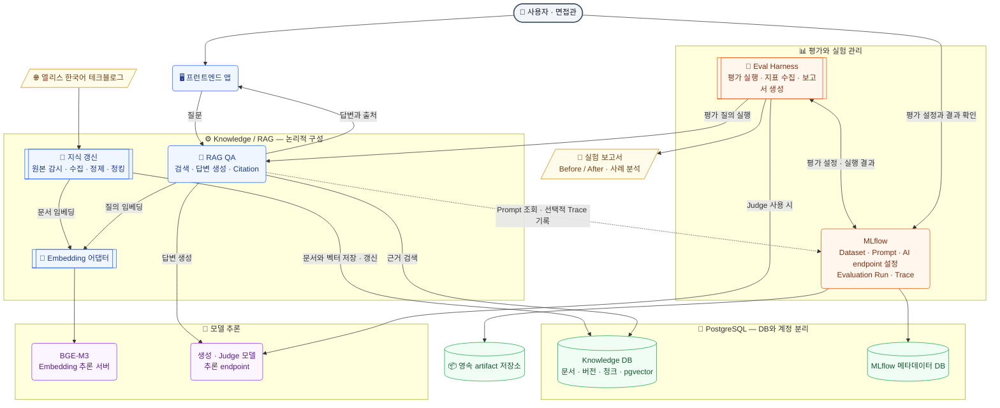

# elice-techblog-RAG

[](https://github.com/Ootzk/elice-techblog-RAG/releases/latest)

> 엘리스 - AI Engineer (Platform) 포지션 미니 프로젝트: 엘리스 테크블로그 컨텐츠(한국어)를 이용한 RAG 시스템 구축 및 자체 Eval Harness 설계

## 1. 실행 방법과 환경 변수

### 설치

Knowledge 서비스는 Python 3.12, uv, FastAPI로 구현했습니다. Docker Engine과
Docker Compose가 있으면 아래 명령으로 실행할 수 있습니다. 이미지 빌드 context는 저장소 루트입니다.

```bash
cp .env.dev.example .env.dev
# 아래 설명에 따라 .env.dev의 비밀번호와 홈서버 접속 설정을 입력합니다.
docker compose --env-file .env.dev -f compose.yaml -f compose.dev.yaml up --build -d
docker compose --env-file .env.dev -f compose.yaml -f compose.dev.yaml exec knowledge python -m elice_knowledge init-db
```

`compose.yaml`은 prod용 기본 구성으로 Knowledge 서비스를 정의합니다. `compose.dev.yaml`을 함께 사용하면
dev용 프로젝트 전용 PostgreSQL + pgvector도 실행합니다. DB 포트는 맥북의 `127.0.0.1:5432`에
바인딩하고, 데이터는 `knowledge-postgres` 볼륨에 보관합니다. 기존 홈서버 Ollama·MLflow는 기동하거나 변경하지 않습니다.
prod는 `.env`의 `DATABASE_URL`로 외부 PostgreSQL에 연결하며 `compose.yaml`만 사용합니다.
`init-db`는 전용 DB에 vector 확장과 연결 검증용 테이블·Corpus 및 청킹 결과 테이블을 생성하며, 재실행할 수 있습니다.
외부 DB에서는 해당 권한이 필요합니다.

컨테이너를 종료해도 DB 볼륨은 유지됩니다.

```bash
docker compose --env-file .env.dev -f compose.yaml -f compose.dev.yaml down
```

맥북에서는 Colima의 Docker Engine에서 실행을 검증합니다. Docker Desktop 설치는 필수가 아닙니다.

개발 DB는 맥북의 `127.0.0.1:5432`로 접속할 수 있습니다. SQLTools 등 DB 클라이언트에서
이 주소와 `.env.dev`의 `POSTGRES_DB`·`POSTGRES_USER`·`POSTGRES_PASSWORD`를 사용합니다.
컨테이너 내부의 `DATABASE_URL`은 호스트 이름 `postgres`를 사용합니다.
수집 이력·문서·스냅샷과 정책별 청킹 결과 조회 SQL은 [tools/sql](tools/sql)에 있습니다.
파일을 열고 연결한 DB에서 실행하면 되며, 문서 상세 쿼리의 제목 검색어는 필요에 맞게 바꿉니다.

### 환경 변수 설정

실제 설정은 Git에서 제외한 prod용 `.env`와 dev용 `.env.dev`에 둡니다. 예시의 주소와 비밀번호는 교체해야 합니다.

| 변수 | 용도 |
| --- | --- |
| `APP_ENV` | `dev` 또는 `prod`; Compose 기본 구성은 `prod`, dev override는 `dev`로 지정하며 접속 주소를 자동 선택하지 않음 |
| `KNOWLEDGE_ENV_FILE` | 컨테이너에 전달할 환경 파일; prod는 `.env`, dev는 `.env.dev` |
| `KNOWLEDGE_PORT` | 맥북의 `127.0.0.1`에 공개할 포트; 기본 `8080` |
| `DATABASE_URL` | 컨테이너에서 접근 가능한 전용 Knowledge PostgreSQL 연결 문자열 |
| `POSTGRES_USER`, `POSTGRES_PASSWORD`, `POSTGRES_DB` | 로컬 DB 초기화 설정; `DATABASE_URL`과 일치시켜야 함 |
| `EMBEDDING_BACKEND` | 현재 `ollama` 지원 |
| `EMBEDDING_BASE_URL`, `EMBEDDING_MODEL` | Ollama 주소와 설치된 모델 이름; 기본 모델 `bge-m3` |
| `EMBEDDING_API_KEY` | 필요할 때만 Bearer 인증에 사용 |
| `EMBEDDING_DIMENSIONS` | 기대 벡터 차원; 기본 `1024` |
| `EMBEDDING_TIMEOUT_SECONDS`, `EMBEDDING_BATCH_SIZE` | 요청 제한 시간과 배치 크기; 기본 `30`, `16` |
| `MLFLOW_ENABLED` | `false`이면 MLflow 연결·기록을 생략 |
| `MLFLOW_TRACKING_URI`, `MLFLOW_EXPERIMENT_NAME` | MLflow 서버와 이 프로젝트의 연결 검증용 실험명 |
| `MLFLOW_TRACKING_USERNAME`, `MLFLOW_TRACKING_PASSWORD`, `MLFLOW_TRACKING_TOKEN` | 서버가 요구하는 방식의 선택적 인증 |
| `MLFLOW_HTTP_REQUEST_TIMEOUT`, `MLFLOW_HTTP_REQUEST_MAX_RETRIES` | MLflow SDK 제한 시간·재시도; 예시는 `10`초·`0`회 |
| `MLFLOW_SUPPRESS_PRINTING_URL_TO_STDOUT` | SDK가 내부 Run URL을 표준 출력에 자동으로 출력하지 않도록 설정; 예시는 `true` |

`DATABASE_URL`의 비밀번호에 예약 문자가 있으면 URL 인코딩해야 합니다.
로컬 DB의 초기화 환경 변수는 빈 볼륨에 처음 기동할 때 적용됩니다.
DB 생성 후 `.env.dev`의 비밀번호만 바꾸면 기존 DB 비밀번호는 바뀌지 않습니다.
컨테이너의 `localhost`는 해당 컨테이너이므로, 홈서버에 도달 가능한 주소를 사용합니다.

prod(엘리스클라우드 배포용)는 `compose.yaml`과 `.env`를 사용하며 파일명에 `prod`를 붙이지 않습니다.
dev는 `compose.dev.yaml`을 덧씌우고 `.env.dev`를 사용합니다.
prod 설정은 `.env.example`에서 별도로 복사합니다.
이 예시는 Ollama 프로토콜용이며 실제 엘리스 추론 API 어댑터·배포는 아직 구현하지 않았습니다.

```bash
cp .env.example .env
# 제출 환경 접속 주소와 인증정보를 입력한 뒤 실행합니다.
docker compose up --build -d
docker compose exec knowledge python -m elice_knowledge init-db
```

개발 주소로 자동 fallback하지 않습니다. 환경 파일·홈서버 주소·키를 이미지나 보고서에 포함하지 않습니다.

### 문서 수집과 색인

Ingest는 Knowledge 패키지 안의 재실행 가능한 CLI입니다. 초기 전체 수집과 이후 갱신에
같은 명령을 사용하며, 현재는 수동 실행합니다. 청킹은 별도 CLI로 실행하고,
Ingest 자체는 임베딩·검색 색인을 수행하지 않으며, 별도의 `index`·`search` CLI로 연결합니다.
스케줄러는 아직 포함하지 않습니다.

본문 HTML 전체를 한 개의 LlamaIndex `Document`로 전달하고,
`IngestionPipeline(transformations=[HTMLNodeParser(...)])`가 문단·태그 탐색과 노드 분리를 처리합니다.
반환된 `TextNode`는 LlamaIndex 표준 직렬화 형식으로 저장합니다.
사이트 전용 코드는 목록 수집·언어 검사·본문 영역 선택과 출처 메타데이터 추출을 담당합니다.
HTML 주석과 본문 바깥 UI는 파싱 전에 제외합니다.

기본 파서의 텍스트 출력은 표와 코드의 공백·구조를 단순화할 수 있습니다.
정확한 정보는 문서 메타데이터에 섹션 앵커 목록, 원래 표 HTML, 코드 원문, 이미지 URL·alt,
본문 링크로 따로 보존합니다. 표의 헤더·셀 병합은 원래 HTML에 남으며 직접 셀 배열로 변환하지 않습니다.
수집 단계의 HTML 노드는 섹션과 정밀 매핑하지 않습니다. 별도의 검색용 청킹 단계에서
저장된 원문을 다시 해석해 섹션 제목과 앵커를 연결합니다.

버전별 문서 등록은 별도의 `IngestionPipeline`과 `PostgresDocumentStore`를 사용합니다.
이 등록 파이프라인의 변환 목록은 비워 두고 `DUPLICATES_ONLY` 전략으로 중복 등록만 처리합니다.
두 파이프라인 모두 모델을 자동 선택하거나 호출하지 않습니다.

```bash
# 최초 실행 시 저장 테이블을 생성합니다. 기존 데이터는 삭제하지 않습니다.
docker compose --env-file .env.dev -f compose.yaml -f compose.dev.yaml exec knowledge python -m elice_knowledge init-db
# 현재 tech_blog 목록을 발견하고 문서를 수집합니다.
docker compose --env-file .env.dev -f compose.yaml -f compose.dev.yaml exec knowledge python -m elice_knowledge ingest --report /artifacts/ingest/latest.json
```

`robots.txt`를 확인하고 요청 사이에 기본 0.5초 간격을 둡니다. 목록의 번호가 표시된
페이지 링크를 순회하며, 목록 링크에서 생략된 `/ko`를 명시합니다. 다른 호스트나 영어 경로로의
리다이렉트는 따라가지 않습니다. 최종 URL·HTML 언어·canonical과 본문의 한국어 텍스트를 검사합니다.

본문은 `articleBody`의 작성 영역에서 추출합니다. 메뉴·푸터와 본문 바깥 공유 UI는 제외합니다.
본문 안의 제품 홍보 문단은 일괄 삭제하지 않으며,
이미지 다운로드·OCR·이미지 속 그래프 수치 해석은 수행하지 않습니다.

수집 결과는 PostgreSQL의 문서·불변 문서 버전·수집 실행/관측 이력·Corpus 스냅샷 테이블에 저장합니다.
버전에는 원본 HTML, LlamaIndex 직렬화 형식의 Document, 게시/수정/수집 시각,
원문·추출 내용 해시와 파서 버전을 보관합니다. Document의 텍스트는 본문이고,
metadata에는 표준 `TextNode` 직렬화 결과(`html_nodes`)와 원본 출처 정보(`source`)가 들어갑니다.
노드의 ID·관계·문자 위치까지 기본 직렬화 형식 그대로 보관합니다. 내용 판별에는 기본 `TextNode.hash`를
사용하고, 같은 내용이 재수집되면 최초 저장한 버전의 노드 ID와 관계를 재사용합니다.
연결 검증용 `connectivity_samples`와는 별도입니다.
`corpus_observations`는 URL별 실행 이력이므로 같은 URL에 최초 200과 재확인 304가 함께 남습니다.
실제 본문 버전은 `corpus_versions`에 저장하며, 같은 추출 내용은 새 버전을 만들지 않습니다.

버전 아카이브는 원문·과거 본문·스냅샷 재현의 기준이며, LlamaIndex PostgreSQL Docstore는
후속 RAG 처리를 위한 버전별 Document 등록본입니다. 각 Document ID는 기존 문서 버전 ID와 같아
내용이 바뀐 새 버전을 등록해도 과거 버전을 덮어쓰지 않습니다.
프레임워크의 문서 해시와 manifest의 내용 해시는 용도가 다르며 별도로 유지합니다.

현재 파서 기준은 `elice-html-v1`입니다.
아카이브와 Docstore 기록은 별도 트랜잭션입니다. Docstore 기록에 실패하면 실행을 실패로 기록하고
새 스냅샷을 확정하지 않습니다. 이미 저장한 아카이브는 유지하며, 재실행 시 HTTP 304여도
누락된 Docstore 문서를 복구합니다. 프레임워크의 해시만 기록되고 문서가 누락된 경우도 복구합니다.

- 재실행 시 ETag·Last-Modified가 있으면 조건부 HTTP 요청을 사용합니다.
  304는 기존 검증 버전을 유지하고, 200이라도 추출 내용과 메타데이터가 같으면 새 버전을 만들지 않습니다.
- `--force`를 붙이면 조건부 요청 없이 다시 다운로드합니다. 파서 버전이 바뀐 경우에도 다시 다운로드합니다.
- 수집·언어 검증 실패는 기존 문서 버전을 덮어쓰지 않습니다. 목록에서 빠진 기존 URL도 다시 확인하고
  삭제 후보로 기록하지만 자동 삭제하지 않습니다. 후보가 수집에 실패하면 새 스냅샷도 발행하지 않습니다.
- 최소 20개 소스와 전체 대상의 성공을 확인한 실행만 스냅샷을 확정합니다.
  일부 문서만 성공하면 그 문서는 저장하되 기존 스냅샷은 유지하며, 명령은 종료 코드 1을 반환합니다.
  동일 버전 집합은 동일 스냅샷 ID를 사용하고, 예전 스냅샷은 예전 문서 버전을 계속 참조합니다.

평가·제출에 사용할 소스 목록과 내용 버전을 [Corpus manifest](corpus/manifest.json)로 Git에 고정합니다.
파일에는 URL·원문/내용 해시·문서/버전 ID·파서 버전·스냅샷 ID를 기록하며 원문은 포함하지 않습니다.
일반 수집은 현재 목록을 탐색하고, `--manifest` 수집은 파일에 포함된 URL과 내용 해시를 기준으로 검사합니다.
문서 내용 해시나 파서 버전이 다르면 실패로 처리하며, 원문 해시·ID·스냅샷 ID는 기준을 추적하는 정보입니다.
이는 과거 원문을 웹에서 복구하는 기능은 아니므로, 과거 데이터 재현에는 해당 DB 버전도 보존해야 합니다.

Corpus 기준을 바꿀 때만 manifest를 갱신합니다. 일반 수집이 성공한 보고서의 `manifest`를 파일의
`documents`로, `processor_version`·`snapshot_id`를 같은 이름의 필드로 반영하고 `source`·`language`는 유지합니다.
URL·내용 버전 변경을 검토한 뒤 커밋하고, 이미지에 포함된 manifest도 갱신되도록 Knowledge 이미지를 다시 빌드합니다.
수집 명령은 이 파일을 자동으로 덮어쓰지 않습니다.

```bash
docker compose --env-file .env.dev -f compose.yaml -f compose.dev.yaml exec knowledge python -m elice_knowledge ingest --manifest /app/corpus/manifest.json --report /artifacts/ingest/pinned.json
mkdir -p artifacts
docker compose --env-file .env.dev -f compose.yaml -f compose.dev.yaml cp knowledge:/artifacts/ingest/pinned.json artifacts/ingest-pinned.json
```

명령의 표준 출력에는 실행 ID·보고서 경로·스냅샷 ID·상태별 개수가, 표준 오류에는 문서별 진행 상태가
JSON으로 출력됩니다. 보고서는 `knowledge-artifacts` 영속 볼륨에 저장합니다.
`--report`를 생략하면 실행 ID별 파일을 생성합니다. 같은 경로를 지정하면 해당 보고서 파일은 교체되며,
DB의 실행 이력은 별도로 유지됩니다. 보고서에는 원문이나 인증정보를 넣지 않습니다.

수집 설정은 `CRAWL_INTERVAL_SECONDS`(기본 0.5), `CRAWL_TIMEOUT_SECONDS`(30),
`CRAWL_RETRIES`(2), `CRAWL_MAX_PAGES`(100), `CORPUS_MIN_DOCUMENTS`(20)로 조정합니다.
컨테이너의 기본 보고서 디렉터리는 `/artifacts/ingest`이며 `INGEST_REPORT_DIR`로 변경할 수 있습니다.
Ingest는 Embedding·MLflow를 호출하지 않습니다. CI에서는 임시 PostgreSQL 스키마로 저장·롤백·스냅샷을
검사하며, 실제 사이트 수집은 CI에서 실행하지 않습니다.

스냅샷 ID는 URL과 추출 문서 버전 집합으로 계산합니다.

청킹은 웹에서 다시 수집하지 않고 스냅샷이 가리키는 DB의 원문 HTML을 사용합니다.
Markdown 변환에는 `markdownify`, 제목 분할에는 LlamaIndex `MarkdownNodeParser`를 사용합니다.
기본 `h2` 정책은 H2와 다음 H2 사이를 한 섹션으로 묶고 H3 이하 제목을 함께 보존합니다.
H2가 없으면 가장 상위에 있는 본문 제목을 경계로 사용하며, 제목 앞 도입부도 포함합니다.
`every_heading`은 모든 제목에서 나누고, `page`는 글 전체를 하나의 논리적 섹션으로 취급합니다.

기본 `sentence` 추가 분할은 긴 섹션의 일반 텍스트에 `SentenceSplitter`를 적용합니다.
크기·중첩 기본값은 512·64토큰이며, 토크나이저는 `cl100k_base`로 명시합니다.
이는 BGE-M3의 입력 토큰 수와 다르며 청크 크기는 본문만 계산합니다.
중첩은 같은 섹션의 연속된 일반 텍스트 안에서 적용하고, 다른 섹션·글 사이에는 적용하지 않습니다.
표와 코드는 추가 분할 전에 보호하여 통째로 보존하고, 긴 섹션에서는 별도 청크로 둡니다.
셀 병합이 있는 표는 HTML로, 다른 표는 Markdown으로 보존하며 코드의 공백과 줄바꿈은 유지합니다.
크기 제한을 넘는 구조화 블록은 `oversized=true`로 기록합니다.
`--overflow none`은 길이 분할을 생략합니다. 원문과 제목 구조는 유지하지만 큰 청크가 생길 수 있습니다.
모델에 전달할 때는 본문과 제목 메타데이터를 합친 전체 입력을 `truncate=false`로 요청합니다.
Ollama가 허용 길이를 넘었다고 응답하면 해당 배치를 저장하지 않고 색인을 중단합니다.

정책별 결과는 PostgreSQL에서 key-value 방식으로 보관합니다.

| 저장소 | Key | Value |
| --- | --- | --- |
| `corpus_chunk_policies` | 설정·청커 버전·토크나이저·관련 라이브러리 버전의 해시 | 전체 정책 설정 JSONB |
| `corpus_chunk_sets` | 문서 버전 ID와 정책 키의 해시 | LlamaIndex 표준 TextNode 배열 JSONB |

같은 문서 버전과 정책이면 기존 결과를 읽고, 정책이나 문서 버전이 바뀌면 별도 키에 저장합니다.
기존 결과를 덮어쓰지 않으므로 정책별 비교가 가능합니다. 정책 등록과 문서별 결과 저장은 한 트랜잭션이며,
전체 스냅샷 처리 도중 실패해도 완료된 문서별 결과는 재실행 때 재사용합니다.
청크에는 URL·글 제목·섹션 제목 경로·앵커·문서 버전·섹션/분할 순번을 보존합니다.
노드 ID는 결과 키와 순번으로 결정하며, 무거운 원본 메타데이터는 청크마다 복사하지 않습니다.
모델 입력에 포함할 메타데이터는 글 제목·제목 경로로 제한하고 나머지는 출처 추적용으로 둡니다.
수집 Docstore의 중복 등록 상태와 청킹 캐시는 별개로 관리합니다.

```bash
# 기존 데이터는 유지하고 청킹 저장 테이블을 추가합니다.
docker compose --env-file .env.dev -f compose.yaml -f compose.dev.yaml exec knowledge python -m elice_knowledge init-db
# --snapshot-id를 생략하면 가장 최근에 생성된 Corpus 스냅샷을 사용합니다.
docker compose --env-file .env.dev -f compose.yaml -f compose.dev.yaml exec knowledge python -m elice_knowledge chunk --profile h2 --chunk-size 512 --chunk-overlap 64
# 같은 스냅샷에 다른 정책을 적용해도 위 결과는 유지됩니다.
docker compose --env-file .env.dev -f compose.yaml -f compose.dev.yaml exec knowledge python -m elice_knowledge chunk --profile every_heading --chunk-size 512 --chunk-overlap 64
```

정확한 비교에는 양쪽 명령에 같은 `--snapshot-id`를 명시합니다.
출력에는 스냅샷 ID·정책 키·정책 설정·새로 생성/재사용한 문서 수·청크 수·크기 초과 청크 수가 포함됩니다.
`tools/sql/corpus-chunk-policies.sql`에서 정책 키와 설정을 확인하고,
`corpus-chunk-sets.sql`과 `corpus-chunks.sql`로 정책별 결과와 실제 본문을 조회할 수 있습니다.
청킹은 Embedding·MLflow를 호출하지 않습니다. Docker 이미지는 빌드 때 토크나이저 데이터를 포함합니다.

검색용 임베딩은 기존 Ollama 어댑터를 LlamaIndex `BaseEmbedding`으로 연결하고,
벡터 저장·검색은 `PGVectorStore`와 `VectorStoreIndex`를 사용합니다.
벡터는 임베딩 프로필별 PostgreSQL 테이블에 저장하며 같은 프로필 안에서는
청크 ID로 재사용합니다. 다른 청킹 정책·문서 버전의 청크는 별도 ID로 유지합니다.
프로필에는 모델 digest·차원·양자화·정규화 등의 백엔드 정보와 문서/질의 입력 계약을 포함하며,
서버 접속 주소는 포함하지 않습니다. 주소가 같아도 모델 프로필이 달라지면 다른 테이블을 사용합니다.
문서는 제목·제목 경로와 청크 본문, 질의는 앞뒤 공백을 제거한 질문을 임베딩하고 별도 접두사는 붙이지 않습니다.

```bash
# 새 저장 테이블을 추가합니다. 기존 Corpus·청킹 결과는 유지합니다.
docker compose --env-file .env.dev -f compose.yaml -f compose.dev.yaml exec knowledge python -m elice_knowledge init-db
# chunk 출력이나 corpus-chunk-policies.sql에서 확인한 정책 키를 지정합니다.
docker compose --env-file .env.dev -f compose.yaml -f compose.dev.yaml exec knowledge python -m elice_knowledge index --policy-key '<policy_key>'
# index 출력이나 corpus-vector-indexes.sql에서 확인한 인덱스 키를 지정합니다.
docker compose --env-file .env.dev -f compose.yaml -f compose.dev.yaml exec knowledge python -m elice_knowledge search 'B300 GPU 가상화는 어떻게 동작하나요?' --index-key '<index_key>' --top-k 5
```

`index`의 `--snapshot-id` 기본값은 최신 Corpus 스냅샷입니다. 지정한 스냅샷의 모든 문서에
해당 정책의 청킹 결과가 있어야 하며, 색인 과정에서 정책을 바꾸거나 자동으로 청킹하지 않습니다.
표준 오류에는 배치 진행 개수, 표준 출력에는 인덱스 키·스냅샷/정책/프로필 키와 신규/재사용 청크 수를 출력합니다.
같은 임베딩 프로필의 색인은 DB 세션 잠금으로 직렬화하고, 추론 중에는 DB 트랜잭션을 유지하지 않습니다.
완료한 배치는 유지하여 실패 후 재실행 시 재사용하고, 추론 전후 모델 프로필이 달라지면 중단합니다.
모든 청크의 벡터를 확인한 뒤에만 `corpus_vector_indexes`에 검색 가능한 인덱스를 등록합니다.

청크 본문의 `cl100k_base` 토큰 수는 BGE-M3의 입력 한도가 아닙니다.
허용 길이 여부는 [Ollama의 truncate=false 응답](https://docs.ollama.com/api/embed)으로 판정하며,
초과 시 CLI는 `EmbeddingInputTooLong`과 안전한 이유 코드를 출력합니다. 표·코드를 자동으로 잘라 재시도하지 않습니다.
더 작은 정책을 적용하거나 큰 구조화 블록의 처리 방식을 별도로 정한 뒤 다시 실행해야 합니다.

`search`는 인덱스 키로 스냅샷·정책·모델 프로필을 고정하고 동일한 임베딩 프로필의 질의 벡터를 사용합니다.
선택한 스냅샷의 문서 버전과 청킹 정책을 메타데이터 필터로 제한하여 과거/다른 정책의 결과가 섞이지 않게 합니다.
현재는 cosine distance 기반의 정확 검색이며 근사 검색 인덱스는 만들지 않습니다.
결과는 유사도 내림차순으로 청크 ID·본문·제목·섹션 경로·원문 URL/앵커·문서 버전을 반환합니다.
유사도는 답변의 정확도나 신뢰 확률이 아니며, 답변 생성·reranking·검색 품질 평가는 아직 구현하지 않았습니다.
프로필이 달라졌거나 벡터가 누락된 인덱스는 검색을 실패 처리합니다.
색인과 검색은 MLflow를 호출하지 않으며, 연결 검증용 `smoke`와 별개입니다.
프로필과 검색 가능한 인덱스는 `tools/sql/corpus-embedding-profiles.sql`·`corpus-vector-indexes.sql`에서 확인합니다.

### 서버 실행과 질문 예시

현재 제공하는 API는 서비스 상태 확인입니다. QA API는 아직 구현하지 않았습니다.

```bash
curl http://127.0.0.1:8080/health/live
curl http://127.0.0.1:8080/health/ready
docker compose --env-file .env.dev -f compose.yaml -f compose.dev.yaml exec knowledge python -m elice_knowledge smoke
```

- `GET /health/live`: 프로세스 응답 여부를 확인하고 HTTP 200을 반환합니다. Docker healthcheck도 이 경로를 사용합니다.
- `GET /health/ready`: PostgreSQL의 vector 확장, Ollama 모델·digest, MLflow API 접근을
  각각 검사합니다. 준비되면 HTTP 200, 실패하면 HTTP 503이며 의존성별 상태를 반환합니다.
  DB 쓰기·임베딩 생성·Run 생성은 하지 않습니다. MLflow를 끄면 `disabled`로 표시합니다.
- `python -m elice_knowledge smoke`: 고정 한국어 문장의 임베딩을 생성하고 pgvector에
  저장·유사도 조회한 뒤 MLflow Run에 연결 검증 지표를 기록합니다. 실패 시 종료 코드는 1입니다.
  MLflow를 켠 상태에서 기록에 실패하면 성공으로 처리하지 않습니다. 이미 저장된 DB 샘플은 남습니다.

상태 응답은 `status`와 `dependencies`를 포함합니다. 각 의존성은 `status`, `detail`을 반환합니다.
구체적인 스키마는 [로컬 API 문서](http://127.0.0.1:8080/docs)에서 확인할 수 있습니다.
실패 응답에는 인증정보나 내부 접속 주소를 포함하지 않습니다.

Smoke 성공 출력에는 `sample_id`, `profile_id`, `dimensions`, `nearest_distance`,
`mlflow_run_id`가 포함됩니다. MLflow UI에서 사용한 환경 파일의 실험명을 찾아 해당 Run을 확인할 수 있습니다.
이 지표는 연결 검증용이며 RAG 품질 평가 결과가 아닙니다. 재실행할 때마다 샘플과 Run이 추가됩니다.

컨테이너 상태와 로그는 다음 명령으로 볼 수 있습니다.

```bash
docker compose --env-file .env.dev -f compose.yaml -f compose.dev.yaml ps
docker compose --env-file .env.dev -f compose.yaml -f compose.dev.yaml logs --tail=100 knowledge
```

개발용 검사는 홈서버 접속 없이 실행할 수 있습니다.

```bash
uv sync --project apps/knowledge --locked
uv run --project apps/knowledge ruff check apps/knowledge
uv run --project apps/knowledge ruff format --check apps/knowledge
uv run --project apps/knowledge pytest apps/knowledge/tests -q
```

PostgreSQL 통합 테스트 15개는 `TEST_DATABASE_URL`을 설정했을 때 실행합니다.
테스트마다 임시 스키마를 만들고 종료 후 삭제하므로 해당 권한이 필요하며,
설정하지 않으면 이 15개만 건너뜁니다. CI는 전용 PostgreSQL 서비스에서 실행합니다.

2026-11-09 기준 맥북 Colima(`linux/arm64`)의 dev 구성에서 이미지 빌드와 두 컨테이너의
기동을 확인했습니다. 준비 상태는 DB·Embedding·MLflow 모두 `ok`였고,
샘플 임베딩은 1024차원, 저장 후 최근접 벡터와의 cosine distance는 `0.0`이었습니다.
MLflow API로 Run이 `FINISHED`이며 `connectivity_success=1`로 저장된 것도 확인했습니다.
수집·청킹·벡터 검색을 포함한 테스트 86개(PostgreSQL 통합 테스트 15개 포함), 린트·포맷·lockfile·Compose 설정 검사는 통과했습니다.
기본 HTML 파서로 한국어 글 27개를 새 `elice-html-v1` 기준으로 수집해 노드 1,156개를 저장했습니다.
표 HTML 48개·코드 원문 41개·이미지 출처 64개는 별도 메타데이터로 보존했습니다.
고정 manifest로 재실행해 27개 모두 기존 버전을 유지하고 동일한 스냅샷을 재사용하는 것을 확인했습니다.
같은 27개 문서 버전에 H2 정책 454개·모든 제목 정책 479개 청크를 생성해 문서별 결과 54개를
정책별 키에 저장했습니다. H2 정책 재실행은 27개 결과를 모두 재사용했습니다.
두 정책 모두 표 2개·코드 1개를 크기 초과 상태로 온전히 보존했으며, 추가한 조회 SQL 3개도 실행했습니다.
H2 정책의 454개 청크를 홈서버 BGE-M3로 임베딩해 1024차원 벡터 454개와 검색 인덱스 1개를 저장했습니다.
재실행은 신규 0개·재사용 454개였으며, B300·Qwen·Whisper 관련 질문에서 해당 글의 청크가 검색됐습니다.
큰 표·코드 3개도 입력 한도 내에서 처리됐고, 별도의 길이 초과 입력은 잘림 없이 거부되는 것을 확인했습니다.
벡터 프로필·인덱스 조회 SQL 2개도 실행했습니다. 이는 동작 확인이며 Gold Set 검색 품질 평가가 아닙니다.
MLflow UI에서의 시각적 확인과 제출 환경·`linux/amd64`의 실제 실행은 아직 검증하지 않았습니다.

### 평가 실행

---

## 2. 데이터셋과 기술 스택 선정 이유

### Corpus: [엘리스 테크블로그 컨텐츠(한국어)](https://elice.io/ko/resources/blog?filter=tech_blog)

제시된 Corpus 유형 중 무엇으로 할 지 고민하다가, 엘리스 미니 프로젝트인만큼 엘리스 블로그에 공개된 컨텐츠들을 사용하면 참가자 입장에서는 기술 면접 대비 공부도 자연스럽게 되면서 면접관의 관심을 끌기 좋고, 실제 면접관 입장에서는 익숙한 도메인인 만큼 RAG 시스템 퀄리티를 평가하기도 좋을 것 같아 서로에게 재미있는 주제라고 생각이 되어 골랐습니다.

블로그 컨텐츠는 엘리스 소식/블로그/테크블로그 세 가지 카테고리로 나뉘어져 있음을 확인했고, 그 중 엘리스 소식 부분은 엘리스 구성원들의 이야기가 주로 담겨있는 만큼 개인정보 부분에서 문제가 될 것 같아 제외했고 (비록 public으로 공개되어 있지만), 블로그는 일반적인 IT 기술 트렌드나 용어 설명들을 담고 있지만 그만큼 AI가 미리 학습한 지식을 이용하여 대답할 가능성이 있어 제외했습니다.
테크블로그 컨텐츠의 경우 실제로 엘리스에서 독자적으로 수행한 실험/구축/개발에 관한 내용이기 때문에, 검색 시스템이 제대로 동작하지 않으면 AI Hallucination이 일어나기 쉬운 구조라 시스템의 퀄리티를 측정하기에 좋다고 생각하여 테크블로그 카테고리만 사용하기로 결정했습니다.

블로그 컨텐츠는 또한 세 가지 언어(한국어, 영어, 일본어)를 지원하는 것을 확인했는데, 한국어가 최신 글들을 많이 포함하고 있고 아직 외국어로는 번역되지 않은 컨텐츠가 있음을 확인했기 때문에 한국어로 작성된 글들만 대상으로 하기로 결정했습니다. (무엇보다 우리 모두 한국인이기 때문에...)
:warning: 블로그 페이지에서 글들을 오갈 때 언어설정이 영어로 불규칙하게 바뀌는 현상이 있습니다.

현실적으로는 블로그 내용들이 모두 인터넷에 공개되어 있어 일반적인 웹 검색으로 블로그 컨텐츠를 쉽게 검색할 수 있지만, 이번 미니 프로젝트에서는 이 블로그의 내용들이 공개되어 있지 않다고 가정하고 문서 Ingest, Chunking, Embedding 등 RAG에 필요한 구성 요소들을 구현하도록 하겠습니다.

### 모델과 프레임워크

현재 결정한 구성은 아래와 같습니다.

| 역할 | 선택한 기술 |
| --- | --- |
| 지식 데이터와 벡터 저장 | PostgreSQL + pgvector |
| Embedding 모델 | BGE-M3 |
| 개발용 Embedding 추론 | 홈서버 Ollama |
| 실험·평가 관리 | MLflow Dataset, Evaluation Run, Prompt와 AI endpoint 설정 |
| Knowledge 서비스 | Python 3.12 + uv + FastAPI |
| 문서 처리·청킹·검색 | LlamaIndex Core + PostgreSQL Docstore·PGVectorStore |

## 3. 시스템 아키텍처

### 서비스와 데이터 흐름

아래는 지금까지 결정한 내용을 바탕으로 그린 설계안입니다. 현재는 서비스 골격과 문서 수집·청킹·벡터 검색을 구현했으며,
Knowledge와 RAG를 하나의 프로세스로 실행할지 나눌지는 정하지 않았습니다.



👤는 사용자, 둥근 상자는 서비스와 추론 endpoint, 이중 테두리 상자는 처리 모듈,
원통은 저장소, 기울어진 상자는 외부 입력과 보고서를 나타냅니다.
실선은 주요 호출·데이터 흐름이고, 점선은 Prompt 조회·선택적 Trace 기록 연결입니다.

Knowledge는 문서와 수집 상태를 관계형 데이터로 관리하고, 청크 벡터도 같은 PostgreSQL의
pgvector에 저장합니다. 문서를 색인할 때와 질문을 검색할 때는 같은 Embedding 프로필을 사용합니다.
생성 모델과 Judge 모델의 구체적인 선택, 프런트엔드와 RAG의 프레임워크는 아직 정하지 않았습니다.

MLflow에는 평가 Dataset과 Prompt, AI endpoint 설정을 준비합니다.
Eval Harness는 이 설정을 이용해 평가를 실행하고, 질문별 결과와 주요 지표를 기록해 보고서로 정리합니다.
지표와 판정 기준은 직접 설계하며, MLflow 설정만으로 RAG나 평가 코드가 대신 구현되는 것은 아닙니다.

### 개발 환경과 제출 환경

| 구분 | 개발·주요 실험 | 제출·면접관 데모 |
| --- | --- | --- |
| 사용하는 인프라 | 홈서버 인프라 중심 | 엘리스클라우드와 엘리스 모델 서비스 |
| BGE-M3 추론 | 홈서버 Ollama | 기관 모델 등록 또는 런박스 GPU 직접 서빙 |
| MLflow | 홈서버 MLflow | 별도 배포한 MLflow와 Dataset·AI endpoint·Prompt 설정 |
| 주요 목적 | 구현, Before/After 실험, 보고서 작성 | QA 직접 사용, 설정·결과 확인, 평가 실행 |

Embedding과 MLflow는 환경별 접속 설정으로 연결합니다. Embedding은 백엔드별 API 차이를
어댑터에서 처리하고, 같은 BGE-M3라도 서빙 방식이 달라졌다면 출력과 검색 결과의 호환성을 확인합니다.
필요한 경우 제출 환경에서 다시 임베딩합니다.

주요 실험과 보고서는 홈서버에서 만들고, 제출 환경에서는 면접관이 홈서버에 접속하지 않아도
서비스를 사용해볼 수 있도록 준비합니다. 모든 개발 이력을 옮기거나 주요 실험 전체를
클라우드에서 다시 수행하는 방식은 아니며, 제출 환경의 실제 동작은 별도로 확인합니다.

## 4. 평가 체계

### Gold Set

### 품질 지표와 판정 기준

### 재현성과 회귀 검증

## 5. 핵심 설계 결정과 Trade-off

## 6. 한계점, 알려진 이슈와 향후 개선 과제

현재 구현은 서비스 기동·외부 인프라 연결 검증, 문서 수집·버전 관리·정책별 청킹과 벡터 검색 범위입니다.
QA·Gold Set 평가와 클라우드 배포는 아직 구현하지 않았습니다.
연결 검증 테이블은 실제 문서·문서 버전·청크 스키마와 별개이며 검색 인덱스 성능을 평가하지 않습니다.
임베딩 프로필에는 Ollama의 모델 digest·모델 정보·차원·양자화 정보·전처리와 truncation 정책을 기록합니다.
주소 변경만으로 프로필이 바뀌지는 않지만, 다른 서빙 구현과의 벡터 호환성은 아직 검증하지 않았습니다.

## 7. 개선 실험과 결과

### Hypothesis — 무엇을 왜 바꿨나요?

### Result — 결과가 어떻게 달라졌나요?

### Analysis — 결과를 어떻게 해석했나요?

### Next Steps — 다음에는 무엇을 해볼까요?
