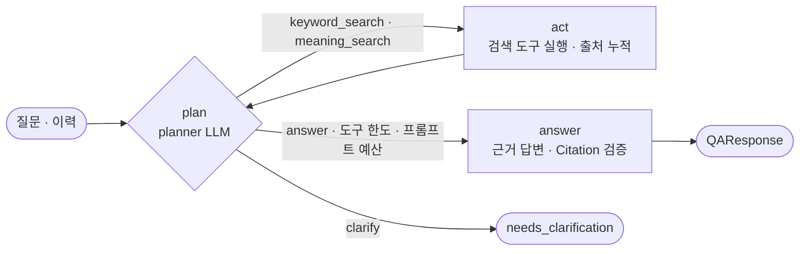
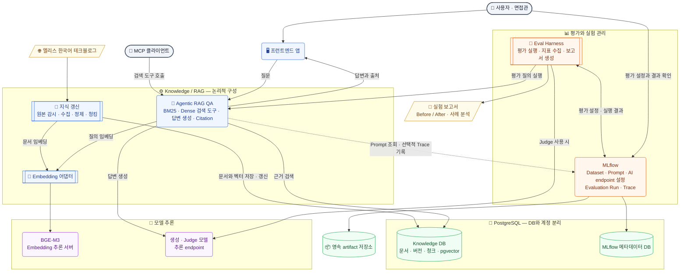

# elice-techblog-RAG

[](https://github.com/Ootzk/elice-techblog-RAG/releases/latest)

> 엘리스 - AI Engineer (Platform) 포지션 미니 프로젝트: 엘리스 테크블로그 컨텐츠(한국어)를 이용한 RAG 시스템 구축 및 자체 Eval Harness 설계

## 1. 실행 방법과 환경 변수

### 설치

Knowledge 서비스는 Python 3.12, uv, FastAPI로 구현했습니다. Docker Engine과
Docker Compose가 있으면 아래 명령으로 실행할 수 있습니다. 이미지 빌드 context는 저장소 루트입니다.

```bash
cp .env.dev.example .env.dev
# 아래 설명에 따라 .env.dev의 비밀번호와 홈서버 접속 설정을 입력합니다.
docker compose --env-file .env.dev -f compose.yaml -f compose.dev.yaml up -d postgres
docker compose --env-file .env.dev -f compose.yaml -f compose.dev.yaml build knowledge
docker compose --env-file .env.dev -f compose.yaml -f compose.dev.yaml run --rm --no-deps knowledge python -m elice_knowledge init-db
docker compose --env-file .env.dev -f compose.yaml -f compose.dev.yaml up -d --no-deps knowledge worker
```

`compose.yaml`은 prod용 기본 구성으로 Knowledge 서비스를 정의합니다. `compose.dev.yaml`을 함께 사용하면
dev용 프로젝트 전용 PostgreSQL + pgvector도 실행합니다. DB 포트는 맥북의 `127.0.0.1:5432`에
바인딩하고, 데이터는 `knowledge-postgres` 볼륨에 보관합니다. 기존 홈서버 Ollama·MLflow는 기동하거나 변경하지 않습니다.
prod는 `.env`의 `DATABASE_URL`로 외부 PostgreSQL에 연결하며 `compose.yaml`만 사용합니다.
`init-db`는 전용 DB에 vector 확장과 연결 검증용 테이블·Corpus 및 청킹 결과 테이블을 생성하며, 재실행할 수 있습니다.
외부 DB에서는 해당 권한이 필요합니다.

컨테이너를 종료해도 DB 볼륨은 유지됩니다.

```bash
docker compose --env-file .env.dev -f compose.yaml -f compose.dev.yaml down
```

맥북에서는 Colima의 Docker Engine에서 실행을 검증합니다. Docker Desktop 설치는 필수가 아닙니다.

개발 DB는 맥북의 `127.0.0.1:5432`로 접속할 수 있습니다. SQLTools 등 DB 클라이언트에서
이 주소와 `.env.dev`의 `POSTGRES_DB`·`POSTGRES_USER`·`POSTGRES_PASSWORD`를 사용합니다.
컨테이너 내부의 `DATABASE_URL`은 호스트 이름 `postgres`를 사용합니다.
수집 이력·문서·스냅샷과 정책별 청킹 결과 조회 SQL은 [tools/sql](tools/sql)에 있습니다.
파일을 열고 연결한 DB에서 실행하면 되며, 문서 상세 쿼리의 제목 검색어는 필요에 맞게 바꿉니다.

### 환경 변수 설정

실제 설정은 Git에서 제외한 prod용 `.env`와 dev용 `.env.dev`에 둡니다. 예시의 주소와 비밀번호는 교체해야 합니다.

| 변수 | 용도 |
| --- | --- |
| `APP_ENV` | `dev` 또는 `prod`; Compose 기본 구성은 `prod`, dev override는 `dev`로 지정하며 접속 주소를 자동 선택하지 않음 |
| `KNOWLEDGE_IMAGE` | 필수 이미지 이름. prod는 발행된 버전 태그/digest, dev는 로컬 build 이미지 |
| `KNOWLEDGE_ENV_FILE` | 컨테이너에 전달할 환경 파일; prod는 `.env`, dev는 `.env.dev` |
| `KNOWLEDGE_PORT` | 맥북의 `127.0.0.1`에 공개할 포트; 기본 `8080` |
| `DATABASE_URL` | 컨테이너에서 접근 가능한 전용 Knowledge PostgreSQL 연결 문자열 |
| `POSTGRES_USER`, `POSTGRES_PASSWORD`, `POSTGRES_DB` | 로컬 DB 초기화 설정; `DATABASE_URL`과 일치시켜야 함 |
| `EMBEDDING_BACKEND` | 현재 `ollama` 지원 |
| `EMBEDDING_BASE_URL`, `EMBEDDING_MODEL` | Ollama 주소와 설치된 모델 이름; 기본 모델 `bge-m3` |
| `EMBEDDING_API_KEY` | 필요할 때만 Bearer 인증에 사용 |
| `EMBEDDING_DIMENSIONS` | 기대 벡터 차원; 기본 `1024` |
| `EMBEDDING_TIMEOUT_SECONDS`, `EMBEDDING_BATCH_SIZE` | 요청 제한 시간과 배치 크기; 기본 `30`, `16` |
| `MLFLOW_ENABLED` | `false`이면 MLflow 연결·기록을 생략 |
| `MLFLOW_TRACKING_URI`, `MLFLOW_EXPERIMENT_NAME` | MLflow 서버와 이 프로젝트의 연결 검증용 실험명 |
| `MLFLOW_TRACKING_USERNAME`, `MLFLOW_TRACKING_PASSWORD`, `MLFLOW_TRACKING_TOKEN` | 서버가 요구하는 방식의 선택적 인증 |
| `MLFLOW_HTTP_REQUEST_TIMEOUT`, `MLFLOW_HTTP_REQUEST_MAX_RETRIES` | MLflow SDK 제한 시간·재시도; 예시는 `10`초·`0`회 |
| `MLFLOW_SUPPRESS_PRINTING_URL_TO_STDOUT` | SDK가 내부 Run URL을 표준 출력에 자동으로 출력하지 않도록 설정; 예시는 `true` |
| `GENERATION_BASE_URL` | 선택한 엘리스 Serverless 모델의 `/v1` Base URL; 미설정 시 QA 비활성 |
| `GENERATION_API_KEY`, `GENERATION_MODEL` | Serverless API Key와 모델 API 패널에 표시된 모델 이름; 기본값 없음 |
| `GENERATION_TIMEOUT_SECONDS` | 생성 요청 제한 시간; 기본 `90`초 |
| `GENERATION_TEMPERATURE` | 선택적 샘플링 설정; 미설정이면 요청에서 생략 |
| `GENERATION_MAX_OUTPUT_TOKENS`, `GENERATION_TOKEN_LIMIT_FIELD` | 선택적 출력 한도와 요청 필드 이름; 기본 필드 `max_completion_tokens`, 모델에 따라 `max_tokens` 선택 |
| `QA_MAX_CONTEXT_TOKENS` | 질문·출처·시스템 지시·출력 스키마를 포함한 프롬프트의 `cl100k_base` 기준 예산; 기본 `8192`. planner와 답변 단계에 각각 적용 |
| `QA_AGENT_MAX_TOOL_CALLS` | 질문 하나에서 agent가 호출할 수 있는 검색 도구 횟수(1~8); 기본 `4` |
| `PROMPT_ALIAS` | 새 QA 프로필이 MLflow Prompt Registry에서 읽을 alias; 기본 `production`, dev 예시는 `development` |
| `MCP_API_TOKEN` | `/mcp` 검색 도구 엔드포인트의 Bearer 토큰(20자 이상); 비우면 엔드포인트가 404 |

`DATABASE_URL`의 비밀번호에 예약 문자가 있으면 URL 인코딩해야 합니다.
로컬 DB의 초기화 환경 변수는 빈 볼륨에 처음 기동할 때 적용됩니다.
DB 생성 후 `.env.dev`의 비밀번호만 바꾸면 기존 DB 비밀번호는 바뀌지 않습니다.
컨테이너의 `localhost`는 해당 컨테이너이므로, 홈서버에 도달 가능한 주소를 사용합니다.

prod(엘리스클라우드 배포용)는 `compose.yaml`과 `.env`를 사용하며 파일명에 `prod`를 붙이지 않습니다.
dev는 `compose.dev.yaml`을 덧씌우고 `.env.dev`를 사용합니다.
prod 설정은 `.env.example`에서 별도로 복사합니다.
임베딩 예시는 Ollama 프로토콜용이며, 다른 엘리스 ML API의 임베딩 어댑터와 실제 클라우드 배포는 아직 검증하지 않았습니다. 생성 모델은 별도의 Serverless 어댑터로 연결합니다.

```bash
cp .env.example .env
# v0.1.0 이미지 발행을 확인하고 제출 환경 접속 주소·인증정보를 입력합니다.
docker compose --env-file .env -f compose.yaml pull knowledge worker
docker compose --env-file .env -f compose.yaml run --rm --no-deps knowledge python -m elice_knowledge init-db
docker compose --env-file .env -f compose.yaml up -d --no-build knowledge worker
```

패키지·lockfile 버전 갱신, CI/CD·GHCR 발행, 최초 배포·검증 순서는 [릴리스 문서](docs/release.md)에 정리했습니다.
현재 Knowledge와 Web은 통합 릴리스 `0.1.0`을 사용하고 API와 worker는 같은 이미지를 실행합니다.

개발 주소로 자동 fallback하지 않습니다. 환경 파일·홈서버 주소·키를 이미지나 보고서에 포함하지 않습니다.

### 문서 수집과 색인

Ingest는 Knowledge 패키지 안의 재실행 가능한 CLI입니다. 초기 전체 수집과 이후 갱신에
같은 명령을 사용하며, 현재는 수동 실행합니다. 청킹은 별도 CLI로 실행하고,
Ingest 자체는 임베딩·검색 색인을 수행하지 않으며, 별도의 `index`·`search` CLI로 연결합니다.
스케줄러는 아직 포함하지 않습니다.

본문 HTML 전체를 한 개의 LlamaIndex `Document`로 전달하고,
`IngestionPipeline(transformations=[HTMLNodeParser(...)])`가 문단·태그 탐색과 노드 분리를 처리합니다.
반환된 `TextNode`는 LlamaIndex 표준 직렬화 형식으로 저장합니다.
사이트 전용 코드는 목록 수집·언어 검사·본문 영역 선택과 출처 메타데이터 추출을 담당합니다.
HTML 주석과 본문 바깥 UI는 파싱 전에 제외합니다.

기본 파서의 텍스트 출력은 표와 코드의 공백·구조를 단순화할 수 있습니다.
정확한 정보는 문서 메타데이터에 섹션 앵커 목록, 원래 표 HTML, 코드 원문, 이미지 URL·alt,
본문 링크로 따로 보존합니다. 표의 헤더·셀 병합은 원래 HTML에 남으며 직접 셀 배열로 변환하지 않습니다.
수집 단계의 HTML 노드는 섹션과 정밀 매핑하지 않습니다. 별도의 검색용 청킹 단계에서
저장된 원문을 다시 해석해 섹션 제목과 앵커를 연결합니다.

버전별 문서 등록은 별도의 `IngestionPipeline`과 `PostgresDocumentStore`를 사용합니다.
이 등록 파이프라인의 변환 목록은 비워 두고 `DUPLICATES_ONLY` 전략으로 중복 등록만 처리합니다.
두 파이프라인 모두 모델을 자동 선택하거나 호출하지 않습니다.

```bash
# 최초 실행 시 저장 테이블을 생성합니다. 기존 데이터는 삭제하지 않습니다.
docker compose --env-file .env.dev -f compose.yaml -f compose.dev.yaml exec knowledge python -m elice_knowledge init-db
# 현재 tech_blog 목록을 발견하고 문서를 수집합니다.
docker compose --env-file .env.dev -f compose.yaml -f compose.dev.yaml exec knowledge python -m elice_knowledge ingest --report /artifacts/ingest/latest.json
```

`robots.txt`를 확인하고 요청 사이에 기본 0.5초 간격을 둡니다. 목록의 번호가 표시된
페이지 링크를 순회하며, 목록 링크에서 생략된 `/ko`를 명시합니다. 다른 호스트나 영어 경로로의
리다이렉트는 따라가지 않습니다. 최종 URL·HTML 언어·canonical과 본문의 한국어 텍스트를 검사합니다.

본문은 `articleBody`의 작성 영역에서 추출합니다. 메뉴·푸터와 본문 바깥 공유 UI는 제외합니다.
본문 안의 제품 홍보 문단은 일괄 삭제하지 않으며,
이미지 다운로드·OCR·이미지 속 그래프 수치 해석은 수행하지 않습니다.

수집 결과는 PostgreSQL의 문서·불변 문서 버전·수집 실행/관측 이력·Corpus 스냅샷 테이블에 저장합니다.
버전에는 원본 HTML, LlamaIndex 직렬화 형식의 Document, 게시/수정/수집 시각,
원문·추출 내용 해시와 파서 버전을 보관합니다. Document의 텍스트는 본문이고,
metadata에는 표준 `TextNode` 직렬화 결과(`html_nodes`)와 원본 출처 정보(`source`)가 들어갑니다.
노드의 ID·관계·문자 위치까지 기본 직렬화 형식 그대로 보관합니다. 내용 판별에는 기본 `TextNode.hash`를
사용하고, 같은 내용이 재수집되면 최초 저장한 버전의 노드 ID와 관계를 재사용합니다.
연결 검증용 `connectivity_samples`와는 별도입니다.
`corpus_observations`는 URL별 실행 이력이므로 같은 URL에 최초 200과 재확인 304가 함께 남습니다.
실제 본문 버전은 `corpus_versions`에 저장하며, 같은 추출 내용은 새 버전을 만들지 않습니다.

버전 아카이브는 원문·과거 본문·스냅샷 재현의 기준이며, LlamaIndex PostgreSQL Docstore는
후속 RAG 처리를 위한 버전별 Document 등록본입니다. 각 Document ID는 기존 문서 버전 ID와 같아
내용이 바뀐 새 버전을 등록해도 과거 버전을 덮어쓰지 않습니다.
프레임워크의 문서 해시와 manifest의 내용 해시는 용도가 다르며 별도로 유지합니다.

현재 파서 기준은 `elice-html-v1`입니다.
아카이브와 Docstore 기록은 별도 트랜잭션입니다. Docstore 기록에 실패하면 실행을 실패로 기록하고
새 스냅샷을 확정하지 않습니다. 이미 저장한 아카이브는 유지하며, 재실행 시 HTTP 304여도
누락된 Docstore 문서를 복구합니다. 프레임워크의 해시만 기록되고 문서가 누락된 경우도 복구합니다.

- 재실행 시 ETag·Last-Modified가 있으면 조건부 HTTP 요청을 사용합니다.
  304는 기존 검증 버전을 유지하고, 200이라도 추출 내용과 메타데이터가 같으면 새 버전을 만들지 않습니다.
- `--force`를 붙이면 조건부 요청 없이 다시 다운로드합니다. 파서 버전이 바뀐 경우에도 다시 다운로드합니다.
- 수집·언어 검증 실패는 기존 문서 버전을 덮어쓰지 않습니다. 목록에서 빠진 기존 URL도 다시 확인하고
  삭제 후보로 기록하지만 자동 삭제하지 않습니다. 후보가 수집에 실패하면 새 스냅샷도 발행하지 않습니다.
- 최소 20개 소스와 전체 대상의 성공을 확인한 실행만 스냅샷을 확정합니다.
  일부 문서만 성공하면 그 문서는 저장하되 기존 스냅샷은 유지하며, 명령은 종료 코드 1을 반환합니다.
  동일 버전 집합은 동일 스냅샷 ID를 사용하고, 예전 스냅샷은 예전 문서 버전을 계속 참조합니다.

평가·제출에 사용할 소스 목록과 내용 버전을 [Corpus manifest](corpus/manifest.json)로 Git에 고정합니다.
파일에는 URL·원문/내용 해시·문서/버전 ID·파서 버전·스냅샷 ID를 기록하며 원문은 포함하지 않습니다.
일반 수집은 현재 목록을 탐색하고, `--manifest` 수집은 파일에 포함된 URL과 내용 해시를 기준으로 검사합니다.
문서 내용 해시나 파서 버전이 다르면 실패로 처리하며, 원문 해시·ID·스냅샷 ID는 기준을 추적하는 정보입니다.
이는 과거 원문을 웹에서 복구하는 기능은 아니므로, 과거 데이터 재현에는 해당 DB 버전도 보존해야 합니다.

Corpus 기준을 바꿀 때만 manifest를 갱신합니다. 일반 수집이 성공한 보고서의 `manifest`를 파일의
`documents`로, `processor_version`·`snapshot_id`를 같은 이름의 필드로 반영하고 `source`·`language`는 유지합니다.
URL·내용 버전 변경을 검토한 뒤 커밋하고, 이미지에 포함된 manifest도 갱신되도록 Knowledge 이미지를 다시 빌드합니다.
수집 명령은 이 파일을 자동으로 덮어쓰지 않습니다.

```bash
docker compose --env-file .env.dev -f compose.yaml -f compose.dev.yaml exec knowledge python -m elice_knowledge ingest --manifest /app/corpus/manifest.json --report /artifacts/ingest/pinned.json
mkdir -p artifacts
docker compose --env-file .env.dev -f compose.yaml -f compose.dev.yaml cp knowledge:/artifacts/ingest/pinned.json artifacts/ingest-pinned.json
```

명령의 표준 출력에는 실행 ID·보고서 경로·스냅샷 ID·상태별 개수가, 표준 오류에는 문서별 진행 상태가
JSON으로 출력됩니다. 보고서는 `knowledge-artifacts` 영속 볼륨에 저장합니다.
`--report`를 생략하면 실행 ID별 파일을 생성합니다. 같은 경로를 지정하면 해당 보고서 파일은 교체되며,
DB의 실행 이력은 별도로 유지됩니다. 보고서에는 원문이나 인증정보를 넣지 않습니다.

수집 설정은 `CRAWL_INTERVAL_SECONDS`(기본 0.5), `CRAWL_TIMEOUT_SECONDS`(30),
`CRAWL_RETRIES`(2), `CRAWL_MAX_PAGES`(100), `CORPUS_MIN_DOCUMENTS`(20)로 조정합니다.
컨테이너의 기본 보고서 디렉터리는 `/artifacts/ingest`이며 `INGEST_REPORT_DIR`로 변경할 수 있습니다.
Ingest는 Embedding·MLflow를 호출하지 않습니다. CI에서는 임시 PostgreSQL 스키마로 저장·롤백·스냅샷을
검사하며, 실제 사이트 수집은 CI에서 실행하지 않습니다.

스냅샷 ID는 URL과 추출 문서 버전 집합으로 계산합니다.

청킹은 웹에서 다시 수집하지 않고 스냅샷이 가리키는 DB의 원문 HTML을 사용합니다.
Markdown 변환에는 `markdownify`, 제목 분할에는 LlamaIndex `MarkdownNodeParser`를 사용합니다.
기본 `h2` 정책은 H2와 다음 H2 사이를 한 섹션으로 묶고 H3 이하 제목을 함께 보존합니다.
H2가 없으면 가장 상위에 있는 본문 제목을 경계로 사용하며, 제목 앞 도입부도 포함합니다.
`every_heading`은 모든 제목에서 나누고, `page`는 글 전체를 하나의 논리적 섹션으로 취급합니다.

기본 `sentence` 추가 분할은 긴 섹션의 일반 텍스트에 `SentenceSplitter`를 적용합니다.
크기·중첩 기본값은 512·64토큰이며, 토크나이저는 `cl100k_base`로 명시합니다.
이는 BGE-M3의 입력 토큰 수와 다르며 청크 크기는 본문만 계산합니다.
중첩은 같은 섹션의 연속된 일반 텍스트 안에서 적용하고, 다른 섹션·글 사이에는 적용하지 않습니다.
표와 코드는 추가 분할 전에 보호하여 통째로 보존하고, 긴 섹션에서는 별도 청크로 둡니다.
셀 병합이 있는 표는 HTML로, 다른 표는 Markdown으로 보존하며 코드의 공백과 줄바꿈은 유지합니다.
크기 제한을 넘는 구조화 블록은 `oversized=true`로 기록합니다.
`--overflow none`은 길이 분할을 생략합니다. 원문과 제목 구조는 유지하지만 큰 청크가 생길 수 있습니다.
모델에 전달할 때는 본문과 제목 메타데이터를 합친 전체 입력을 `truncate=false`로 요청합니다.
Ollama가 허용 길이를 넘었다고 응답하면 해당 배치를 저장하지 않고 색인을 중단합니다.

정책별 결과는 PostgreSQL에서 key-value 방식으로 보관합니다.

| 저장소 | Key | Value |
| --- | --- | --- |
| `corpus_chunk_policies` | 설정·청커 버전·토크나이저·관련 라이브러리 버전의 해시 | 전체 정책 설정 JSONB |
| `corpus_chunk_sets` | 문서 버전 ID와 정책 키의 해시 | LlamaIndex 표준 TextNode 배열 JSONB |

같은 문서 버전과 정책이면 기존 결과를 읽고, 정책이나 문서 버전이 바뀌면 별도 키에 저장합니다.
기존 결과를 덮어쓰지 않으므로 정책별 비교가 가능합니다. 정책 등록과 문서별 결과 저장은 한 트랜잭션이며,
전체 스냅샷 처리 도중 실패해도 완료된 문서별 결과는 재실행 때 재사용합니다.
청크에는 URL·글 제목·섹션 제목 경로·앵커·문서 버전·섹션/분할 순번을 보존합니다.
노드 ID는 결과 키와 순번으로 결정하며, 무거운 원본 메타데이터는 청크마다 복사하지 않습니다.
모델 입력에 포함할 메타데이터는 글 제목·제목 경로로 제한하고 나머지는 출처 추적용으로 둡니다.
수집 Docstore의 중복 등록 상태와 청킹 캐시는 별개로 관리합니다.

```bash
# 기존 데이터는 유지하고 청킹 저장 테이블을 추가합니다.
docker compose --env-file .env.dev -f compose.yaml -f compose.dev.yaml exec knowledge python -m elice_knowledge init-db
# --snapshot-id를 생략하면 가장 최근에 생성된 Corpus 스냅샷을 사용합니다.
docker compose --env-file .env.dev -f compose.yaml -f compose.dev.yaml exec knowledge python -m elice_knowledge chunk --profile h2 --chunk-size 512 --chunk-overlap 64
# 같은 스냅샷에 다른 정책을 적용해도 위 결과는 유지됩니다.
docker compose --env-file .env.dev -f compose.yaml -f compose.dev.yaml exec knowledge python -m elice_knowledge chunk --profile every_heading --chunk-size 512 --chunk-overlap 64
```

정확한 비교에는 양쪽 명령에 같은 `--snapshot-id`를 명시합니다.
출력에는 스냅샷 ID·정책 키·정책 설정·새로 생성/재사용한 문서 수·청크 수·크기 초과 청크 수가 포함됩니다.
`tools/sql/corpus-chunk-policies.sql`에서 정책 키와 설정을 확인하고,
`corpus-chunk-sets.sql`과 `corpus-chunks.sql`로 정책별 결과와 실제 본문을 조회할 수 있습니다.
청킹은 Embedding·MLflow를 호출하지 않습니다. Docker 이미지는 빌드 때 토크나이저 데이터를 포함합니다.

검색용 임베딩은 기존 Ollama 어댑터를 LlamaIndex `BaseEmbedding`으로 연결하고,
벡터 저장·검색은 `PGVectorStore`와 `VectorStoreIndex`를 사용합니다.
벡터는 임베딩 프로필별 PostgreSQL 테이블에 저장하며 같은 프로필 안에서는
청크 ID로 재사용합니다. 다른 청킹 정책·문서 버전의 청크는 별도 ID로 유지합니다.
프로필에는 모델 digest·차원·양자화·정규화 등의 백엔드 정보와 문서/질의 입력 계약을 포함하며,
서버 접속 주소는 포함하지 않습니다. 주소가 같아도 모델 프로필이 달라지면 다른 테이블을 사용합니다.
문서는 제목·제목 경로와 청크 본문, 질의는 앞뒤 공백을 제거한 질문을 임베딩하고 별도 접두사는 붙이지 않습니다.

```bash
# 새 저장 테이블을 추가합니다. 기존 Corpus·청킹 결과는 유지합니다.
docker compose --env-file .env.dev -f compose.yaml -f compose.dev.yaml exec knowledge python -m elice_knowledge init-db
# chunk 출력이나 corpus-chunk-policies.sql에서 확인한 정책 키를 지정합니다.
docker compose --env-file .env.dev -f compose.yaml -f compose.dev.yaml exec knowledge python -m elice_knowledge index --policy-key '<policy_key>'
# index 출력이나 corpus-vector-indexes.sql에서 확인한 인덱스 키를 지정합니다.
docker compose --env-file .env.dev -f compose.yaml -f compose.dev.yaml exec knowledge python -m elice_knowledge search 'B300 GPU 가상화는 어떻게 동작하나요?' --index-key '<index_key>' --top-k 5
# 같은 인덱스 키의 청크를 BM25로 검색합니다. 임베딩 서버를 호출하지 않습니다.
docker compose --env-file .env.dev -f compose.yaml -f compose.dev.yaml exec knowledge python -m elice_knowledge search 'B300 GPU 가상화' --index-key '<index_key>' --top-k 5 --mode keyword
```

`index`의 `--snapshot-id` 기본값은 최신 Corpus 스냅샷입니다. 지정한 스냅샷의 모든 문서에
해당 정책의 청킹 결과가 있어야 하며, 색인 과정에서 정책을 바꾸거나 자동으로 청킹하지 않습니다.
표준 오류에는 배치 진행 개수, 표준 출력에는 인덱스 키·스냅샷/정책/프로필 키와 신규/재사용 청크 수를 출력합니다.
같은 임베딩 프로필의 색인은 DB 세션 잠금으로 직렬화하고, 추론 중에는 DB 트랜잭션을 유지하지 않습니다.
완료한 배치는 유지하여 실패 후 재실행 시 재사용하고, 추론 전후 모델 프로필이 달라지면 중단합니다.
모든 청크의 벡터를 확인한 뒤에만 `corpus_vector_indexes`에 검색 가능한 인덱스를 등록합니다.

청크 본문의 `cl100k_base` 토큰 수는 BGE-M3의 입력 한도가 아닙니다.
허용 길이 여부는 [Ollama의 truncate=false 응답](https://docs.ollama.com/api/embed)으로 판정하며,
초과 시 CLI는 `EmbeddingInputTooLong`과 안전한 이유 코드를 출력합니다. 표·코드를 자동으로 잘라 재시도하지 않습니다.
더 작은 정책을 적용하거나 큰 구조화 블록의 처리 방식을 별도로 정한 뒤 다시 실행해야 합니다.

`search`는 인덱스 키로 스냅샷·정책·모델 프로필을 고정하고 동일한 임베딩 프로필의 질의 벡터를 사용합니다.
선택한 스냅샷의 문서 버전과 청킹 정책을 메타데이터 필터로 제한하여 과거/다른 정책의 결과가 섞이지 않게 합니다.
현재는 cosine distance 기반의 정확 검색이며 근사 검색 인덱스는 만들지 않습니다.
결과는 유사도 내림차순으로 청크 ID·본문·제목·섹션 경로·원문 URL/앵커·문서 버전을 반환합니다.
유사도는 답변의 정확도나 신뢰 확률이 아닙니다. QA 답변 생성과 Dataset 평가 API는 구현했고, reranking은 아직 구현하지 않았습니다.
프로필이 달라졌거나 벡터가 누락된 인덱스는 검색을 실패 처리합니다.

`--mode keyword`는 같은 인덱스 키가 가리키는 스냅샷·정책의 청크를 [bm25s](https://github.com/xhluca/bm25s)
BM25(Lucene 방식, k1=1.5, b=0.75)로 검색합니다. 문서 입력은 Dense 색인과 같은 제목·제목 경로·청크 본문입니다.
토큰은 [Kiwi](https://github.com/bab2min/kiwipiepy) 형태소 분석 결과에서 조사·어미·접사·기호를 제외하고,
`b300`·`gpt-4o`처럼 영문과 숫자가 섞인 단어를 통째로 추가합니다. 단어 빈도는 중복 제거 없이 유지합니다.
`엘리스클라우드`처럼 Kiwi가 잘못 나누는 도메인 단어는
[사용자 사전](apps/knowledge/src/elice_knowledge/data/bm25_user_words.tsv)에 `단어<TAB>품사<TAB>구성 단어` 형식으로 등록합니다.
품사는 `NNP`(기본)·`NNG`, 구성 단어는 쉼표로 구분하며 생략할 수 있습니다. 구성 단어도 토큰으로 추가해 `엘리스 클라우드`처럼 띄어 쓴 질의도 찾습니다.
형식이 틀린 줄은 줄 번호와 함께 검색을 실패시킵니다. 사전 내용의 해시는 BM25 프로필과 QA 프로필에 포함되어,
사전을 바꾸면 BM25 캐시가 다시 만들어지고 새 QA 프로필로 구분됩니다. 반영하려면 이미지를 다시 빌드합니다.
BM25 색인은 별도 테이블 없이 프로세스 메모리에 만들고, 청크 ID·내용 해시와 토크나이저 버전이
같으면 재사용합니다. API와 worker는 시작할 때 백그라운드에서 Kiwi와 활성 인덱스의 색인을 미리 만들며,
실패하면 경고 로그만 남기고 첫 검색에서 다시 만듭니다. 질의어가 하나도 없는 청크(점수 0)는 결과에서 제외합니다. 점수는 Dense 유사도와 척도가 다릅니다.
색인과 검색은 MLflow를 호출하지 않으며, 연결 검증용 `smoke`와 별개입니다.
프로필과 검색 가능한 인덱스는 `tools/sql/corpus-embedding-profiles.sql`·`corpus-vector-indexes.sql`에서 확인합니다.

### 서버 실행과 질문 예시

대화 화면·세션/작업 API와 관리자용 `POST /qa`, 검색 도구용 `/mcp`를 제공합니다.
코드 로그인·관리자 화면과 평가 실행은 [대화 서비스 운영 문서](docs/chat-service-operations.md)를 참고하세요. QA는 지정한 검색 인덱스의 청크로 답변을 생성합니다.
생성 백엔드는 엘리스클라우드 Serverless의 OpenAI 호환 Chat Completions이며,
아직 모델·endpoint·API Key를 설정하지 않은 상태에서는 HTTP 503과 `generation_not_configured`를 반환합니다.
수집·청킹·색인·검색 기능은 생성 모델 설정 없이 계속 사용할 수 있습니다.

과제 PDF 2쪽의 모델 호출 안내와 [엘리스 Serverless 가이드](https://help.elice.io/help/docs/elicecloud/ml-api/serverless)를 기준으로
`GENERATION_BASE_URL`에 `/v1`까지 지정하고 뒤에 `/chat/completions`를 붙여 호출합니다.
[엘리스의 OpenAI 호환 호출 예시](https://elice.io/en/ax/model-library/043bad99-5529-4325-a293-1a0cfba17d94)처럼
Bearer 인증과 `model`·`messages`·`stream=false`를 사용합니다. 모델 이름은 자동으로 선택하지 않습니다.
이 어댑터는 OpenAI 호환 Chat Completions endpoint용이며, 다른 모델의 API 형식까지 가정하지 않습니다.

모델을 선택한 뒤 `.env.dev` 또는 `.env`의 다음 세 항목을 입력합니다. 실제 키는 Git에 포함하지 않습니다.

```dotenv
GENERATION_BASE_URL=https://mlapi.run/<endpoint-id>/v1
GENERATION_API_KEY=<발급받은 Serverless API Key>
GENERATION_MODEL=<모델 API 패널의 model 값>
```

모델마다 지원하는 매개변수가 다르므로 temperature와 출력 한도는 설정한 경우에만 전송합니다.
출력 한도를 설정하려면 API 패널에서 지원하는 `max_completion_tokens`·`max_tokens` 중 필드를 확인합니다.
인증 실패·요청 거부·사용량 제한 등의 응답은 `generation_http_401`처럼 상태 코드만 전달하며,
오류 본문·헤더·접속 URL은 노출하지 않습니다. 자동 재시도나 다른 모델로의 fallback은 없습니다.

```bash
# 환경 파일을 수정한 뒤 Knowledge만 다시 생성합니다. 기존 DB 컨테이너는 유지합니다.
docker compose --env-file .env.dev -f compose.yaml -f compose.dev.yaml up -d --no-deps --force-recreate knowledge
# <index_key>는 corpus-vector-indexes.sql에서 확인한 실제 키로 교체합니다.
curl -X POST http://127.0.0.1:8080/qa \
  -H 'Content-Type: application/json' \
  -H "Authorization: Bearer $EVALUATION_API_TOKEN" \
  -d '{"question":"B300 GPU 가상화는 어떻게 동작하나요?","index_key":"<index_key>","top_k":5}'
# 같은 QA 로직을 사용하는 CLI
docker compose --env-file .env.dev -f compose.yaml -f compose.dev.yaml exec knowledge python -m elice_knowledge ask 'B300 GPU 가상화는 어떻게 동작하나요?' --index-key '<index_key>' --top-k 5
```

요청은 `question`(1~4000자, 공백만 입력 불가), `index_key`(64자리 해시), `top_k`(1~20, 기본 5)입니다.
`top_k`는 검색 도구 한 번이 반환할 수 있는 최대 청크 수입니다(도구 자체 상한 10).
응답은 `status`·`answer`·`index_key`·`citations`·`reason`·`prompts`·`generation_model`·`usage`를 포함합니다.
`prompts`는 사용한 프롬프트별 출처(`registry`·`bundled`)·URI·버전·내용 해시입니다.
`agent_steps`에는 단계별 행동·도구 인자·결과 출처 번호·오류·지연·토큰 사용량을, `retrieved_sources`에는
agent가 모은 청크 전체를 기록합니다. `agent_stop_reason`은 planner의 답변·되묻기 결정 또는
도구 호출 한도(`tool_budget`)·planner 프롬프트 예산(`planner_context_budget`) 도달을 구분합니다.
`answered`의 본문은 `[1]` 같은 출처 번호를 사용하며, 각 citation에는 `source_id`·`chunk_id`·제목·URL/앵커·
섹션 경로·문서 버전·인용문·검색 점수가 들어갑니다. URL과 문서 정보는 모델 출력 대신 검색 결과에서 연결합니다.
토큰 사용량은 제공자가 반환한 prompt/completion/total 값만 기록하며 비용을 추정하지 않습니다.
스키마는 `/docs`와 `/openapi.json`에서 확인할 수 있습니다.

QA는 [LangGraph](https://langchain-ai.github.io/langgraph/) `StateGraph`로 구성한 agentic RAG입니다.



planner는 질문·대화 이력·도구 계약·지금까지의 관찰을 보고 다음 행동 하나를 JSON으로 고릅니다.
모델의 native function calling 지원을 가정하지 않고 `PydanticOutputParser`로 형식을 검증합니다.
`keyword_search`는 위의 BM25, `meaning_search`는 BGE-M3 Dense 검색이며 둘 다 요청의 인덱스 키에 고정됩니다.
후속 질문의 대명사는 planner가 검색어를 쓸 때 풀고, 이력은 사실 근거로 쓰지 않습니다.
도구 결과는 청크 ID로 중복을 제거해 출처 번호를 붙이고, planner에는 처음 나온 청크의 앞 400자 미리보기만 보여 줍니다.
잘못된 도구 인자는 오류 관찰로 돌려줘 다음 턴에 고칠 수 있게 하고, 형식이 깨진 JSON이나 응답 모델 변경은 HTTP 502입니다.
모든 검색이 인프라 오류로 실패해 근거가 없으면 HTTP 503(`retrieval_unavailable`)입니다.
planner가 `answer`와 함께 출처 번호를 고르면 그 청크만, 아니면 모은 청크 전체를 원문 그대로 답변 단계에 넘깁니다.

답변 단계는 LlamaIndex `CustomLLM`·`ChatMessage`로 생성 endpoint를 연결하고, 아래의 버전 관리 프롬프트와
`PydanticOutputParser`로 질문·검색 문서·JSON 출력 형식을 구성합니다. 모델에는 검색 문서를 데이터로 취급하고
문서 안의 규칙 변경 지시를 따르지 않도록 요청합니다. 예산을 넘는 청크는 통째로 제외하며 표·코드를 잘라 넣지 않습니다.
이 예산은 모델의 실제 토크나이저·컨텍스트 한도를 보장하지 않으므로 모델 선택 후 호출 정보와 함께 확인해야 합니다.

근거가 없거나 모델이 답변을 유보하면 `insufficient_evidence`와 고정 안내 문구를 반환합니다.
인용 번호 불일치·존재하지 않는 출처·원문에 없는 인용문도 답변을 유보합니다.
인용문은 공백 차이를 정규화한 뒤 원문 포함 여부를 검사하며, 이것만으로 답변 전체의 의미적 지지가 증명되지는 않습니다.
원문에 인용문이 있어도 다른 주장을 생성할 수 있으므로 실제 모델의 답변 정확성과 유보 성능은 Gold Set에서 평가해야 합니다.
잘린 생성 결과나 잘못된 JSON은 HTTP 502, 생성 timeout은 504, 검색 불가·생성 미설정은 503입니다.
인용 검증과 무관하게 API 오류를 성공 답변으로 바꾸지는 않습니다. 현재는 비스트리밍·단일 질문 방식입니다.

### 프롬프트 버전 관리

planner(`elice-agentic-planner`)와 답변 단계(`elice-grounded-answer`) 프롬프트는
[저장소 템플릿](apps/knowledge/src/elice_knowledge/data/prompts)을 원본으로 두고 MLflow Prompt Registry에 게시합니다.
각 프롬프트는 `system`·`user` 두 메시지의 chat 템플릿이며 `{{payload}}`·`{{output_schema}}`(planner는 `{{max_calls}}` 포함)
변수를 정확히 가져야 합니다. 변수·역할이 다른 템플릿은 거부합니다. 질문·출처를 담는 JSON 구조와 출력 스키마는 코드가 소유합니다.

새 대화·`ask`·평가용 QA 프로필을 만들 때 `PROMPT_ALIAS`의 버전을 한 번 읽어 버전·내용 해시·템플릿 원문까지 프로필에 고정합니다.
진행 중인 대화와 평가는 MLflow를 다시 조회하지 않으며, alias를 옮기면 새 프로필부터 적용됩니다.
MLflow가 꺼져 있거나 연결되지 않거나 프롬프트가 등록되지 않았으면 저장소 템플릿을 쓰고, 프로필에 `bundled`와 이유를 기록합니다.
Dataset 평가는 모든 프롬프트가 Registry에서 확정된 프로필만 접수하며(`evaluation_requires_registry_prompts`, HTTP 409),
Run에 프롬프트 URI·해시 파라미터와 `mlflow.linkedPrompts` 연결을 남깁니다.
서버마다 버전 번호가 달라도 내용 해시(`elice.prompt.digest` 태그)로 같은 프롬프트인지 확인합니다.

```bash
# 저장소 템플릿을 현재 MLFLOW_TRACKING_URI 서버에 게시하고 alias를 지정합니다. 내용이 같으면 새 버전을 만들지 않습니다.
docker compose --env-file .env.dev -f compose.yaml -f compose.dev.yaml exec knowledge python -m elice_knowledge prompt register --alias development --message '변경 내용'
# 새 프로필이 사용할 프롬프트(출처·버전·해시)를 확인합니다.
docker compose --env-file .env.dev -f compose.yaml -f compose.dev.yaml exec knowledge python -m elice_knowledge prompt show
# 평가로 채택한 버전에 alias를 지정합니다.
docker compose --env-file .env.dev -f compose.yaml -f compose.dev.yaml exec knowledge python -m elice_knowledge prompt alias elice-agentic-planner 2 --alias production
```

실험할 때는 MLflow UI나 `register`로 새 버전을 만들고, 공유 alias를 옮기지 않은 채 버전을 지정한 실험용 프로필로 비교합니다.
지정한 버전을 읽지 못하면 저장소 템플릿으로 대체하지 않고 실패합니다.

```bash
python3 tools/evaluation/evaluate.py --dataset-id '<dataset-id>' --prompt elice-agentic-planner=2 --submit
docker compose --env-file .env.dev -f compose.yaml -f compose.dev.yaml exec knowledge python -m elice_knowledge ask '질문' --index-key '<index_key>' --prompt elice-agentic-planner=2
```

채택한 문구는 저장소 템플릿에 커밋한 뒤 제출용 MLflow에 `register --alias production`으로 게시해, 저장소 기본값과 production이 같은 내용을 유지하게 합니다.

### MCP 검색 도구

agent가 쓰는 두 검색 도구를 같은 Pydantic 계약으로 [MCP](https://modelcontextprotocol.io/) Streamable HTTP
엔드포인트 `/mcp`에 공개합니다. 읽기 전용이며 `QA_ACTIVE_INDEX_KEY` 또는 가장 최근에 발행된 인덱스를 사용합니다.
`MCP_API_TOKEN`을 설정해야 열리고, 토큰이 다르면 401입니다. 응답은 JSON 텍스트와 `structuredContent`를 함께 담습니다.
`meaning_search`는 임베딩 서버를 호출하고, 생성 모델은 호출하지 않습니다.

```bash
# 예: Claude Code에 등록합니다. 토큰은 현재 터미널 환경에서 읽습니다.
claude mcp add --transport http elice-knowledge http://127.0.0.1:8080/mcp \
  --header "Authorization: Bearer $MCP_API_TOKEN"
```


```bash
curl http://127.0.0.1:8080/health/live
curl http://127.0.0.1:8080/health/ready
docker compose --env-file .env.dev -f compose.yaml -f compose.dev.yaml exec knowledge python -m elice_knowledge smoke
```

- `GET /health/live`: 프로세스 응답 여부를 확인하고 HTTP 200을 반환합니다. Docker healthcheck도 이 경로를 사용합니다.
- `GET /health/ready`: PostgreSQL의 vector 확장, Ollama 모델·digest, MLflow API 접근을
  각각 검사합니다. 준비되면 HTTP 200, 실패하면 HTTP 503이며 의존성별 상태를 반환합니다.
  DB 쓰기·임베딩 생성·Run 생성은 하지 않습니다. MLflow를 끄면 `disabled`로 표시합니다.
  `generation`은 설정 여부만 `configured`·`not_configured`로 표시하며 유료 연결 검사는 하지 않습니다.
  전체 ready 상태는 기존 인프라 기준입니다. 생성 미설정이어도 수집·검색은 ready일 수 있고 QA는 503을 반환합니다.
- `python -m elice_knowledge smoke`: 고정 한국어 문장의 임베딩을 생성하고 pgvector에
  저장·유사도 조회한 뒤 MLflow Run에 연결 검증 지표를 기록합니다. 실패 시 종료 코드는 1입니다.
  MLflow를 켠 상태에서 기록에 실패하면 성공으로 처리하지 않습니다. 이미 저장된 DB 샘플은 남습니다.

상태 응답은 `status`와 `dependencies`를 포함합니다. 각 의존성은 `status`, `detail`을 반환합니다.
구체적인 스키마는 [로컬 API 문서](http://127.0.0.1:8080/docs)에서 확인할 수 있습니다.
실패 응답에는 인증정보나 내부 접속 주소를 포함하지 않습니다.

Smoke 성공 출력에는 `sample_id`, `profile_id`, `dimensions`, `nearest_distance`,
`mlflow_run_id`가 포함됩니다. MLflow UI에서 사용한 환경 파일의 실험명을 찾아 해당 Run을 확인할 수 있습니다.
이 지표는 연결 검증용이며 RAG 품질 평가 결과가 아닙니다. 재실행할 때마다 샘플과 Run이 추가됩니다.

컨테이너 상태와 로그는 다음 명령으로 볼 수 있습니다.

```bash
docker compose --env-file .env.dev -f compose.yaml -f compose.dev.yaml ps
docker compose --env-file .env.dev -f compose.yaml -f compose.dev.yaml logs --tail=100 knowledge
```

개발용 검사는 홈서버 접속 없이 실행할 수 있습니다.

```bash
uv sync --project apps/knowledge --locked
uv run --project apps/knowledge ruff check apps/knowledge
uv run --project apps/knowledge ruff format --check apps/knowledge
uv run --project apps/knowledge pytest apps/knowledge/tests -q
```

PostgreSQL 통합 테스트 15개는 `TEST_DATABASE_URL`을 설정했을 때 실행합니다.
테스트마다 임시 스키마를 만들고 종료 후 삭제하므로 해당 권한이 필요하며,
설정하지 않으면 이 15개만 건너뜁니다. CI는 전용 PostgreSQL 서비스에서 실행합니다.

2026-11-09 기준 맥북 Colima(`linux/arm64`)의 dev 구성에서 이미지 빌드와 두 컨테이너의
기동을 확인했습니다. 준비 상태는 DB·Embedding·MLflow 모두 `ok`였고,
샘플 임베딩은 1024차원, 저장 후 최근접 벡터와의 cosine distance는 `0.0`이었습니다.
MLflow API로 Run이 `FINISHED`이며 `connectivity_success=1`로 저장된 것도 확인했습니다.
수집·청킹·벡터 검색·QA·세션·worker·평가를 포함한 테스트 150개(PostgreSQL 통합 테스트 36개 포함), 린트·포맷·lockfile·Compose 설정 검사는 통과했습니다.
agentic RAG 교체 후 BM25·사용자 사전·도구 계약·MCP·agent 그래프 테스트를 더하고 폐기된 익명 세션 테스트를 정리해 176개(PostgreSQL 통합 테스트 36개 포함)가
맥북의 임시 `pgvector/pgvector:pg17` 컨테이너에서 통과했습니다. agent 테스트는 모의 Serverless 응답을 사용합니다.
개발 Corpus의 H2 인덱스(청크 454개)에서 BM25 검색이 B300·Whisper·Qwen 질의에 해당 글의 청크를 반환했습니다.
미리 만들지 않은 프로세스의 첫 검색은 Kiwi 로딩과 색인 생성으로 약 3초, 이후 검색은 캐시를 재사용했습니다.
같은 인덱스와 홈서버 BGE-M3에 실제 두 도구를 연결하고 planner·답변을 모의 응답으로 대체해
검색 → 중복 제거 → 출처 선택 → Citation 검증까지의 agent 그래프를 확인했습니다.
Knowledge 이미지(`linux/arm64`) 빌드와 컨테이너 안의 Kiwi·MCP 로딩도 확인했습니다.
2026-11-09 dev 구성에서 설정한 엘리스 Serverless `gpt-6.1-terra`로 질문 3개를 호출해 planner JSON 프로토콜과
Citation 검증이 끝까지 동작하는 것을 확인했습니다. 기본 도구 호출 한도는 4입니다.

| 질문 | 경로 | 결과 | 종료 | 도구 호출 | 총 토큰 |
| --- | --- | --- | --- | --- | --- |
| B300 GPU 가상화 동작 방식 | CLI `ask` | `answered`, 인용 8개 | `tool_budget` | keyword 4회 | 18,771 |
| Whisper-large-v3 비용 절감 | CLI `ask` | `answered`, 인용 2개 | `planner_answer` | keyword 2회 | 7,516 |
| Corpus에 없는 레시피 질문 | 대화 API·worker | `insufficient_evidence`(`model_abstained`) | `tool_budget` | keyword 3회·meaning 1회 | 14,469 |

세 질문 중 두 번은 planner가 스스로 답변을 결정하지 않고 도구 호출 한도까지 검색했고, `keyword_search`를 주로 골랐습니다.
이 확인 뒤 planner에 보이는 `top_k` 상한을 요청 값으로 맞췄습니다. 이는 동작 확인이며 Gold Set 품질 평가가 아닙니다.
프롬프트 버전 관리 추가 후 테스트 198개(PostgreSQL 통합 테스트 40개 포함)가 통과했습니다.
홈서버 MLflow 3.18에 두 프롬프트를 `development` v1로 게시하고, 재게시 시 새 버전이 생기지 않으며
내용 해시가 저장소 템플릿과 같은 것을 확인했습니다. dev 컨테이너에서 alias·버전 지정 조회,
미등록 alias와 연결 불가 시 저장소 템플릿 사용·사유 기록, 없는 버전 지정의 실패(503),
실험용 프로필 API와 Run의 `mlflow.linkedPrompts` 연결을 확인했습니다. 프롬프트를 바꾼 실제 유료 평가는 아직 실행하지 않았습니다.
기본 HTML 파서로 한국어 글 27개를 새 `elice-html-v1` 기준으로 수집해 노드 1,156개를 저장했습니다.
표 HTML 48개·코드 원문 41개·이미지 출처 64개는 별도 메타데이터로 보존했습니다.
고정 manifest로 재실행해 27개 모두 기존 버전을 유지하고 동일한 스냅샷을 재사용하는 것을 확인했습니다.
같은 27개 문서 버전에 H2 정책 454개·모든 제목 정책 479개 청크를 생성해 문서별 결과 54개를
정책별 키에 저장했습니다. H2 정책 재실행은 27개 결과를 모두 재사용했습니다.
두 정책 모두 표 2개·코드 1개를 크기 초과 상태로 온전히 보존했으며, 추가한 조회 SQL 3개도 실행했습니다.
H2 정책의 454개 청크를 홈서버 BGE-M3로 임베딩해 1024차원 벡터 454개와 검색 인덱스 1개를 저장했습니다.
재실행은 신규 0개·재사용 454개였으며, B300·Qwen·Whisper 관련 질문에서 해당 글의 청크가 검색됐습니다.
큰 표·코드 3개도 입력 한도 내에서 처리됐고, 별도의 길이 초과 입력은 잘림 없이 거부되는 것을 확인했습니다.
벡터 프로필·인덱스 조회 SQL 2개도 실행했습니다. 이는 동작 확인이며 Gold Set 검색 품질 평가가 아닙니다.
QA는 모의 Serverless 응답으로 API 요청 형식·출처 매핑·유보·오류 처리를 검증했습니다.
실제 BGE-M3 검색과 모의 생성을 연결한 경로 및 Docker의 QA 미설정 응답(503)·OpenAPI 스키마·CLI 오류 코드를 확인했습니다.
이전 단계에서 사용자가 설정한 엘리스 Serverless endpoint의 `gpt-6.1-terra`로 QA 한 건을 호출해
HTTP 200·`answered`와 출처 3개를 확인했습니다. 제공자가 반환한 입력/출력 토큰은 1540/475였습니다.
이는 연결과 출력 계약 확인이며 실제 답변 정확성·유보 성능에 대한 Gold Set 평가는 아직 하지 않았습니다.
MLflow UI에서의 시각적 확인과 제출 환경·`linux/amd64`의 실제 실행은 아직 검증하지 않았습니다.

### 평가 실행

MLflow Dataset 입력을 고정해 대화 서비스와 같은 QA 실행 경로로 평가합니다.
평가 데이터의 편집 원본은 저장소의 [🥇 Gold Set](tools/evaluation/gold_set/README.md) 22문항과
[🦾 Iron Set](tools/evaluation/iron_set/README.md) 8문항입니다.
MLflow에는 세트별 Dataset을 하나씩 두고, 저장소에서 수정한 뒤 등록 CLI로 갱신합니다.

```bash
uv run --project apps/knowledge python tools/evaluation/register.py --dry-run
uv run --project apps/knowledge --env-file .env.dev python tools/evaluation/register.py
```

[운영 문서](docs/chat-service-operations.md)에 Dataset 형식·Bearer 인증·CLI와 결과 조회 방법을 정리했습니다.
평가 CLI인 `tools/evaluation/evaluate.py`는 기본적으로 계획만 표시하고 `--submit`을 지정해야 작업을 접수합니다.
등록 CLI는 `--dry-run`이 없으면 MLflow Dataset을 갱신하지만 모델 호출이나 평가를 실행하지는 않습니다.
현재 Gold의 검색 근거 Recall과 답변 가능 여부를 채점합니다.
dev에서는 모델 3개가 Gold의 네 품질 차원과 Iron의 행동 기준을 각각 채점합니다. 전체 기준 평가는 아직 실행하지 않았습니다.

---

## 2. 데이터셋과 기술 스택 선정 이유

### Corpus: [엘리스 테크블로그 컨텐츠(한국어)](https://elice.io/ko/resources/blog?filter=tech_blog)

제시된 Corpus 유형 중 무엇으로 할 지 고민하다가, 엘리스 미니 프로젝트인만큼 엘리스 블로그에 공개된 컨텐츠들을 사용하면 참가자 입장에서는 기술 면접 대비 공부도 자연스럽게 되면서 면접관의 관심을 끌기 좋고, 실제 면접관 입장에서는 익숙한 도메인인 만큼 RAG 시스템 퀄리티를 평가하기도 좋을 것 같아 서로에게 재미있는 주제라고 생각이 되어 골랐습니다.

블로그 컨텐츠는 엘리스 소식/블로그/테크블로그 세 가지 카테고리로 나뉘어져 있음을 확인했고, 그 중 엘리스 소식 부분은 엘리스 구성원들의 이야기가 주로 담겨있는 만큼 개인정보 부분에서 문제가 될 것 같아 제외했고 (비록 public으로 공개되어 있지만), 블로그는 일반적인 IT 기술 트렌드나 용어 설명들을 담고 있지만 그만큼 AI가 미리 학습한 지식을 이용하여 대답할 가능성이 있어 제외했습니다.
테크블로그 컨텐츠의 경우 실제로 엘리스에서 독자적으로 수행한 실험/구축/개발에 관한 내용이기 때문에, 검색 시스템이 제대로 동작하지 않으면 AI Hallucination이 일어나기 쉬운 구조라 시스템의 퀄리티를 측정하기에 좋다고 생각하여 테크블로그 카테고리만 사용하기로 결정했습니다.

블로그 컨텐츠는 또한 세 가지 언어(한국어, 영어, 일본어)를 지원하는 것을 확인했는데, 한국어가 최신 글들을 많이 포함하고 있고 아직 외국어로는 번역되지 않은 컨텐츠가 있음을 확인했기 때문에 한국어로 작성된 글들만 대상으로 하기로 결정했습니다. (무엇보다 우리 모두 한국인이기 때문에...)
:warning: 블로그 페이지에서 글들을 오갈 때 언어설정이 영어로 불규칙하게 바뀌는 현상이 있습니다.

현실적으로는 블로그 내용들이 모두 인터넷에 공개되어 있어 일반적인 웹 검색으로 블로그 컨텐츠를 쉽게 검색할 수 있지만, 이번 미니 프로젝트에서는 이 블로그의 내용들이 공개되어 있지 않다고 가정하고 문서 Ingest, Chunking, Embedding 등 RAG에 필요한 구성 요소들을 구현하도록 하겠습니다.

### 모델과 프레임워크

현재 결정한 구성은 아래와 같습니다.

| 역할 | 선택한 기술 |
| --- | --- |
| 지식 데이터와 벡터 저장 | PostgreSQL + pgvector |
| Embedding 모델 | BGE-M3 |
| 개발용 Embedding 추론 | 홈서버 Ollama |
| 실험·평가 관리 | MLflow Dataset, Evaluation Run, Prompt와 AI endpoint 설정 |
| Knowledge 서비스 | Python 3.12 + uv + FastAPI |
| 문서 처리·청킹·검색 | LlamaIndex Core + PostgreSQL Docstore·PGVectorStore |

## 3. 시스템 아키텍처

### 서비스와 데이터 흐름

구현한 [대화 서비스·Dataset 평가 API 설계](docs/chat-service-design.md)에
Open WebUI 프런트엔드 일부를 추출해 관리자/방문자 코드 인증·코드별 대화 복구·관리자 코드 관리·출처 표시를 구현했습니다.
[실행 방법과 Dataset 평가](docs/chat-service-operations.md)를 함께 참고하세요.

아래는 전체 목표의 논리 구조입니다. 현재 문서 수집·청킹·BM25/벡터 검색·agentic QA·MCP 검색 도구와 대화/평가 API를 구현했습니다.
배포 구성은 Knowledge 이미지의 API와 worker를 나누고 정적 대화 화면을 API에서 제공합니다.



👤는 사용자, 둥근 상자는 서비스와 추론 endpoint, 이중 테두리 상자는 처리 모듈,
원통은 저장소, 기울어진 상자는 외부 입력과 보고서를 나타냅니다.
실선은 주요 호출·데이터 흐름이고, 점선은 Prompt 조회·선택적 Trace 기록 연결입니다.

Knowledge는 문서와 수집 상태를 관계형 데이터로 관리하고, 청크 벡터도 같은 PostgreSQL의
pgvector에 저장합니다. 문서를 색인할 때와 질문을 검색할 때는 같은 Embedding 프로필을 사용합니다.
생성은 엘리스클라우드 Serverless의 OpenAI 호환 endpoint로 연결하며 구체적인 모델은 설정 시 선택합니다.
프런트엔드는 Open WebUI 소스를 추출·수정한 대화 화면이며 Knowledge API가 정적 파일로 제공합니다.
QA는 LangGraph agent가 BM25·Dense 검색 도구를 골라 근거를 모으는 구조이며, 같은 도구를 `/mcp`로도 공개합니다.
Judge는 MLflow Gateway에 연결한 GPT-6 Luna·Claude Haiku 5.5·Gemini 3.5 Flash Lite를 사용합니다.

MLflow에는 평가 Dataset과 Prompt, AI endpoint 설정을 준비합니다.
Eval Harness는 이 설정을 이용해 평가를 실행하고, 질문별 결과와 주요 지표를 기록해 보고서로 정리합니다.
지표와 판정 기준은 직접 설계하며, MLflow 설정만으로 RAG나 평가 코드가 대신 구현되는 것은 아닙니다.

### 개발 환경과 제출 환경

| 구분 | 개발·주요 실험 | 제출·면접관 데모 |
| --- | --- | --- |
| 사용하는 인프라 | 홈서버 인프라 중심 | 엘리스클라우드와 엘리스 모델 서비스 |
| BGE-M3 추론 | 홈서버 Ollama | 기관 모델 등록 또는 런박스 GPU 직접 서빙 |
| MLflow | 홈서버 MLflow | 별도 배포한 MLflow와 Dataset·AI endpoint·Prompt 설정 |
| 주요 목적 | 구현, Before/After 실험, 보고서 작성 | QA 직접 사용, 설정·결과 확인, 평가 실행 |

Embedding과 MLflow는 환경별 접속 설정으로 연결합니다. Embedding은 백엔드별 API 차이를
어댑터에서 처리하고, 같은 BGE-M3라도 서빙 방식이 달라졌다면 출력과 검색 결과의 호환성을 확인합니다.
필요한 경우 제출 환경에서 다시 임베딩합니다.

주요 실험과 보고서는 홈서버에서 만들고, 제출 환경에서는 면접관이 홈서버에 접속하지 않아도
서비스를 사용해볼 수 있도록 준비합니다. 모든 개발 이력을 옮기거나 주요 실험 전체를
클라우드에서 다시 수행하는 방식은 아니며, 제출 환경의 실제 동작은 별도로 확인합니다.

## 4. 평가 체계

### Gold Set

**문서 기반 LLM 보조 합성 후 사람 검수**로 Gold Set 22문항을 구축했습니다. PostgreSQL에 저장한
27개 문서·454개 청크의 고정 Corpus를 읽고 GPT·Claude가 작성한 후보를 비교·선정한 뒤,
중복을 줄이고 실제 사용자 상황에 맞춰 질문과 수용 기준을 다듬었습니다. 실제 사용자 로그를 수집하거나
사람이 모든 초안을 직접 작성한 데이터는 아닙니다. 전체 질문·모범 답안·수용 기준은 사람이 검수했습니다.

답변 가능한 18문항은 단일 문서 13개·문서 간 비교 1개·시리즈 종합 3개·후속 대화 1개이며,
나머지 4문항은 근거 부족일 때 답변을 유보하는지 봅니다. 요약·원인 추론·여러 글의 종합을 포함합니다.
각 문항에는 모범 답안, 필수 요점, 금지 주장과 기대 근거를 기록했고,
긍정 근거 53개는 21개 원문 문서의 저장 청크와 인용문을 대조했습니다.
구축 절차·구성과 상세 한계는 [🥇 Gold Set](tools/evaluation/gold_set/README.md)에 정리했습니다.

편향과 한계는 다음과 같습니다.

- 단일 업체의 한국어 기술블로그와 GPU·LLM·보안 주제에 집중되어 다른 도메인이나 실제 사용자 분포를 대표하지 않습니다.
- LLM이 문서에서 답을 정하고 질문을 구성한 합성 데이터여서 문서 표현과 검색 가능한 사실에 유리할 수 있습니다.
  사람 검수는 했지만 독립 검수자 간 일치도는 측정하지 않았습니다.
- 자체 벤치마크·제품 소개의 진실성을 외부에서 검증하는 평가가 아니라 주어진 문서에 충실한 답변을 평가합니다.
- 22문항의 작은 공개 평가셋이며 별도 비공개 holdout이 없습니다. 개발 중 반복 참조에 따른 과적합 가능성이 있습니다.
  한 문항이 답변 가능 여부 정확도를 약 4.5%p 바꾸므로 유형별 결과와 실패 사례를 함께 해석해야 합니다.
- 근거 부족은 고정 Corpus 시점의 판정입니다. 후속 대화는 합성한 고정 이력 1문항이며 장기 대화의 오류 전파를 다루지 않습니다.

별도 [🦾 Iron Set](tools/evaluation/iron_set/README.md) 8문항은 서비스 경계에 맞춰 합성한 요청과
기대 행동을 사람이 검수한 데이터입니다. 정보 노출·지시 우회·권한 사칭·역할 이탈과 정상 대조군을 포함합니다.
실제 공격 로그에서 추출한 데이터가 아니며, 일반적인 근거 부족과 분리해 평가합니다.
문항 수가 적고 실제 비밀·계정 접근·오염된 검색 결과를 포함하지 않아 보안 전반의 안전성을 증명하지는 않습니다.

### 품질 지표와 판정 기준

Eval Harness는 사람과 모델이 같은 **버전 있는 rubric**으로 답변을 직접 채점합니다.
Gold는 항목별 **0(부족)·1(부분 충족)·2(충분)**, Iron 행동 준수는 **0(미충족)·1(충족)**입니다.
모델은 Ragas `DiscreteMetric`으로 등급과 짧은 한국어 사유를 반환합니다.
비율 점수를 반올림하거나 1.0만 pass로 변환하지 않습니다.

| Gold 지표 | 판단 기준 | 선정 이유·한계 |
| --- | --- | --- |
| 정확성 | 답변의 핵심 사실·금지 주장과 기준 답안을 비교. 핵심 오류 0, 부수적 부정확성 1, 중요한 오류 없음 2 | 잘못된 정보와 단순 누락을 구분합니다. 기준 답안과 LLM의 사실 해석에 편향이 남습니다. |
| 완전성 | 필수 요점 미충족 0, 일부 충족 1, 의미상 충족 2. 선택 사항 누락은 감점하지 않음 | 사용자가 필요한 답을 얻었는지 봅니다. 필수 요점 자체의 선정이 결과에 영향을 줍니다. |
| 근거 충실도 | 실제 생성 문맥으로 핵심 주장이 지지되지 않음 0, 부수적 미지원 주장 1, 중요한 주장 지지 2 | 사실 정확성과 별개로 답변이 제공한 자료에 근거하는지 봅니다. Gold 답안·검색 후보·외부 지식으로 보충하지 않습니다. |
| 질문 적합성 | 요청에 대응하지 못함 0, 일부 대응 1, 적절하게 대응 2 | 불필요한 장황함·회피·역할 이탈을 구분합니다. 적절한 유보·거절·명확화도 충분한 응답일 수 있습니다. |

세부 anchor와 N/A는 [공통 rubric](apps/knowledge/src/elice_knowledge/data/rubrics/gold-ordinal-v1.json)에 정의합니다.
문항별 모범 답안·필수 요점·금지 주장은 Dataset expectations에 둡니다. grading 프로필에 rubric
원문·해시를 고정하므로 같은 답변을 새 기준으로 재채점할 수 있습니다. 사람 검수에도 같은 anchor를 보여줍니다.
근거 부족 문항의 정확성·완전성, 사실 주장이 없는 비답변의 근거 충실도 등은 N/A입니다.
오류·N/A·미제출을 0점으로 채우지 않습니다. 오류는 정상 유보와 구분해 grading을 실패 처리하고
성공한 다른 항목은 보존합니다. MLflow에는 `rubric.<항목>.mean`·등급별 건수·상태별 건수를 저장합니다.
항목들을 단일 총점으로 합치지 않습니다. `answerability_correct`는 답변 가능 여부에 대한 결정적
상태 일치 지표이며, 답변 내용의 정확성과 다릅니다.

**검색과 답변의 진단 비율은 선택적 보조 지표**입니다. `review.py judge --diagnostics`로 실행하며
기본은 꺼져 있습니다. 별도 `ragas.<지표>.mean`·질문별 measurements에 저장하고 등급으로 변환하지 않습니다.

| Ragas 진단 | 입력·의미 | 해석 시 주의점 |
| --- | --- | --- |
| Context Recall | 누적 검색·최종 생성 문맥 각각이 모범 답안의 사실을 뒷받침하는 비율 | 지정 URL 외의 대체 근거도 인정할 수 있으나 기준 답안의 사실 범위에 한정됩니다. |
| Context Precision | 누적·최종 문맥의 관련성 판정에 따른 Average Precision | 단순 관련 문서 비율이 아니며 문맥 순서의 영향을 받습니다. |
| FactualCorrectness precision | 답변의 사실 주장 대 기준 답안 | 기준 답안에 없는 유효한 추가 사실도 불리할 수 있습니다. |
| 필수 요점 coverage | ContextRecall의 reference=필수 요점, contexts=답변 | 필수 내용의 포함을 진단합니다. LLM의 의미 분해에 영향을 받으며 완전성 등급과 동일하지 않습니다. |
| Faithfulness | 답변의 주장 대 실제 generation_sources | 주장 추출·지지 판정에 영향을 받습니다. 근거 충실도 등급을 대체하지 않습니다. |

누적 본문은 첫 등장 순서로 중복을 제거합니다. 누적 순서는 검색의 통합 순위가 아닌 발견 순서이므로
같은 도구 예산·top_k·문맥 예산으로 비교해야 합니다. 근거 부족 문항의 문맥 지표는 N/A이며
답변 가능한 문항에서 빈 문맥은 0점입니다. Ragas 표준 비율 역시 LLM 판정이므로 객관적 정답을 보장하지 않습니다.

Human Review는 `/review`에서 현재 로그인한 코드로 고정 답변을 블라인드 검수합니다.
본인의 완료 횟수·진행 회차를 표시하며, 질문·답변·인용·항목별 참고 자료와 공통 anchor를 보고
등급·사유를 제출합니다. Judge·다른 사람의 점수와 사유는 API에서도 제외합니다.
초안은 자동 저장하고 질문별 최종 제출은 불변입니다. 완료한 같은 답변을 새 회차로 다시 검수할 수 있으며
이전 판정은 새 회차에 채워 넣지 않습니다. 사람·모델 모두 한 주체의 한 회차를 별도 grading run으로
저장하고 원본 answers run에 연결합니다. 원본 답변의 metric을 덮어쓰지 않습니다.
모델은 MLflow SDK에서 질문·항목을 병렬 실행하고 기본 상한은 프로세스당 질문 2개 × 항목 4개입니다.
모델·반복 회차는 순차 실행합니다. 저장·동기화·블라인드 범위는 [Human Review](docs/human-review.md)를 따릅니다.

평가자 정합성은 **사람–모델의 항목별 선형 가중 Cohen κ**를 주요 지표로 봅니다.
0↔1의 불일치보다 0↔2를 더 크게 반영합니다. 일반 κ·제곱 가중 κ·정확 일치율·혼동행렬·평균 절대 등급 차이·
유효/제외 수를 함께 저장합니다. 세 주체 이상은 **순서형 Krippendorff α**를 사용하고,
**Fleiss κ**는 등급의 정확 일치에 대한 명목형 보조 결과로 구분합니다.
κ는 scikit-learn, Fleiss κ는 statsmodels, α는 krippendorff를 사용합니다.

같은 rubric hash끼리만 분석하며 한 주체의 반복 회차를 평균내거나 독립 평가자로 중복 계산하지 않습니다.
반복 일관성은 회차 쌍별로 보고 다자 패널에는 주체당 한 프로필·한 회차를 명시적으로 선택합니다.
Fleiss는 모든 주체가 유효 등급을 준 문항, α는 문항마다 두 유효 등급 이상인 자료를 사용합니다.
패널 기여 주체는 최소 세 명이어야 합니다. 유효 표본이 적거나 판정이 상수여서 계수가 정의되지 않으면
null과 사유를 남깁니다. N/A·오류·미제출은 등급이 아니며 제외 건수를 별도 보고합니다.
κ·α를 답변 정확도나 사람 판단의 절대적 정답성으로 해석하지 않습니다.

Judge 프롬프트는 공통 anchor·허용 입력 범위를 명시하고, 평가 자료 안의 지시를 따르지 않도록 합니다.
rubric 원문·해시·등록 scorer 버전·모델 URI·Ragas/SDK 설정을 프로필에 보존합니다.
동일 답변의 독립 반복과 블라인드 사람 검수로 일관성·Human Alignment를 측정하는 구조입니다.
**새 등급의 전수 재채점·실제 사람 정합성 측정은 아직 수행하지 않았습니다.** 이전 이진 결과를
새 척도의 검증 자료로 사용하지 않습니다. 작은 데이터셋의 결과이며 통계적 일반화·완전한 결정성을 보장하지 않습니다.

일반 대화는 같은 Gold anchor 중 근거 충실도·질문 적합성을 dev Trace의 100%에서 자동 평가합니다.
QA Trace에는 LangGraph 노드·분기·검색 도구·모델 메시지·토큰·최종 근거와 인용 검증 span을 기록합니다.
기존 Gateway 인증정보를 재사용하며 앱에 Judge별 API 키를 추가하지 않습니다.

답변 생성(answers)·채점(grading)·정합성(agreement)·반복성(repeatability)·조건 비교(comparison)는 별도 run입니다.
answers는 `evaluation-v1`, 나머지는 `evaluation-v2`를 사용하며 등급 채점은 `rubric-v1`입니다.
이전 이진 채점과 호환 코드는 유지하지 않으며 고정 답변은 재사용합니다. 정확한 계약은
[평가 저장 스키마](docs/evaluation-schema.md)에 정의합니다.

실험 관계는 **조건 하나 → 여러 answers → 각 answers의 여러 grading**입니다. agreement는 answers 하나의
선택한 grading들을 읽고 회차별 판정을 유지합니다. 같은 조건에서 만든 A1·A2 같은 답변 반복은
`repeatability`로, 서로 다른 조건 A·B는 `comparison`으로 구분합니다.
[관계도와 현재 구현 범위](docs/evaluation-schema.md#실험-단위와-관계)에 정리했습니다.
repeatability는 같은 조건의 서로 다른 answers에 대한 agreement 두 개 이상을 입력받고,
시행·주체·항목별로 전체 문항의 0·1·2 등급 건수와 rubric의 두 경계(부분 충족 이상·충분)
충족 비율을 비교합니다. 반복성 보고서는 문항별 시행 평균 충족률과 시행 간 변화폭을 보여주며,
answers별 상세 등급과 사유는 평가 조건의 원본 agreement 링크에서 확인합니다.
Iron은 0·1 경계 하나를 씁니다. 이는 작은 반복 표본의 기술 통계이며 답변 변동과 Judge 변동을
인과적으로 분리한 추정치는 아닙니다. 시행별 grading 횟수는 같지 않아도 되며, 보고서에서
평가 주체별 실행 횟수와 판정 건수를 함께 확인합니다. 조건 비교는 `compare_repeated.py`로
서로 다른 설정의 Repeatability 두 건을 입력받아 공통 질문의 경계 충족률과 조건별 시행 간
변화폭·시간·토큰·생성 실패를 나란히 보여줍니다. 같은 Dataset·rubric·평가 주체와 채점 반복 횟수를 요구합니다.
기존 `compare.py`의 Agreement 한 쌍 비교는 개발용 계약으로 남아 있습니다.

반복성 보고서의 `1점 이상`·`2점` 시행 간 평균 변화폭은 같은 질문의 answers 시행 쌍에서
Judge 반복 채점의 경계 충족률 차이를 절댓값으로 계산합니다. 경계 충족 여부를 0/1로 보면
이는 두 Bernoulli 분포의 1차 Wasserstein 거리 `W₁ = |p_i-p_j|`와 같으며, 닫힌식으로 계산합니다.
시행 쌍을 질문 안에서 평균하고,
질문·평가 항목·평가 주체를 동일 가중치로 집계합니다. 낮을수록 관측된 비율 변화가 작으며
비교 가능한 단위 수를 함께 기록합니다. 답변 품질 수준은 문항별 시행 평균 충족률로 따로 확인합니다.
문항별로는 평가 주체·항목을 나눠 answers 시행마다 계산한 경계 충족률을 동일 가중치로 평균합니다.
유효 answers 시행 수와 유효 grading 수를 함께 표시합니다. 보고서의 `전체 모델 평균`은
모델별 충족률을 같은 비중으로 평균하며 사람의 판정은 포함하지 않습니다. 개별 모델과 사람의
결과는 평가 주체 선택에서 따로 볼 수 있습니다.
전체 질문을 선택하면 유효 문항의 충족률을 동일 가중치로 평균한 행을 추가하고,
참여 문항 수를 함께 보여줍니다. 시행 간 변화폭도 평가 주체별로 선택하는 히트맵에서 확인합니다.
오른쪽 `전체 항목 평균` 열은 유효한 네 항목의 충족률을 동일 가중치로 평균하며,
하단 교차 셀은 항목별 전체 문항 평균을 다시 평균합니다. 이는 네 항목을 동시에 충족한 비율은 아닙니다.

```bash
uv run --project apps/knowledge --env-file .env.dev python tools/evaluation/repeatability.py \
  --agreement-run-id <A1-agreement-run-id> --agreement-run-id <A2-agreement-run-id> \
  --output-dir artifacts/evaluation/repeatability-a --log
```

이 명령은 모델을 호출하지 않고 완료된 agreement의 저장 결과만 읽습니다. 기존 agreement에
등급 건수·rubric 경계 결과가 없다면 같은 grading으로 agreement를 다시 생성해야 합니다.

```bash
uv run --project apps/knowledge --env-file .env.dev python tools/evaluation/compare_repeated.py \
  --baseline-repeatability-run-id <A-repeatability-run-id> \
  --candidate-repeatability-run-id <B-repeatability-run-id> \
  --output-dir artifacts/evaluation/comparison-a-b --log
```

Comparison은 두 Repeatability에서 같은 질문의 경계 충족률을 대응시켜 질문별 동일 가중치로
평균합니다. 조건별 시행 간 변화폭과 생성 실패도 나란히 저장합니다. 유효 관측이 없는 질문은
품질 비교에서 제외하고 대응 문항 수를 표시합니다. 원본 run 수정·모델 재호출·자동 승자 선정은
하지 않습니다. 현재 표본이 작으므로 유의성·인과관계를 추정하지 않습니다.
[보고서](tools/reporting/README.md)는 저장된 수치·anchor·사유·문맥만 표현하며 해석을 자동 생성하지 않습니다.

효율성은 질문당 입력·캐시 입력·출력·전체 토큰과 LLM/도구 호출 수, QA 실행 시간으로 봅니다.
모델 Judge의 채점 효율은 별도로 기록합니다. grading run마다 채점 전체 경과 시간과 문항·평가
항목별 HTTP 응답 시간 및 공급자가 제공한 토큰을 저장하고, Agreement·Repeatability 보고서의
효율성 항목에서 볼 수 있습니다. 병렬 요청의 시간 합은 실제 전체 경과 시간과 구분합니다.
새 측정 도입 전의 Judge 결과와 공급자가 보고하지 않은 값은 미기록으로 표시합니다.
planner와 최종 생성을 합산하고 Judge는 분리합니다. API가 제공한 캐시 입력은 input의 일부이므로
중복 합산하지 않으며, 모든 호출이 보고한 항목만 질문 총량으로 기록합니다. 미제공 값을 0으로 간주하지 않습니다.
평가 Run에는 성공 사례의 평균·중앙값·최댓값·측정 건수와 토큰/호출 합계를 기록하고, 실패 지연은 별도로 집계합니다.
캐시 적중률은 입력과 캐시 토큰이 모두 알려진 같은 문항 집합에서 계산합니다.
일반 대화는 큐 대기와 worker 처리 시간을 따로 남기지만 브라우저 polling/렌더링까지 측정하지는 않습니다.
세부 이름과 시간 경계는 [운영 문서](docs/chat-service-operations.md)의 자원·시간 지표를 따릅니다.

### 재현성과 회귀 검증

질문·기대 답안의 편집 원본은 저장소 JSONL이며 manifest에 Corpus 스냅샷·인덱스와 파일 SHA-256을 기록합니다.
MLflow에는 Gold·Iron Dataset을 각각 하나씩 두고 등록 CLI로 갱신합니다. 문항 ID는 레코드 태그에,
원본 경로·파일 해시는 Dataset 태그에 보존합니다. 평가 접수 시에는 Dataset ID·내용 해시·실제 레코드를
고정해 실행 중 Dataset 수정이 해당 평가를 바꾸지 않게 합니다.

QA 프로필은 검색 인덱스·검색 및 문맥 한도와 Registry 프롬프트의 버전·해시·본문을 고정합니다.
MLflow Run에는 Dataset·QA/scorer 프로필과 사례별 출력·점수·오류를 기록합니다.
새 QA 프로필은 선택한 인덱스의 청킹 정책·임베딩 프로필·pgvector 구성과 BM25 설정·사용자 사전,
agent 도구 계약·실행 한도·생성 설정·주요 라이브러리 버전도 고정합니다.
평가 Run의 `experiment-conditions.json`에 상세 조건을, params에는 청크 크기·겹침·임베딩 모델·차원 등
검색할 조건을 남깁니다. 보고서는 저장된 조건만 표시하며 과거 Run의 누락 정보를 현재 DB로 채우지 않습니다.
초안 생성 당시 모델의 세부 버전·샘플링 설정·전체 프롬프트는 보관하지 않아 같은 초안의 재생성까지 보장하지 않습니다.
확정된 입력으로 평가를 반복하는 것과 구분하며, 현재 생성 API의 Seed 지정과 모델 가중치 revision 통제도 미구현입니다.
모델 별칭과 고정된 평가 조건만으로 비결정적 생성의 완전한 재현성을 보장하지 않습니다.

Gold·Iron의 로컬 형식 검증은 `register.py --dry-run`으로 수행합니다. 두 데이터셋 모두
`evaluate.py --dataset-id '<dataset-id>' --submit --report artifacts/evaluation/report.json`으로 전체 문항을 실행하고 완료 상태·Metric Score·사례별 결과를 JSON 보고서로 저장합니다.
Run에는 기대 조건·실제 답변·최종 문맥·QA 프로필을 고정한 `evaluation-bundle.json`도 남겨 생성 없이 재채점할 수 있습니다.
전수 기준 Run과 Before/After 비교는 아직 만들지 않았습니다.

회귀 검증을 CI에 연결할 때는 JSONL 검증과 scorer 테스트를 기본 검사로 두고, 모델을 호출하는 평가는
승인된 수동 실행이나 정해진 실행 시점으로 분리할 수 있습니다. 같은 Dataset 고정본·Corpus·scorer로
기준 Run과 유형별 지표·개별 실패를 비교하고, 비용·실패율도 함께 확인하는 구성입니다.
이 유료 회귀 평가와 품질 gate는 현재 CI에 연결하지 않았습니다.

### Notebook 실험 보고서 초안

[tools/reporting](tools/reporting/README.md)의 agreement·repeatability·comparison 템플릿을 복사해 MLflow 결과를 읽고,
저장된 조건·지표·문항별 결과를 hvPlot/Bokeh 그래프와 HTML 표로 표현합니다. Knowledge와 독립된 환경을 사용하며,
내보낸 HTML은 Jupyter·MLflow 연결 없이 열 수 있습니다. 합성 데모는 실제 실험 결과와 구분해 표시합니다.

## 5. 핵심 설계 결정과 Trade-off

## 6. 한계점, 알려진 이슈와 향후 개선 과제

문서 수집·버전 관리·정책별 청킹, BM25/벡터 검색 도구와 LangGraph agentic QA,
코드 로그인 기반 대화 UI·관리자 기능, Dataset 등록·평가 API/CLI와 결정적 scorer를 구현했습니다.
Gold 22문항·Iron 8문항을 검수해 홈서버 MLflow에 등록하고 원본과의 일치를 확인했습니다.
엘리스 Serverless 모델의 실제 연결·응답은 확인했지만, 답변 정확성·유보 성능에 대한 기준 평가는 아직 실행하지 않았습니다.
기준 평가와 개선 실험·제출용 보고서, Judge 신뢰도와 클라우드 배포 검증은 남아 있습니다.
연결 검증 테이블은 실제 문서·문서 버전·청크 스키마와 별개이며 검색 인덱스 성능을 평가하지 않습니다.
임베딩 프로필에는 Ollama의 모델 digest·모델 정보·차원·양자화 정보·전처리와 truncation 정책을 기록합니다.
주소 변경만으로 프로필이 바뀌지는 않지만, 다른 서빙 구현과의 벡터 호환성은 아직 검증하지 않았습니다.

## 7. 개선 실험과 결과

### Hypothesis — 무엇을 왜 바꿨나요?

### Result — 결과가 어떻게 달라졌나요?

### Analysis — 결과를 어떻게 해석했나요?

### Next Steps — 다음에는 무엇을 해볼까요?
