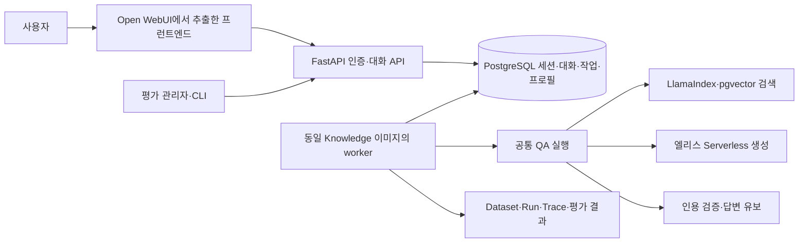

# 대화 서비스와 Dataset 평가 API 설계

2026-11-09 기준 설계와 구현 계약이다. 대화 UI·공유 인증·대화 저장·worker와
Dataset 평가 API/CLI를 구현했다. 실행 방법과 검증 한계는
[운영 문서](chat-service-operations.md)를 따른다. Gold Set 작성과 의미적 Judge 평가는 후속 작업이다.

## 확정한 방향

- Open WebUI의 프런트엔드를 원본에서 추출·수정하여 `apps/web/`에 배치한다.
- 공유 접속 코드로 인증하고, 브라우저별 익명 세션과 대화 이력을 분리한다.
- 기존 FastAPI Knowledge 서비스가 인증·대화·검색·생성·출처 검증을 담당한다.
- 지식과 대화·작업 상태는 PostgreSQL에 저장하고, 생성은 기존 엘리스 Serverless 어댑터를 사용한다.
- 대화와 Dataset 평가는 하나의 QA 실행 로직을 공유한다.

## Open WebUI 소스 조사

조사한 원본은 [open-webui/open-webui](https://github.com/open-webui/open-webui)의
커밋 [`b0e6098e940942281d9c83f3529ea117287a3a22`](https://github.com/open-webui/open-webui/tree/b0e6098e940942281d9c83f3529ea117287a3a22)이다.
해당 `package.json`의 버전은 `0.13.3`이고 Svelte 5·SvelteKit·Vite·Tailwind를 사용한다.
추출 시 이 커밋을 기준으로 하고, 이후 upstream 갱신은 별도 변경으로 검토한다.

확인한 주요 의존성은 다음과 같다.

| 원본 | 확인한 결합 | 추출·수정 범위 |
| --- | --- | --- |
| `src/routes/+layout.svelte`, `(app)/+layout.svelte` | `/api/config`, `localStorage.token`, 사용자 조회, Socket.IO 초기화 | 우리 세션·공개 UI 설정으로 교체 |
| `src/lib/components/chat/Chat.svelte` | 5,899줄; 대화 저장·모델 선택·검색·도구·음성·터미널 | 선형 대화 상태와 우리 요청 수명주기로 수정 |
| `src/lib/components/chat/MessageInput.svelte` | 3,164줄; 편집기·첨부·음성·외부 파일 서비스 | 텍스트 입력·전송·모바일 조작 부분 추출 |
| `src/lib/components/chat/Messages.svelte` | 584줄; 메시지 트리와 메시지별 표시 | 서버가 반환한 user/assistant 메시지를 표시 |
| `Messages/ResponseMessage.svelte` | 1,761줄; Markdown·출처 외에 음성·이미지·도구·평가 호출 | 답변·유보·오류·원문 인용 표시 부분 추출 |
| `src/lib/apis/{auths,chats,openai}/`와 `apis/index.ts` | 원본 인증·대화 CRUD·Chat Completions 요청 | 우리 API를 호출하는 어댑터로 대체 |

위 대화 컴포넌트 네 개의 정적 import를 추적하면 451개 파일과 27개 API import 루트가 연결된다.
이는 조건부 실행 여부를 구분하지 않는 소스 조사 결과이며, 실행 시 호출 수나 최종 bundle 크기는 아니다.
아직 추출본의 설치·빌드를 수행한 것은 아니다.
따라서 원본 컴포넌트 몇 개를 복사하는 작업과 실제 서비스 연동을 구분한다.

원본 Svelte UI와 관련 스타일·아이콘·Markdown/코드/표 렌더링·필요한 한국어 번역을 재사용한다.
추출한 파일은 원본 경로·커밋·원본 해시·수정 내용을 `apps/web/UPSTREAM.md`와 manifest에 기록한다.
추출 후 원본과의 diff로 실제 재사용 범위를 확인할 수 있어야 한다.
필요한 의존성만 남기고 새 lockfile을 만들며 Node 22에서 빌드·CI를 맞춘다.

원본 전체의 도구·업로드·음성·이미지 생성·터미널·모델 관리·여러 답변 분기 기능은 초기 범위에서 제외한다.
제외한 기능의 UI와 import를 함께 제거해 호출하지 않는 API가 성공한 것처럼 보이는 stub을 만들지 않는다.
원본의 대화 tree는 어댑터에서 선형 메시지로 매핑하고, 편집·분기·복수 모델 버튼도 초기에는 표시하지 않는다.
원본의 메시지 피드백용 `apis/evaluations` 호출은 제외하고, Dataset 평가는 우리 관리자 API로 제공한다.

원본 [LICENSE](https://github.com/open-webui/open-webui/blob/b0e6098e940942281d9c83f3529ea117287a3a22/LICENSE),
`LICENSE_HISTORY`, `LICENSE_NOTICE`와 관련 저작권 고지를 추출본에 함께 보관한다.
Open WebUI 이름·로고·기존 branding 표시는 유지하고, 수정본임을 About 화면에 고지한다.
사용자 수에 따른 branding 예외를 적용하는 설계는 하지 않는다.

## 서비스 구성



웹 소스는 `apps/web/`, 공통 QA와 API·worker는 `apps/knowledge/`, 평가 CLI는 `tools/evaluation/`에 둔다.
웹은 SvelteKit 정적 산출물로 빌드해 Knowledge 이미지에서 제공하고, API와 같은 origin을 사용한다.
API·worker는 같은 패키지와 이미지를 다른 명령으로 실행한다. 개발 시 Vite proxy로 API를 연결한다.
Open WebUI의 Python 백엔드나 자체 RAG·모델 프록시는 배포하지 않는다.
프런트엔드 build에는 Serverless·DB·MLflow 자격증명을 전달하지 않는다.

## 사용자 경험과 접속

초기 화면은 공유 코드 입력 → 새 대화/대화 목록 → 질문·답변·출처 순서다.
대화 제목은 첫 질문에서 결정하며 제목·태그 생성을 위한 추가 LLM 호출은 하지 않는다.
후속 질문, 이전 대화 복구, 새 대화, 대화 삭제, 답변 복사, 원문 링크·인용문 확인을 지원한다.
입력 중·응답 대기·유보·실패를 구분하고, 모바일 입력과 키보드 전송도 확인한다.

공유 코드는 서버 환경 변수에서 읽고 인증 요청 본문에서만 받는다.
인증 성공 시 브라우저마다 별도의 무작위 opaque 세션 토큰을 발급한다.
DB에는 토큰 원문 대신 해시와 만료·폐기 상태를 저장한다.
쿠키는 HttpOnly·SameSite=Lax를 적용하고 prod에서는 Secure를 사용한다.
같은 코드를 사용해도 다른 브라우저 세션의 대화는 조회·수정할 수 없다.
익명 세션이므로 쿠키를 잃으면 기존 대화를 복구하는 개인 계정 기능은 제공하지 않는다.

상태 변경 요청은 같은 origin과 CSRF 토큰을 검사한다. 공유 코드는 JS 저장소에 남기지 않는다.
로그인 시도·세션별 요청 수·전체 생성 동시 실행 수는 서버 설정으로 제한한다.
API가 여러 프로세스로 실행되어도 한도가 유지되도록 상태는 DB에서 관리한다.
세션·대화의 보존 기간과 사용자 요청 한도는 배포 설정에 명시하고 만료 데이터를 정리한다.

## 공통 QA 실행 계약

화면의 대화 요청과 관리자의 평가 요청을 같은 `execution.execute` 입력으로 변환한다.
경로에 따라 검색·재작성·생성·인용 검증 프롬프트를 달리하지 않는다.
브라우저에는 모델 이름·인덱스 해시·검색 크기를 직접 고르는 관리 기능을 제공하지 않는다.

실행 입력은 다음으로 고정한다.

- 현재 질문
- 제한된 이전 대화: user/assistant 역할만 허용
- 불변 QA 프로필 키
- 실행 ID와 관측용 활동 구분: interactive/evaluation

QA 프로필에는 `index_key`, `top_k`, QA 구현·의존성 식별자, 생성 provider 별칭·요청 모델·선택적 매개변수,
프롬프트 내용 해시·버전, 대화 문맥 제한, 검색 질의 재작성 정책, 컨텍스트 예산을 포함한다.
이 전체 설정의 정규화된 해시를 키로 사용하고 비밀값·접속 URL은 제외한다.
대화 생성과 평가 시작 시 프로필을 고정하므로 활성 인덱스나 환경 설정을 바꾸어도 진행 중인 실행에 섞이지 않는다.
실제 응답 모델 식별자·제공자가 반환한 사용량도 별도로 기록한다.
지원 여부를 확인하지 않은 seed나 모델 매개변수는 보내지 않는다.
worker가 고정 프로필을 실행할 수 없거나 응답 모델 식별자가 기대와 다르면 실패 처리한다.
Serverless 별칭 뒤의 비공개 모델 revision 변경까지 통제하거나 동일 답변의 재생을 보장하지는 않는다.
실행 기록에는 코드 revision·dirty 상태·QA 소스 내용 해시도 남긴다.

후속 질문은 최근 문맥으로 독립된 검색 질의를 만든 뒤 검색한다.
이전 답변은 대화 해석에만 사용하고, 사실 근거는 매 턴 새로 검색한 문서에서 확보한다.
원 질문과 재작성 질의를 모두 기록한다. 참조 대상을 결정할 수 없으면 `needs_clarification`으로 되묻는다.
대화 길이는 동일한 프로필 규칙으로 제한하고 생략한 범위를 실행 기록에 남긴다.
질의 재작성에 생성 모델을 호출했다면 그 지연·토큰 사용량도 단계별 기록과 전체 집계에 포함한다.

검증이 완료된 답변만 화면에 표시한다.
현재의 JSON 출력·인용 검증 계약에서는 검증 전 토큰을 사용자에게 흘리지 않는다.
첫 구현은 작업 상태 polling으로 진행을 보여주고, 필요하면 같은 상태 이벤트를 SSE로 제공한다.
`answered`, `insufficient_evidence`, `needs_clarification`과 API/실행 실패를 구분한다.
대화 문맥에는 성공한 대화 결과만 포함하고 실패·중단·중복 요청은 넣지 않는다.

## API 초안

| API | 인증 | 용도 |
| --- | --- | --- |
| `GET /api/ui-config` | 공개 | 서비스 이름·공유 접속 방식·세션 보존 시간 |
| `POST /api/auth/session` | 공유 코드 | 세션 쿠키 발급·로그인 시도 제한 |
| `GET /api/auth/session` | 세션 | 현재 인증·만료·CSRF 토큰 확인 |
| `DELETE /api/auth/session` | 세션+CSRF | 로그아웃·세션 폐기 |
| `POST /api/conversations` | 세션+CSRF | 현재 활성 QA 프로필로 새 대화 생성 |
| `GET /api/conversations` | 세션 | 본인 대화 목록·cursor pagination |
| `GET /api/conversations/{id}` | 세션 | 본인 대화와 메시지·진행 중 요청 복구 |
| `DELETE /api/conversations/{id}` | 세션+CSRF | 본인 대화 삭제·진행 중 요청 시 충돌 응답 |
| `POST /api/conversations/{id}/turns` | 세션+CSRF | 질문을 접수하고 turn ID 반환 |
| `GET /api/turns/{id}` | 세션 | 진행 상태·검증된 최종 결과 확인 |
| `GET /api/qa-profiles` | 관리자 Bearer | 평가 가능한 고정 프로필과 설정 확인 |
| `POST /qa` | 관리자 Bearer | 대화 이력을 변경하지 않고 공통 QA 한 턴 실행 |
| `POST /api/evaluations` | 관리자 Bearer | MLflow Dataset 기준 평가 작업 생성 |
| `GET /api/evaluations/{id}` | 관리자 Bearer | 진행률·Run ID·집계 결과 확인 |
| `GET /api/evaluations/{id}/cases` | 관리자 Bearer | 사례별 결과·오류·평가 확인 |

현재 `POST /qa`도 관리자 인증을 적용해 공유 코드·사용량 제한을 우회하는 공개 생성 경로를 남기지 않는다.
단일 QA 실행의 입력은 QA 프로필·질문·history로 정리하고, 기존 CLI도 같은 실행 함수를 사용하도록 변경한다.
예외와 request/response 타입은 공통 모델을 사용한다.
QA용 관리자 토큰은 공유 코드와 다른 자격증명이며, 프런트엔드에 전달하지 않는다.

대화 질문 요청 예시는 다음과 같다. UI가 UUID를 생성하고 같은 전송의 재시도에는 같은 값을 사용한다.

```json
{
  "request_id": "4f25f30f-bde4-4f2c-b996-12eacdbb2031",
  "question": "그 구조에서는 노드 간 통신을 어떻게 처리하나요?"
}
```

새 요청은 HTTP 202와 turn의 `id`·`status`를 반환한다.
같은 요청은 기존 turn과 현재 결과를 반환하고, 같은 request ID에 다른 질문을 보내면 409다.
한 대화에 다른 요청이 진행 중이면 409 `conversation_busy`를 반환한다.
한 세션·대화의 ID만 알아낸 다른 세션은 자원에 접근할 수 없으며 404로 처리한다.

turn 응답은 `id`, `conversation_id`, `status`, `stage`, `result`, `error`, `run_id`를 가진다.
`result`는 검증된 QA 결과와 출처이고, `error`는 안전한 오류 코드다. failed/interrupted는 자동 재시도하지 않는다.
상태는 queued/running/completed/failed/interrupted로 구분한다.
내부 모델·검색 설정·토큰 통계는 관리자 실행 기록에 보관하고 일반 화면에는 답변·출처·사용자용 상태를 표시한다.

## 저장과 요청 수명주기

| 논리 저장소 | 주요 값 |
| --- | --- |
| `chat_sessions` | 토큰 해시·만료·폐기·요청 한도 상태 |
| `qa_profiles` | 불변 설정 키·정규화된 설정 JSONB |
| `chat_conversations` | 소유 세션·고정 QA 프로필·제목·삭제 상태 |
| `chat_turns` | 요청 ID·질문·상태·QA 실행 ID·검증 결과·안전한 오류 |
| `qa_runs` | 실제 입력 문맥·검색/생성 결과·실행 식별자·단계별 시간·trace ID |
| `qa_jobs` | 작업 종류·상태·lease·실행 주체·진행률 |
| `evaluation_runs`, `evaluation_cases` | Dataset 고정본·QA 프로필·평가 조건·사례별 실행/점수·MLflow Run ID |

API는 작업 접수와 상태 반환을 담당하고 worker가 생성 요청을 실행한다.
작업 claim·사용량 예약·대화 동시성 검사는 짧은 DB 트랜잭션에서 수행한다.
추론 중에는 트랜잭션을 유지하지 않고, 완료 결과와 작업 상태를 함께 확정한다.
공개 ID는 순차 번호 대신 무작위 UUID를 사용하고 소유 세션을 함께 검사한다.

재접속·새로고침·같은 요청 ID의 재전송은 같은 turn을 조회한다.
worker 장애로 lease가 만료된 실행은 interrupted로 기록하고 유료 생성 요청을 자동 재전송하지 않는다.
외부 제공자가 요청을 받은 직후 장애가 나면 실제 과금 여부를 알 수 없으므로 exactly-once 호출을 보장하지 않는다.
사용자가 명시적으로 재시도하면 새 요청 ID와 원래 요청의 연결을 기록한다.
초기 UI에는 생성 중단·답변 분기·편집을 제공하지 않으며 동작 없는 원본 버튼도 남기지 않는다.

## Dataset 평가 계약

MLflow Evaluation Dataset이 질문·기대 근거·수용 기준의 기준 저장소다.
평가 접수 시 Dataset ID·선택 record ID·내용 해시와 실제 레코드를 고정해 실행 중 변경을 차단한다.
저장소에 내보내는 Gold Set은 같은 ID·해시를 기록하고 별도 사본을 독립적으로 수정하지 않는다.
운영 대화를 자동으로 Gold Set에 편입하지 않는다. 운영·평가 활동을 구분해 기록하고
자격증명·서버 접속 정보는 trace와 보고서에서 제외한다.

각 레코드는 다음 두 부분을 분리한다.

- `inputs`: question, history
- `expectations`: answerable, 원문 URL·인용 구간, 답변 수용 기준

expectations는 QA 실행 입력이나 생성 프롬프트에 전달하지 않고 scorer에서만 사용한다.
기대 근거는 정책 변경 때 ID가 달라지는 청크 ID 하나에 의존하지 않고 원문 버전·URL·인용 구간으로 정의한다.

평가 요청은 다음 필드를 갖는다.

```json
{
  "dataset_id": "<MLflow Dataset ID>",
  "dataset_digest": "<선택한 Dataset 고정본의 내용 해시>",
  "record_ids": null,
  "qa_profile_key": "<고정 QA 프로필 키>",
  "scorer_profile_key": "<고정 scorer 설정 키>",
  "history_mode": "provided"
}
```

기본 provided 모드는 Dataset의 고정 history를 사용해 사례를 독립적으로 평가한다.
이전 모델 답변을 다음 턴 문맥으로 쓰는 rollout 평가는 episode 단위로 순차 실행하고 다른 평가 모드로 기록한다.
초기 구현은 provided 모드부터 제공하며 rollout을 지원하기 전에는 요청을 명시적으로 거부한다.
대화 입력과 history 자르기·질의 재작성·검색·답변 생성·인용 검증은 실서비스와 동일하다.

평가 작업은 HTTP 202와 작업 ID를 반환한다.
결과에는 사례별 QA run ID·제품 상태·검색 근거·답변/인용·지연·실제 모델·사용량·점수·오류가 포함된다.
failed/interrupted는 정상적인 답변 유보와 구분하고 실패율·평가 완료 비율을 함께 보고한다.
MLflow 기록에 실패한 평가는 성공으로 표시하지 않는다.
운영 대화의 선택적 trace export 장애는 사용자 답변을 막지 않으며 두 정책을 구분한다.

지표 후보는 기대 인용 구간을 기준으로 한 검색 Recall@k, 답변 정확성·근거 충실도,
답변 불가 문항의 유보 성능, 지연·토큰 사용량이다. 인용 형식 검사는 이미 강제하므로 단독 품질 지표로 삼지 않는다.
Judge 모델·rubric·집계 방식과 최소 20개 Gold Set의 작성·검토는 평가 구현 단계에서 구체화한다.
자동 Judge를 사용하기 전에 사람 판단과의 정합성을 확인한다.

## 구현 순서와 완료 기준

1. 원본 UI 추출과 API adapter: 원본 커밋·고지·변경 내역을 보존하고 최소 대화 화면을 빌드한다.
2. 공유 인증과 대화 저장: 소유권·만료·CSRF·요청 한도·중복 전송을 검증한다.
3. 공통 QA 실행과 worker: 후속 질문·진행 상태·재접속·장애 상태·출처 표시를 연결한다.
4. Dataset 평가 API·CLI: 고정 레코드와 같은 QA 실행으로 사례별 결과·MLflow Run을 기록한다.
5. 같은 고정 QA 입력이 대화 경로와 평가 경로에서 같은 프롬프트·검색 조건을 사용하는지 검증한다.

브라우저 검증에는 코드 입력 → 질문 → 검증된 답변·출처 열기 → 후속 질문 → 새로고침 복구 → 새 대화를 포함한다.
별도 브라우저 세션 간 이력 분리와 API의 소유권 검사도 검증한다.
전체 작업은 모의 생성 응답으로 먼저 확인하고, 실제 유료 QA·평가는 사용자가 승인한 실행 범위에서 수행한다.
화면만 새로 만드는 방식이나 Open WebUI 백엔드를 함께 배포하는 방식으로 범위를 바꾸지 않는다.
