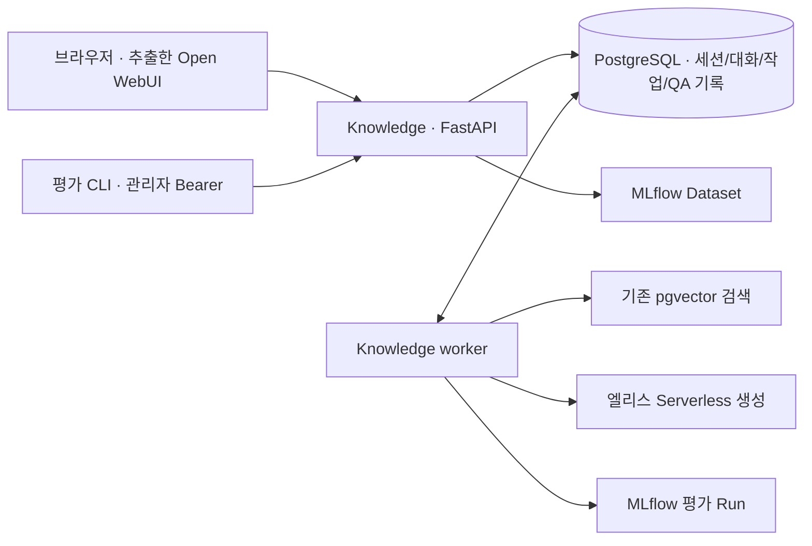

# 대화 서비스 실행과 Dataset 평가

## 실행 구성

`apps/web`는 Open WebUI 프론트엔드에서 추출·수정한 Svelte 화면이다.
원본 커밋·파일별 해시·변경 범위는 `apps/web/UPSTREAM.md`와 `upstream.json`에 있다.
Node 22(22.17 이상)에서 정적 빌드하고 Knowledge 이미지에 포함한다.
API와 worker는 동일 이미지의 서로 다른 프로세스이며 Open WebUI 백엔드는 실행하지 않는다.



`.env.dev`에는 기존 DB·임베딩·MLflow·생성 설정과 아래 값을 넣는다.
배포는 `.env`와 `compose.yaml`을 사용하고 HTTPS reverse proxy 뒤에 배치한다.

```dotenv
ADMIN_ACCESS_CODE=<최초 관리자 로그인 코드, 최소 20자>
AUTH_SESSION_SECRET=<세션 CSRF 서명용 비밀값, 최소 32자>
EVALUATION_API_TOKEN=<평가 API 전용 관리자 토큰>
QA_ACTIVE_INDEX_KEY=<corpus-vector-indexes.sql에서 확인한 인덱스 키>
CHAT_SESSION_HOURS=168
QA_WORKER_CONCURRENCY=1
```

값은 예를 들어 `python3 -c 'import secrets; print(secrets.token_urlsafe(32))'`로 각각 생성한다.
로그인 코드는 로그인 화면에만 입력한다. 평가 API 토큰과 세션 비밀값은 프론트엔드에 넣지 않는다.
`init-db`가 최초 관리자 코드를 DB에 등록한다. 동일 코드 재실행으로 폐기 상태를 되돌리지 않는다.
`AUTH_SESSION_SECRET`은 모든 API 인스턴스에서 동일하게 유지한다. 변경하면 기존 쿠키는 무효가 되지만,
로그인 코드와 코드별 대화는 남아 있어 다시 로그인할 수 있다.

```bash
export KNOWLEDGE_ENV_FILE=.env.dev
# 기존 DB를 유지하고 테이블만 추가한다. 먼저 새 이미지를 빌드한다.
docker compose --env-file .env.dev -f compose.yaml -f compose.dev.yaml build knowledge
docker compose --env-file .env.dev -f compose.yaml -f compose.dev.yaml run --rm --no-deps knowledge python -m elice_knowledge init-db
docker compose --env-file .env.dev -f compose.yaml -f compose.dev.yaml up -d --no-deps knowledge worker
```

브라우저에서 http://127.0.0.1:8080 에 접속한다. 별도 UI 개발 시 Node 22에서
`cd apps/web && npm ci && npm run dev`를 사용한다. Vite는 `/api`를 8080으로 proxy한다.
API와 Vite 접속 주소의 hostname을 통일한다. `localhost`와 `127.0.0.1` 쿠키는 공유되지 않는다.

prod 세션 쿠키는 Secure다. HTTPS proxy가 원래 Host·scheme을 전달하도록 구성하고,
Uvicorn의 forwarded-header 신뢰 대상을 해당 proxy 주소로 제한한다.
로그인 한도는 연결 IP 기준이므로 reverse proxy 환경에서는 신뢰할 수 있는 client IP 전달도 구성한다.
Compose 기본 바인딩은 localhost이므로 외부 접속은 배포 ingress에서 연결한다.

## 관리자와 방문자 코드

관리자 코드로 로그인하면 대화 화면 상단에 **관리자 ↗** 버튼이 표시된다.
`/admin/authentication`에서 다음 작업을 할 수 있다.

- 방문자별 이름/용도, 유효기간(1~3660일), 시간당 질문 한도를 지정해 코드 발급.
- 정상·만료 임박(3일 이내)·만료·폐기 상태 필터, 최근 로그인 시간/IP와 최근 1시간 질문 수 확인.
- 활성 코드는 기존 만료일에서, 만료된 코드는 현재 시각에서 유효기간 연장.
- 코드 폐기. 연결된 모든 세션은 다음 요청부터 차단하며 폐기는 되돌릴 수 없다.

방문자 코드는 암호학적 난수로 생성하고 DB에는 SHA-256 해시만 보관한다.
홈페이지의 역할·발급/연장/폐기 흐름을 참고했으며, 원문 코드를 라벨에 보관하는 방식은 가져오지 않았다.
발급 직후에만 원문을 표시하므로 닫기 전에 복사해 전달한다. 분실 시 새 코드를 발급하고 기존 코드를 폐기한다.
코드 자체가 대화 소유자이므로 여러 사람에게 하나의 코드를 배포하면 서로의 대화가 보인다.
새 코드는 별도의 소유자이며 다른 코드의 대화를 자동으로 가져오지 않는다.

관리자 코드는 웹에서 생성·승격·폐기하지 않는다. 새 `ADMIN_ACCESS_CODE`를 환경 파일에 지정하고
새 환경으로 `init-db`를 실행하면 추가 관리자 코드가 등록된다. 이전 관리자 코드 폐기는 서버 CLI를 사용한다.
마지막 관리자 코드는 폐기할 수 없다.

```bash
docker compose --env-file .env.dev -f compose.yaml -f compose.dev.yaml exec knowledge python -m elice_knowledge revoke-admin '<관리자 코드 ID>'
```

`ADMIN_ACCESS_CODE`는 초기 등록용이며 DB에 등록된 후 환경 파일 변경만으로 이전 코드를 폐기하지 않는다.
관리자 브라우저 로그인과 `EVALUATION_API_TOKEN`은 서로 다른 권한 경로다.
평가 Bearer만으로 코드 관리 화면/API를 사용할 수 없으며, 로그인 코드는 평가 API 토큰을 대신하지 않는다.
관리자 HTML은 서버에서, 관리 API는 세션 역할/CSRF에서 각각 접근을 제한한다.

| API | 역할 |
| --- | --- |
| `GET /api/admin/access-codes?status=all&page=1` | 관리자 코드 목록·사용량, 페이지당 30개 |
| `POST /api/admin/access-codes` | 방문자 코드 발급, 원문 일회 반환 |
| `POST /api/admin/access-codes/{id}/extend` | `days`만큼 유효기간 연장 |
| `DELETE /api/admin/access-codes/{id}` | 방문자 코드 영구 폐기 |

등록·연장·폐기는 `access_code_events`에 작업자와 UTC 시각을 기록하며 원문 코드를 남기지 않는다.
서버에서 표시할 시간은 UTC로 저장하고 화면에서는 브라우저 현지 시간대로 표시한다.

## 대화와 실패 처리

- opaque 쿠키는 HttpOnly/SameSite=Lax이며 DB에는 해시만 저장한다. CSRF 토큰은 메모리에 둔다.
- 같은 로그인 코드라면 로그아웃·쿠키 만료·다른 기기에서도 대화를 불러온다. 다른 코드의 대화는 404다.
- 대화에 고정된 QA 프로필은 인덱스·모델·생성 매개변수·문맥 예산·코드/의존성 해시를 포함한다.
  접속 endpoint는 해시로만 식별한다. 프로필과 실행 환경이 달라지면 새 대화를 시작해야 한다.
- 기본 최근 3쌍/2048토큰 이력을 planner에 지시 대상 해석용으로만 주고 매 턴 문서를 다시 검색한다.
  한 질문의 유료 호출은 planner 턴(최대 `QA_AGENT_MAX_TOOL_CALLS`회)과 답변 생성 1회다.
  도구 호출 한도에 도달하면 planner를 더 호출하지 않고 답변 단계로 넘어가므로 기본값 4에서 최대 5회다.
  근거가 없거나 되묻기로 끝나면 답변 생성 호출은 생략한다.
- 요청 UUID는 같은 전송에 재사용한다. 네트워크 오류 시 브라우저 sessionStorage에 질문과 UUID를
  남겨 같은 요청으로 확인한다. 자격증명은 저장하지 않는다.
- queued/running 작업은 polling한다. 출처 검증을 마친 최종 답변만 표시한다.
- 원문 링크는 인용문을 Text Fragments(`#:~:text=`)로 지정해 지원 브라우저에서 이동·강조한다.
  Markdown 표기를 보이는 텍스트로 정리하고 여러 문단은 시작/끝 범위로 연결한다.
  기존 섹션 앵커는 유지한다. 원문 변경·동일 문구 중복·브라우저 지원/정책에 따라 강조가 실패할 수 있으며,
  실제 브라우저에서의 원문 강조는 자동 검증하지 않았다. 명세: https://wicg.github.io/scroll-to-text-fragment/
- worker lease 기본 300초, 동시 실행 기본 1이다. DB에서 모든 worker의 claim을 직렬화하고
  running 작업 수를 검사한다. lease 만료 작업은 interrupted이며 자동 재호출하지 않는다.
- 쿠키 세션 기본 168시간이며 로그아웃은 해당 세션만 종료한다. 코드별 대화는 세션 정리로 삭제하지 않는다.
  명시적으로 삭제한 대화와 관련 실행 기록은 24시간 후 worker가 정리한다. 평가 기록은 별도다.
- 질문 한도는 모든 기기·세션을 합쳐 코드별로 계산한다. 실패/중단을 포함한 접수 건수 기준이며
  재로그인으로 초기화하지 않는다. 관리자 코드는 이 시간당 한도만 우회하고 전역 worker 동시 실행 제한은 적용한다.
- 코드 만료/폐기 시 queued 작업은 중단한다. 이미 실행 중인 외부 모델 요청을 취소하거나 과금을 되돌리지는 않는다.
- 방문자 질문 한도는 코드 발급 시 설정한다.
- 총 예산과 대규모 공개 서비스의 ingress 제한은 후속 과제다.

## 평가 API와 CLI

`POST /qa`, QA/scorer 프로필과 Dataset/평가 API는 `Authorization: Bearer <EVALUATION_API_TOKEN>`이 필요하다.
`POST /qa`는 관리자용 즉시 실행 경로다. 일반 대화는 반드시 `/api/conversations/.../turns` 큐를 사용한다.
HTTP 계약은 `/docs`에서 확인한다.

MLflow Dataset의 각 레코드는 다음 형식을 사용한다.

```json
{
  "inputs": {"question": "GPU 가상화의 목적은?", "history": []},
  "expectations": {
    "answerable": true,
    "evidence": [{"url": "https://elice.io/ko/resources/blog/<article>", "quote": "실제 원문 인용 구간"}],
    "answer": "사람이 검토한 수용 기준 또는 기대 답변"
  }
}
```

history가 있으면 user/assistant 완전한 쌍으로 구성한다. expectations는 QA로 전달하지 않는다.
answerable=true 문항은 evidence가 필수다. answerable=false는 evidence를 생략할 수 있다.
데이터셋을 읽을 때 inputs를 엄격히 검증하고 전체 레코드 내용으로 해시를 만든다.
실행 접수 시 그 해시를 다시 확인하고 선택 레코드를 PostgreSQL에 고정한다. 한 번에 최대 200개다.
현재 provided-history만 허용하며 rollout 요청은 422로 거부한다.

```bash
# EVALUATION_API_TOKEN은 현재 터미널 환경에 설정한다. 명령 인자나 Git에 넣지 않는다.
python3 tools/evaluation/evaluate.py --dataset-id '<dataset-id>'
# 위 출력의 대상·건수·프로필을 검토한 뒤 유료 작업을 명시적으로 접수한다.
python3 tools/evaluation/evaluate.py --dataset-id '<dataset-id>' --submit
```

개별 record는 `--record-id`를 반복해 선택한다. QA 프로필은 `--qa-profile-key`로 지정할 수 있다.
`--prompt NAME=VERSION|ALIAS`를 반복하면 해당 Registry 프롬프트로 고정한 실험용 프로필을 만들어 평가한다(미리보기에서도 프로필은 생성된다).
평가는 모든 프롬프트가 Registry에서 확정된 프로필만 접수하고, 저장소 템플릿으로 대체된 프로필은 409로 거부한다.
CLI 기본 동작은 metadata만 읽으며 생성하지 않는다. 접수 후 다음 API에서 조회한다.

| API | 용도 |
| --- | --- |
| `GET /api/qa-profiles` | 활성/저장된 QA 프로필 |
| `POST /api/qa-profiles` | `index_key`·`top_k`·`prompts`(이름→버전/alias)로 실험용 프로필 생성, HTTP 201 |
| `GET /api/scorer-profiles` | 고정 scorer 키와 정의 |
| `GET /api/evaluation-datasets/{id}` | Dataset 해시·레코드 검토 |
| `POST /api/evaluations` | 고정 평가 접수, HTTP 202 |
| `GET /api/evaluations/{id}` | 상태·집계·MLflow Run ID |
| `GET /api/evaluations/{id}/cases?limit=50&offset=0` | 사례별 실행·검색 결과·점수·오류 |

대화·평가·ask CLI는 `execution.execute`를 공유하고 `qa_runs`에 입력·출력·지연을 저장한다.
MLflow에는 Dataset ID/해시·QA/scorer 프로필·사례별 출력·집계 JSON과 지표를 남긴다.
MLflow 기록 실패 또는 사례 실패가 있으면 평가 전체를 성공으로 표시하지 않는다.

첫 scorer `evidence-v1`은 다음 두 지표만 계산한다.

- `evidence_recall_at_k`: URL과 정규화한 원문 인용문이 검색된 청크에 함께 존재하는 비율.
- `answerability_correct`: answered 여부가 기대 answerable과 일치하는지.

실행 실패는 0점 답변으로 섞지 않고 실패율과 유효 채점 건수를 별도로 집계한다.
이 지표는 의미적 답변 정확성·충실도를 검증하지 않는다.
검토된 Gold Set 최소 20개, Judge/rubric 및 사람 판단과의 정합성 검증은 후속 작업이다.
유료 평가와 실제 생성 호출은 아직 이번 구현 검증에 포함하지 않았다.

## 검증 한계

브라우저 연결이 없어 실제 화면 클릭·모바일 배치는 확인하지 못했다.
테스트 150개(PostgreSQL 통합 36개), 린트·포맷·정적 빌드와 Docker HTTP 검증을 통과했다.
기존 Corpus 27개·스냅샷 1개·청킹 결과 54개·벡터 인덱스 1개를 유지했다.
런타임 npm 의존성 보안 검사는 별도로 확인하며, 개발 도구에 low severity advisory 4개가 남아 있다. `npm audit --omit=dev`는 0개다.
정적 배포 이미지에는 Node/npm 개발 도구를 포함하지 않는다.
