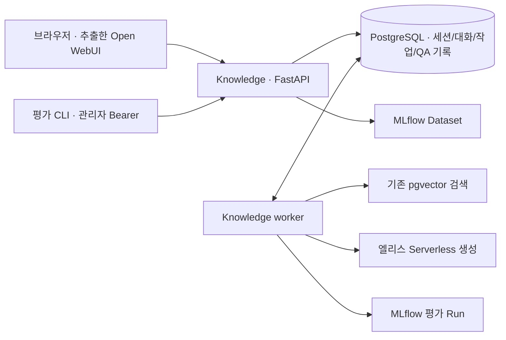

# 대화 서비스 실행과 Dataset 평가

## 실행 구성

`apps/web`는 Open WebUI 프론트엔드에서 추출·수정한 Svelte 화면이다.
원본 커밋·파일별 해시·변경 범위는 `apps/web/UPSTREAM.md`와 `upstream.json`에 있다.
Node 22(22.17 이상)에서 정적 빌드하고 Knowledge 이미지에 포함한다.
API와 worker는 동일 이미지의 서로 다른 프로세스이며 Open WebUI 백엔드는 실행하지 않는다.



`.env.dev`에는 기존 DB·임베딩·MLflow·생성 설정과 아래 값을 넣는다.
배포는 `.env`와 `compose.yaml`을 사용하고 HTTPS reverse proxy 뒤에 배치한다.

```dotenv
CHAT_ACCESS_CODE=<공유할 무작위 코드>
EVALUATION_API_TOKEN=<공유 코드와 다른 관리자 토큰>
QA_ACTIVE_INDEX_KEY=<corpus-vector-indexes.sql에서 확인한 인덱스 키>
CHAT_SESSION_HOURS=168
CHAT_REQUESTS_PER_HOUR=30
QA_WORKER_CONCURRENCY=1
```

값은 예를 들어 `python3 -c 'import secrets; print(secrets.token_urlsafe(32))'`로 각각 생성한다.
공유 코드는 로그인 화면에만 입력한다. 관리자 토큰은 프론트엔드에 넣지 않는다.
비어 있으면 인증을 해제하는 대신 서비스를 미설정 상태로 둔다.

```bash
export KNOWLEDGE_ENV_FILE=.env.dev
# 기존 DB를 유지하고 테이블만 추가한다. 먼저 새 이미지를 빌드한다.
docker compose --env-file .env.dev -f compose.yaml -f compose.dev.yaml build knowledge
docker compose --env-file .env.dev -f compose.yaml -f compose.dev.yaml run --rm --no-deps knowledge python -m elice_knowledge init-db
docker compose --env-file .env.dev -f compose.yaml -f compose.dev.yaml up -d --no-deps knowledge worker
```

브라우저에서 http://127.0.0.1:8080 에 접속한다. 별도 UI 개발 시 Node 22에서
`cd apps/web && npm ci && npm run dev`를 사용한다. Vite는 `/api`를 8080으로 proxy한다.
API와 Vite 접속 주소의 hostname을 통일한다. `localhost`와 `127.0.0.1` 쿠키는 공유되지 않는다.

prod 세션 쿠키는 Secure다. HTTPS proxy가 원래 Host·scheme을 전달하도록 구성하고,
Uvicorn의 forwarded-header 신뢰 대상을 해당 proxy 주소로 제한한다.
로그인 한도는 연결 IP 기준이므로 reverse proxy 환경에서는 신뢰할 수 있는 client IP 전달도 구성한다.
Compose 기본 바인딩은 localhost이므로 외부 접속은 배포 ingress에서 연결한다.

## 대화와 실패 처리

- opaque 쿠키는 HttpOnly/SameSite=Lax이며 DB에는 해시만 저장한다. CSRF 토큰은 메모리에 둔다.
- 같은 공유 코드를 사용해도 세션 소유권이 다르면 대화·질문 조회/삭제에 404를 반환한다.
- 대화에 고정된 QA 프로필은 인덱스·모델·생성 매개변수·문맥 예산·코드/의존성 해시를 포함한다.
  접속 endpoint는 해시로만 식별한다. 프로필과 실행 환경이 달라지면 새 대화를 시작해야 한다.
- 기본 최근 3쌍/2048토큰 이력으로 검색 질문을 재작성하고 매 턴 문서를 다시 검색한다.
  후속 질문은 재작성과 답변 생성으로 최대 두 번의 유료 호출이 발생할 수 있다.
- 요청 UUID는 같은 전송에 재사용한다. 네트워크 오류 시 브라우저 sessionStorage에 질문과 UUID를
  남겨 같은 요청으로 확인한다. 자격증명은 저장하지 않는다.
- queued/running 작업은 polling한다. 출처 검증을 마친 최종 답변만 표시한다.
- worker lease 기본 300초, 동시 실행 기본 1이다. DB에서 모든 worker의 claim을 직렬화하고
  running 작업 수를 검사한다. lease 만료 작업은 interrupted이며 자동 재호출하지 않는다.
- 세션 기본 168시간, 만료 후 24시간이 지나면 worker가 대화·관련 실행 데이터를 정리한다.
  로그아웃한 세션은 재접속으로 복구하지 않는다. 평가 기록은 이 정리 대상이 아니다.
- 공유 코드를 아는 사용자가 새 세션을 발급받을 수 있으므로 개인별 누적 사용량 통제는 제공하지 않는다.
  대규모 공개 서비스는 사용자 계정·총 예산·ingress 제한을 추가해야 한다.

## 평가 API와 CLI

`POST /qa`, QA/scorer 프로필과 Dataset/평가 API는 `Authorization: Bearer <EVALUATION_API_TOKEN>`이 필요하다.
`POST /qa`는 관리자용 즉시 실행 경로다. 일반 대화는 반드시 `/api/conversations/.../turns` 큐를 사용한다.
HTTP 계약은 `/docs`에서 확인한다.

MLflow Dataset의 각 레코드는 다음 형식을 사용한다.

```json
{
  "inputs": {"question": "GPU 가상화의 목적은?", "history": []},
  "expectations": {
    "answerable": true,
    "evidence": [{"url": "https://elice.io/ko/resources/blog/<article>", "quote": "실제 원문 인용 구간"}],
    "answer": "사람이 검토한 수용 기준 또는 기대 답변"
  }
}
```

history가 있으면 user/assistant 완전한 쌍으로 구성한다. expectations는 QA로 전달하지 않는다.
answerable=true 문항은 evidence가 필수다. answerable=false는 evidence를 생략할 수 있다.
데이터셋을 읽을 때 inputs를 엄격히 검증하고 전체 레코드 내용으로 해시를 만든다.
실행 접수 시 그 해시를 다시 확인하고 선택 레코드를 PostgreSQL에 고정한다. 한 번에 최대 200개다.
현재 provided-history만 허용하며 rollout 요청은 422로 거부한다.

```bash
# EVALUATION_API_TOKEN은 현재 터미널 환경에 설정한다. 명령 인자나 Git에 넣지 않는다.
python3 tools/evaluation/evaluate.py --dataset-id '<dataset-id>'
# 위 출력의 대상·건수·프로필을 검토한 뒤 유료 작업을 명시적으로 접수한다.
python3 tools/evaluation/evaluate.py --dataset-id '<dataset-id>' --submit
```

개별 record는 `--record-id`를 반복해 선택한다. QA 프로필은 `--qa-profile-key`로 지정할 수 있다.
CLI 기본 동작은 metadata만 읽으며 생성하지 않는다. 접수 후 다음 API에서 조회한다.

| API | 용도 |
| --- | --- |
| `GET /api/qa-profiles` | 활성/저장된 QA 프로필 |
| `GET /api/scorer-profiles` | 고정 scorer 키와 정의 |
| `GET /api/evaluation-datasets/{id}` | Dataset 해시·레코드 검토 |
| `POST /api/evaluations` | 고정 평가 접수, HTTP 202 |
| `GET /api/evaluations/{id}` | 상태·집계·MLflow Run ID |
| `GET /api/evaluations/{id}/cases?limit=50&offset=0` | 사례별 실행·검색 결과·점수·오류 |

대화·평가·ask CLI는 `execution.execute`를 공유하고 `qa_runs`에 입력·출력·지연을 저장한다.
MLflow에는 Dataset ID/해시·QA/scorer 프로필·사례별 출력·집계 JSON과 지표를 남긴다.
MLflow 기록 실패 또는 사례 실패가 있으면 평가 전체를 성공으로 표시하지 않는다.

첫 scorer `evidence-v1`은 다음 두 지표만 계산한다.

- `evidence_recall_at_k`: URL과 정규화한 원문 인용문이 검색된 청크에 함께 존재하는 비율.
- `answerability_correct`: answered 여부가 기대 answerable과 일치하는지.

실행 실패는 0점 답변으로 섞지 않고 실패율과 유효 채점 건수를 별도로 집계한다.
이 지표는 의미적 답변 정확성·충실도를 검증하지 않는다.
검토된 Gold Set 최소 20개, Judge/rubric 및 사람 판단과의 정합성 검증은 후속 작업이다.
유료 평가와 실제 생성 호출은 아직 이번 구현 검증에 포함하지 않았다.

## 검증 한계

브라우저 연결이 없어 실제 화면 클릭·모바일 배치는 확인하지 못했다.
테스트 139개(PostgreSQL 통합 25개), 린트·포맷·정적 빌드와 Docker HTTP 검증을 통과했다.
기존 Corpus 27개·스냅샷 1개·청킹 결과 54개·벡터 인덱스 1개를 유지했다.
런타임 npm 의존성 보안 검사는 별도로 확인하며, 개발 도구에 low severity advisory 4개가 남아 있다. `npm audit --omit=dev`는 0개다.
정적 배포 이미지에는 Node/npm 개발 도구를 포함하지 않는다.
