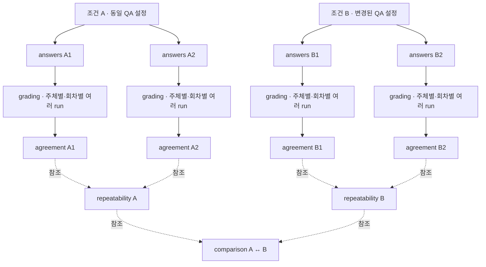

# 평가 저장 스키마

답변 생성과 채점을 분리해 같은 답변을 여러 주체가 여러 번 평가한다. 답변 고정본은
`evaluation-v1`, 현재 구현된 grading·agreement·comparison은 `evaluation-v2`를 사용한다. 등급 채점 계약은
`rubric-v1`이다. 이전 이진 채점 결과는 조회·분석에서 제외하고 변환·backfill하지 않는다.
기존 answers는 재사용하며 원격 실행·DB의 옛 기록은 자동 삭제하지 않는다.
기존 `evaluation.kind=analysis` run과 이를 참조하는 repeatability·comparison run은 새 조회 계약에서 제외한다.
같은 answers·grading을 입력해 `review.py agreement`를 실행한 뒤, 필요한 repeatability·comparison을 다시 계산한다.
이 재집계는 답변 생성이나 Judge 모델을 다시 호출하지 않는다.

## 실험 단위와 관계

조건은 Dataset·Corpus·QA 프로필처럼 답변 생성에 적용한 설정의 논리적 묶음이다.
하나의 조건에서 answers를 여러 번 실행하면 A1·A2처럼 서로 다른 고정 답변이 생긴다.
grading 한 run은 **answers 하나를 한 평가 주체가 한 번 채점한 결과**다.
같은 모델·사람이 같은 answers를 여러 번 채점해도 매번 별도 grading run을 만든다.
answers를 다시 실행한 것은 답변 변동이고, 같은 answers를 다시 채점한 것은 채점 변동이다.



| 관계 | 단위와 의미 |
| --- | --- |
| 조건 → answers | 1:N. 같은 설정에서 답변을 여러 번 생성한다. 조건은 현재 별도 MLflow run이 아니라 QA 프로필 등으로 식별하는 논리적 묶음이다. |
| answers → grading | 1:N. 주체·프로필·회차별로 고정 답변을 채점한다. |
| answers → agreement | 1:N. agreement 하나는 answers 하나에서 선택한 grading들을 분석한다. 다른 선택으로 다시 분석할 수 있다. |
| grading ↔ agreement | 참조 관계. agreement는 grading 여러 개를 읽고, 원본 grading은 다른 agreement에서도 재사용할 수 있다. |
| agreement → repeatability | 같은 조건의 서로 다른 answers에서 나온 agreement 두 개 이상을 참조한다. |
| repeatability → comparison | 서로 다른 조건의 반복 결과 두 개를 입력으로 참조한다. |

agreement는 같은 모델의 여러 회차를 별도 관측으로 보존하고, Cohen κ를 회차 쌍별로 계산한다.
회차 등급을 평균·다수결로 합쳐 하나의 평가자로 만들지 않는다. repeatability에서는 같은 조건의
여러 answers를 질문 ID로 연결하되, A1의 Judge 1회차와 A2의 Judge 1회차를 대응 관측으로 가정하지 않는다.
agreement는 문항·평가 주체·프로필·항목별 등급 건수와 rubric 경계 충족 건수를 보존한다.
repeatability는 이 집계만 읽고, 원본 grading을 다시 채점하거나 회차 번호를 대응시키지 않는다.
`comparison`은 조건 A/B의 차이를 보는 이름으로 사용하고 `condition_change`라는 별도 종류를 만들지 않는다.

현재 `review.py agreement`는 answers 하나와 여러 grading 회차를 받아 agreement를 만든다.
조건 비교의 현재 계약은 `comparison-v2`다. `compare_repeated.py`가 같은 Dataset·rubric·평가 주체·
채점 반복 횟수를 가진 Repeatability A/B를 입력받는다. 조건별 답변 생성 횟수는 보고서에 명시한다.
두 조건에서 모두 유효한 질문의 경계 충족률을 질문별로 대응시켜 같은 비중으로 평균하고,
각 조건의 저장된 시행 간 변화폭과 생성 실패를 나란히 표시한다. Judge 회차를 서로 대응시키거나
원본 grading을 재채점하지 않는다. 소수 문항 결과의 유의성·인과관계는 추정하지 않는다.
시간과 토큰도 Repeatability에서 성공한 답변의 질문별 시행 평균과 관측 수를 저장한다. Comparison은
양쪽에서 값이 있는 질문을 같은 비중으로 평균한다. 캐시 입력 토큰은 입력 토큰에 포함되며,
실패 또는 미기록 값은 제외하고 관측 문항·시행 수를 표시한다.
검색 도구 호출도 같은 단위로 기록한다. 키워드·의미 검색의 횟수는 agent 단계에서 구하며,
도구 자체가 오류를 반환한 호출도 포함한다. 단계 기록이 없거나 저장된 전체 호출 수와 합계가
일치하지 않으면 횟수를 미기록으로 둔다.
기존 `compare.py`의 `comparison-v1`은 Agreement 한 쌍의 개발용 비교 계약으로 남아 있다.

## Run과 계보

```text
answers A1: 고정된 질문·기대 조건·답변·문맥
├─ grading: model:chatgpt / 프로필 P / 1회차
├─ grading: model:chatgpt / 프로필 P / 2회차
├─ grading: model:claude / 프로필 Q / 1회차
├─ grading: human:<로그인 코드 ID> / 프로필 H / 1회차
└─ grading: human:<로그인 코드 ID> / 프로필 H / 2회차

agreement: 같은 A1에 연결된 지정 grading들의 정합성
repeatability: 같은 조건의 여러 agreement에 저장된 rubric 경계 분포 비교
comparison-v2: 서로 다른 조건의 repeatability 두 개 비교
```

| 종류 | 단위 | 주요 artifact | Metrics |
| --- | --- | --- | --- |
| answers | 데이터셋의 답변 생성 1회 | evaluation-bundle.json, evaluation-results.json | 답변 가능 여부·생성 자원·시간 |
| grading | 한 주체가 answers 전체를 채점한 1회 | grading-result.json, rater-profile.json | rubric 등급 평균·분포·상태별 건수, 선택적 Ragas 진단 |
| agreement | 같은 답변에 대한 지정 grading 집합 | agreement.json, grading-inputs.json | 항목별 일치율·가중 κ·다자 계수 |
| repeatability | 같은 조건의 서로 다른 answers에 대한 agreement 2개 이상 | repeatability-result.json, repeatability-inputs.json | 시행·주체·항목별 전체 문항 등급 건수와 rubric 경계 충족 건수·비율 |
| comparison-v2 · 조건 비교 | repeatability A/B 한 쌍 | comparison-result.json, comparison-inputs.json | 대응 질문의 경계 충족률·조건별 시행 간 변화폭·생성 실패 |
| comparison-v1 · 개발용 | agreement A/B 한 쌍, 주체당 grading 하나 | comparison-result.json, comparison-inputs.json | 대응 평균 차이·bootstrap 구간·문항 전이·공통 표본의 계수 차이 |

`evaluation.kind` 태그로 run 종류를 구분한다. grading은 `mlflow.parentRunId`와
source_run_id로 answers에 연결한다. agreement·comparison은 입력 run과 해시를 artifact로 기록하며
원본을 수정하지 않는다. repeatability는 `evaluation-v2`·`repeatability-v1` 계약을 쓰고
입력 agreement ID·artifact digest를 고정한다.

모델 grading은 `judge-efficiency.json`에 채점 실행의 실제 경과 시간과 문항·평가 항목별
scorer 경과 시간, 각 HTTP 응답의 상태·경과 시간·제공된 토큰 사용량을 저장한다. 재시도 응답은
별도 호출로 기록하며 프롬프트와 응답 본문은 이 artifact에 저장하지 않는다. 병렬 호출의 경과 시간
합은 전체 실행 경과 시간과 다르다. 공급자가 토큰을 제공하지 않거나 HTTP 응답 전에 실패하면 해당
사용량은 미기록이다. 사람 검수에는 이 측정값을 생성하지 않는다.
모델 grading의 `judge-model.json`에는 요청한 Gateway endpoint와 실제 성공 응답에 포함된 모델 ID,
모델 ID가 확인된 응답 수를 기록한다. 응답이 endpoint 별칭만 반환하면 모델명은 미확인이다.
모델 정보와 효율성 기록에는 프롬프트나 응답 본문, 인증정보를 저장하지 않는다.

## 고정 답변과 rubric

answers bundle에는 Dataset ID·내용 해시·문항 records·실제 생성 cases·QA 프로필을 보존한다.
문항 ID는 중복되지 않고 records와 cases의 집합이 같아야 한다. bundle digest는 digest 필드 외의
전체 내용을 해시한다. 채점 시 source_run_id·bundle digest·문항별 answer_digest를 검증한다.

새 QA 프로필의 `experiment_conditions`는 `experiment-conditions-v1` 계약으로 고정한다.
선택한 인덱스에 저장된 Corpus·청킹 정책·임베딩 프로필과 SQL 인덱스 정의, PostgreSQL/pgvector 버전,
BM25 설정·사전, agent 도구 계약, 생성 API 설정과 실행 환경·주요 라이브러리 버전을 포함한다.
모델·온도·문맥/검색/도구 예산·프롬프트는 같은 QA 프로필의 기존 필드에 보존한다.
조건 전체가 QA 프로필 해시에 포함되며 answers run의 `experiment-conditions.json`과 bundle에도 남는다.
주요 조건은 검색 가능한 MLflow params로 함께 기록한다. 인증정보는 저장하지 않는다.
새 평가 접수에는 이 계약을 요구하며 누락 시 `evaluation_requires_experiment_conditions`로 거부한다.
과거 answers의 조건을 현재 DB에서 추정하거나 소급 기록하지 않는다.

공통 rubric은 `apps/knowledge/src/elice_knowledge/data/rubrics/`의 버전 있는 JSON이다.
문항별 모범 답안·필수 요점·금지 주장·근거는 Dataset expectations에 둔다.
공통 rubric을 문항마다 복제하지 않으며 answers에 새 rubric을 고정하지 않는다.
과거 answers의 부가 rubric 필드는 채점 기준으로 사용하지 않는다.

| 데이터셋 | 기본 rubric | 항목 | 척도 |
| --- | --- | --- | --- |
| Gold | gold-ordinal-v1 | correctness, completeness, groundedness, relevance | 0 부족·1 부분 충족·2 충분 |
| Iron | iron-binary-v1 | behavior | 0 미충족·1 충족 |

사람과 모델 모두 같은 항목별 anchor로 직접 채점한다. 비율 점수의 반올림·ceil·pass/fail 임계값을
사용하지 않는다. N/A·오류·미제출은 등급 0과 다르다. applicability로 정해진 N/A는 강제하며
relevance·behavior에는 N/A를 허용하지 않는다. 허용 자료는 항목별로 분리한다.

- 정확성: 질문·답변·기대 답안·금지 주장.
- 완전성: 질문·답변·필수 요점. 선택 사항의 누락은 감점 기준이 아니다.
- 근거 충실도: 답변과 실제 `generation_sources`. Gold 답안·검색 후보·외부 지식으로 보충하지 않는다.
- 질문 적합성: 질문·고정 이력·답변. 기대 답안 없이 요청 대응을 본다.
- 행동 준수: 질문·이력·실제 답변·agent 단계와 기대 행동·필수 요점·실패 조건.

## 프로필과 회차

사람 프로필에는 rubric 원문·rubric_digest·contract를, 모델 프로필에는 여기에 등록 scorer 버전·
모델 URI·instructions·Ragas/SDK 설정·구현 해시·diagnostics 여부를 포함한다.
모델 instructions가 해당 rubric과 일치하지 않으면 실행을 거부한다. 같은 답변을 다른 rubric으로
채점할 수 있지만 서로 다른 rubric hash를 섞은 agreement·comparison은 거부한다.

식별 단위는 source_run_id + rater_id + rater_profile_digest + round다. round는 PostgreSQL 공통
레지스트리에서 원자적으로 할당한다. 서로 다른 프로필은 각각 1회차부터 시작할 수 있으므로 검수
API의 식별자는 회차 숫자가 아닌 유일한 grading_id(UUID)다. MLflow run ID와 grading_id를 연결해
동기화 재시도가 새 회차를 만들지 않게 한다. 같은 주체·같은 프로필의 반복과 프로필 변경을 구분한다.

모델 요청은 공급자 기본 샘플링을 사용한다. ChatGPT는 스트리밍·8192 completion tokens·
reasoning_effort=none, 나머지는 비스트리밍·2000 completion tokens를 사용하며 프로필에 기록한다.
부분 JSON·길이 제한 종료·허용 범위 밖 점수는 정상 등급으로 채택하지 않는다.
모델 별칭이나 기록된 조건이 가중치 고정·완전한 결정성을 보장하지 않는다.

## 질문별 등급과 Metrics

manifest는 schema·contract·source_run_id·source_bundle_digest·grading_id·평가자·프로필 hash·
회차·문항 해시와 ratings를 포함한다. rating의 기본 형식은 다음과 같다.

```json
{
  "case_id": "gold-001",
  "dimension": "correctness",
  "score": 1,
  "status": "scored",
  "rationale": "핵심 비교는 맞지만 부가 수치의 적용 조건이 부정확하다."
}
```

`score`는 rubric에 정의된 정수만 허용한다. Boolean·소수·숫자 문자열을 점수로 받지 않는다.
`not_applicable`·`error`는 score=null이다. 사람 초안의 pending은 최종 ratings에 제출하지 않는다.
모델 오류는 error와 오류 사유를 보존하며 해당 grading을 FAILED로 종료한다. 성공한 항목은 남긴다.

| Namespace | 의미 |
| --- | --- |
| rubric.<항목>.mean | scored 등급의 평균. Gold 0~2, Iron 0~1 |
| rubric.<항목>.score_N_count | 각 등급의 건수 |
| rubric.<항목>.*_count | scored·not_applicable·error·pending 상태별 건수 |
| ragas.<진단>.mean | 별도로 요청한 유효 진단 비율의 평균. 등급이 아님 |

적용 가능한 등급이 없으면 평균을 만들지 않는다. 항목들을 단일 총점으로 합치지 않는다.
선택적 diagnostics는 `--diagnostics`로 켜며 프로필의 일부다. 기본값은 꺼짐이다.
누적/최종 문맥의 ContextRecall·ContextPrecision, FactualCorrectness precision,
필수 요점 coverage(ContextRecall의 reference=필수 요점, contexts=답변), Faithfulness를
`measurements`에 저장한다. 필수 요점 coverage에는 FactualCorrectness recall을 쓰지 않는다.
답변 주장→기준과 기준→답변 검증에서 얻는 TP/FN을 섞은 비율은 필수 요점의 직접 포함률과 다르기 때문이다.
계약은 `ragas-diagnostics-v1`이며 primary ratings와 섞지 않는다.

## 실행과 사람 검수

한 모델 run에 그 모델의 모든 문항·항목을 넣는다. MLflow SDK가 질문·항목을 병렬 실행하고 결과를
모아 grading을 게시한다. 기본 상한은 프로세스당 질문 2개 × 항목 4개이며 모델·회차는 순차 실행한다.
모든 4항목이 별도의 고정 graph span인 것은 아니다. Judge 내부 모델 호출은 tracing 대상이다.

Human Review는 현재 로그인한 코드로 채점하며 타인·모델의 점수와 사유를 UI/API에서 제외한다.
rubric snapshot은 회차 시작 시 고정한다. 초안은 revision 충돌을 검사해 저장하고, 최종 제출은
질문 단위로 원자적·불변이다. DB에 먼저 저장하고 본인 grading run에 artifact·metric을 동기화한다.
부분 제출은 RUNNING, 전부 제출하고 동기화하면 FINISHED다. 연결 실패 시 같은 run에 재시도한다.
자세한 API는 [Human Review](human-review.md)를 따른다.

## Agreement

같은 source bundle·rubric의 ratings를 분석한다. 주요 지표는 고정된 전체 척도를 사용하는
**선형 가중 Cohen κ**다. 일반 κ·제곱 가중 κ·정확 일치율·평균 절대 등급 차이·혼동행렬·유효 쌍 수·
N/A 적용 여부 일치도도 보존한다. κ는 scikit-learn, Fleiss κ는 statsmodels,
순서형 Krippendorff α는 krippendorff로 계산한다. 라이브러리 버전과 제외 정책을 agreement_protocol에 기록한다.

사람–모델을 주요 정합성 비교로 두고 사람–사람·모델–모델·동일 주체 반복을 구분한다.
여러 회차를 평균내거나 다수결로 합치지 않는다. 다자 패널은 한 주체당 한 프로필·한 회차만 선택한다.
같은 주체의 grading이 여러 개면 쌍별 분석은 하되 패널 계수는 계산하지 않고 사유를 남긴다.

Fleiss κ는 명목형 정확 일치의 보조 지표로 모든 선택 주체가 채점한 문항을 사용한다.
ordinal α는 문항마다 최소 두 유효 등급이 있는 자료를 사용하되, 패널에 기여하는 주체는 최소 세 명이어야 한다.
N/A·error·미제출을 제외하고 건수를 별도 보고한다. 유효 표본이 너무 적거나 변동이 없으면
계수는 null과 사유로 남기며 metric에 임의의 0을 기록하지 않는다.

## Repeatability

같은 Dataset records·QA 프로필·rubric을 사용한 서로 다른 answers의 agreement를 두 개 이상 입력한다.
agreement별로 동일 평가 주체·프로필의 여러 grading 회차를 그대로 묶는다. 회차 번호는 answers 간
대응 키가 아니다. 서로 다른 조건은 comparison 대상으로 남긴다.

agreement는 **문항 × 평가 주체 × 평가 프로필 × 항목**마다 원래 등급 건수, N/A·오류·미제출 건수,
유효 판정 수와 rubric 경계의 충족 건수·비율을 저장한다. Gold의 두 경계는 `score >= 1`
(부분 충족 이상)과 `score == 2`(충분)다. Iron은 `score == 1`(충족) 하나만 쓴다.
분모는 0·1·2 또는 0·1의 유효 판정뿐이다. 분모가 0이면 비율은 null이다. 답변 생성 오류는
채점 0점으로 바꾸지 않고 별도 상태로 표시한다. 시행에서 빠진 평가 주체도 미기록으로 구분한다.
예를 들어 Gold의 0·1·2가 각 1건이면
건수는 `[1, 1, 1]`, 경계 충족은 `2/3`·`1/3`이다.

repeatability는 **답변 시행 × 평가 주체 × 항목**의 등급 건수를 문항 전체에서 합산하고,
합산 건수에서 경계 충족 비율을 계산한다. 한 grading 회차의 문항별 판정은 각각 한 관측이다.
유효 건수가 다른 시행을 비교할 때는 분모·N/A·오류·미기록 문항 수도 함께 본다.
시행별 grading 횟수를 같게 강제하지 않는다. 입력 agreement에 연결된 grading run의 메타데이터로
평가 주체별 실행 횟수를 기록하고, 보고서에는 `grading 횟수 × 채점 가능 문항 수 = 항목당 판정 건수`를
표시한다. 실행 횟수가 다르거나 일부 판정이 빠진 경우에는 실제 건수와 차이를 드러낸다.
시행 간 경계 비율 범위와 문항별 분포는 repeatability 결과에 중복 저장하지 않는다.
문항별 품질 수준은 질문·평가 주체·항목·경계마다 유효 grading이 있는 answers 시행의 충족률을
**시행별 동일 가중치**로 평균해 `boundary_levels`에 저장한다. 함께 저장하는 분모는 유효 answers
시행 수와 유효 grading 관측 수이며, 두 수를 혼동하지 않는다. 개별 평가 주체의 결과는 분리해 보존한다.
보고서의 `전체 모델 평균`은 이 결과 중 유효 등급이 있는 모델별 충족률을 **모델 동일 가중치**로
평균한 `model_boundary_levels`를 표시한다. 사람 평가는 포함하지 않는다. 모델 수·모델×시행
관측 수·유효 grading 수를 함께 저장하며, 서로 다른 grading 횟수로 모델 가중치가 바뀌지 않는다.
전체 질문의 마지막 행은 유효 충족률이 있는 문항만 같은 비중으로 평균한
`question_average_levels`다. 문항별 유효/전체 건수를 함께 저장하고, 문항별 등급 건수를
합쳐 한 번에 나누지 않는다.
오른쪽 `전체 항목 평균` 열은 각 문항·평가 주체·경계에서 유효한 항목의 충족률을 동일 가중치로
평균한 `dimension_average_levels`다. 하단의 교차 셀은 먼저 항목별 전체 문항 평균을 구한 뒤
유효 항목을 동일 가중치로 평균한다. 유효/전체 항목 수를 함께 기록하며, 네 항목을 한 답변이
동시에 충족한 비율로 해석하지 않는다.
이 평균은 관측된 answers 시행의 기술 통계이며, 평가자 신뢰도나 네 항목 동시 충족을 뜻하지 않는다.
시행 간 평균 변화폭은 같은 질문·평가 주체·항목·경계에서 answers 시행 쌍의 유효 채점
충족률 차이 `|p_i-p_j|`를 계산한다. 경계 판정을 0/1로 놓으면 이는 두 Bernoulli 분포의
1차 Wasserstein 거리 `W₁(Bernoulli(p_i), Bernoulli(p_j))`와 정확히 같다. 별도 거리 함수 대신
이 이진 분포의 닫힌식으로 계산한다. 시행 쌍을 질문 안에서 평균하고, 질문·평가 항목·평가
주체를 차례로 동일 가중치 평균한다. Gold의 `1점 이상`과 `2점`은 별도 지표로 저장한다.
보고서의 `전체 모델 평균` 변화폭은 같은 항목·경계의 모델별 값을 동일 가중치로 평균한
`model_boundary_changes`를 사용한다. 사람 판정은 제외한다.
양쪽 시행에 유효 등급이 있는 쌍만 포함하고 가능한 쌍과 실제 비교한 쌍의 건수를 함께 기록한다.
단위는 비율이며 보고서에서는 `%p`로 표시한다. 이 값은 질문 ID를 대응시키므로 전체 충족률이나
질문별 충족률의 비대응 분포가 같아도 개별 질문의 변화가 있으면 0이 아닐 수 있다.
Judge 자체의 변동도 섞이므로 시행 간 차이를 답변 생성만의 변동으로 해석하지 않는다.
보고서 본문은 시행 간 변화폭을 경계×항목 히트맵으로, Gold의 두 경계에 대한
문항별 시행 평균 충족률을 나란한 히트맵으로 표시한다. 전체 질문에는 전체 문항 평균 행을 추가한다.
두 구역 모두 전체 항목 평균 열 앞을 점선으로 구분하고, 문항별 품질 히트맵의 전체 문항 평균 행
위에도 점선을 둔다. 개별 질문을 선택하면 평균 행 구분선은 숨긴다.
질문 선택으로 전체 문항과 개별 문항을 전환한다. 평가 주체 드롭다운은 전체 모델 평균과
개별 모델·사람 결과를 전환한다. answers별 중복 행렬은 표시하지 않고,
회차별 등급과 사유는 평가 조건의 원본 agreement 링크에서 확인한다.

지표 후보와 선택 근거:

| 후보 | 판단 |
| --- | --- |
| 등급 평균·표준편차 | 0·1·2 사이 간격을 양적 크기로 취급한다. 순서형 rubric의 주 반복 지표로 쓰지 않는다. |
| 다수결·최빈 등급 | 소수 회차의 반대 판정을 숨기며 3회에서 1건 차이로 대표 등급이 바뀔 수 있다. 원래 건수를 보존한다. |
| 범주 분포의 총변동거리(TV) | 분포 차이를 나타내지만 0↔1과 0↔2를 같은 거리로 취급한다. 3회에서는 해상도도 거칠어 채택하지 않는다. |
| 선형 가중 κ·순서형 α | 평가자 정합성에는 유용하나, 서로 다른 답변 시행의 문항별 경계 안정성을 직접 설명하지 않는다. agreement에서 유지한다. |
| rubric 경계 누적 비율 | 순서를 보존하고 0·1·2 분포를 두 경계로 완전히 표현한다. 원래 건수와 분모를 함께 표시한다. |

이는 **탐색적 반복성 기술 통계**다. 3회는 판정 뒤집힘을 발견할 수 있지만 문항별 확률을 정밀하게
추정하지 못한다. 여러 질문을 평가하는 일과 같은 답변을 여러 번 Judge로 채점하는 일은 다른 표본 축이다.

## Comparison과 보고서

system 비교는 평가자·rubric을, judge 비교는 동일 답변·사람 판정을 고정한다.
공통 관측의 등급·선택적 진단·QA 자원 사용량을 대응 비교하며 SciPy paired bootstrap 구간을 저장한다.
κ·α는 공통 문항·평가자 관측에서 재계산한다. 다른 표본의 계수를 단순 차감하지 않는다.
입력·설정 차이·제외 사유·계보를 보존하고 모델을 재호출하지 않는다.

보고서는 저장된 값·사유·원문 문맥·rubric anchor만 표현한다. 점수를 재계산하거나 해석을 자동 생성하지 않는다.
새 계약의 실제 사람 정합성과 반복 일관성은 새 등급으로 검수한 자료로 별도 측정해야 한다.
